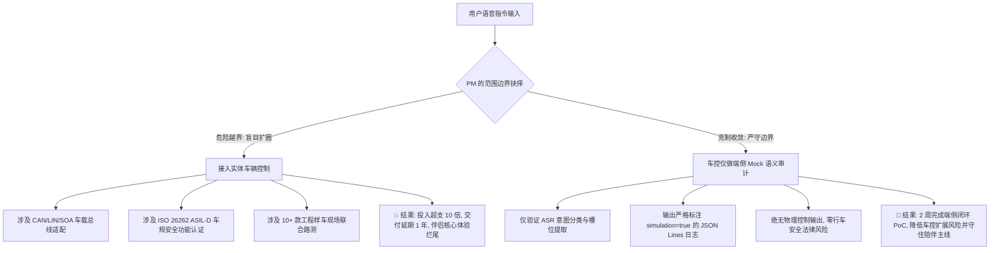

# 产品工作的边界与权责划分：以端侧 AI 语音伴侣与 Mock 车控为例

在软硬件与 AI 复合型项目中，产品经理（尤其是拥有技术背景的 PM）面临的最大挑战往往不是“缺乏专业技能”，而是**“角色边界不清”**：
- **向上/向外缺乏边界守护**：业务方或老板顺口提一句“顺便支持车控吧”，PM 没有守住技术与合规底线，导致项目无限膨胀为巨型车规系统，最终烂尾；
- **向下/向内过度越界干预**：因为自己懂底层 C++、DSP、模型推理，在 PRD 里替研发设计无锁环形队列、指定线程池调度参数，被研发团队视为“手伸太长的监工”，反而丢掉了对业务目标、用户场景和商业 ROI 的把控。

**产品经理的核心价值，不仅在于“定义做什么”，更在于“明确划定边界——坚决不做什么、守住谁的权责、在何处停止交接”。**

本篇以本仓库的真实虚拟项目 —— **《Pixel 10 端侧 AI 语音伴侣与 Mock 车控 PoC》** 为贯穿案例，系统拆解产品经理在五个核心边界维度的准则与协作界面，并用 RACI 矩阵明确权责。

---

## 一、 产品边界全景图：PM 的管辖区与禁飞区

```
┌─────────────────────────────────────────────────────────────────────────────┐
│                            产品经理的核心管辖区 (PM Territory)                │
│                                                                             │
│    【WHY】业务动机 & 商业闭环       【WHAT】功能规格 & 业务规则        【WHO】目标用户 & 核心场景  │
│    • 商业 ROI 与投入产出比          • 核心用户旅程与操作闭环          • 睡前/通勤/独处私密倾诉   │
│    • 成功指标 (TTFA：P50 ≤800ms，P95 ≤1150ms)  • 异常与边界分支 (打断/断网)      • 真实痛点与替代方案识别   │
│    • 护栏指标 (温控/内存/零外联)    • 显式确认与隐私红线              • 区分 Buyer 与 End User  │
└──────────────────────────────────────┬──────────────────────────────────────┘
                                       │
                      【临界交接契约：清晰的 PRD + BDD 验收准则】
                                       │
┌──────────────────────────────────────┴──────────────────────────────────────┐
│                            研发与专业团队管辖区 (禁飞区 No-Fly Zone)           │
│                                                                             │
│    【HOW: 研发架构】               【STYLE: UI/UX 设计】             【TEST: QA 测试保障】   │
│    • C++ Oboe 缓冲队列设计          • 具体的贝塞尔动效曲线            • 自动化测试脚本与 CI 流水线 │
│    • LiteRT / Tensor G5 硬件映射    • 像素级阴影与视觉样式            • 压力测试与系统故障注入   │
│    • SQLite-vec 向量索引算法        • 字体字号与颜色微调              • 回归测试用例集维护       │
└─────────────────────────────────────────────────────────────────────────────┘
```

---

## 二、 边界维度 1：问题空间 vs. 解法空间 (Why & What vs. How)

这是工程师转型 PM **最容易犯下“手痒越界”的第一大雷区**。

| 对比项 | PM 管辖区（问题与规格空间：Why & What） | 研发管辖区（实现与架构空间：How） | 越界灾难后果 |
| :--- | :--- | :--- | :--- |
| **定义职责** | 阐明用户痛点、业务目标、功能输入输出契约、性能 SLA 与验收标准 | 决定技术架构、框架选型、算法复杂度、数据结构、线程模型与内部接口设计 | PM 替研发设计实现细节，研发失去技术自主性，出了 Bug 互相甩锅 |
| **虚拟项目实战案例 1：语音响应延迟 (TTFA)** | **PM 正确做法**：<br>在 PRD 中明确定义：“在 Pixel 10 上，从音频输入链路确认用户停止说话（包含 VAD 端点检测时间）到耳机播出首帧音频，端到端延迟目标为 $P50 \le 800\text{ms}$、$P95 \le 1150\text{ms}$；同时记录测试设备、样本量、统计窗口及本地遥测 HUD 的测量口径。” | **研发正向做法**：<br>由 Tech Lead 评估后决定：“采用 LiteRT GPU 预填充 + 首句切分（$\le 12$ 字送入 TTS）+ Oboe AAudio 低延迟回调管道来实现。” | **PM 越界典型（反面教材）**：<br>在 PRD 中写道：“必须使用无锁单生产者单消费者 (SPSC) 环形缓冲区，大小设为 8192 字节，并强制使用 C++ `std::atomic` 内存屏障。”（研发会反感：你连硬件内存对齐和平台特性都没测过，凭什么替我定底层数据结构？） |
| **虚拟项目实战案例 2：插话打断 (Barge-in)** | **PM 正确做法**：<br>定义交互要求：“AI 正在说话时，若用户发声打断，系统应以 80ms 为待验证的目标值，尽快截断音频播放并停止模型推理；字幕追加 `[被打断]` 标记并切回倾听态。验收前需明确计时起点、测试设备与测量方式。” | **研发正向做法**：<br>由研发评估 Native 音频流刷新与推理取消机制，并验证其在目标设备上的行为。 | **PM 越界典型（反面教材）**：<br>在 PRD 中规定底层线程如何通过 POSIX 信号量唤醒和挂起，导致研发受限于 PM 不够专业的代码伪逻辑。 |

> **💡 技术型 PM 的最佳姿态 ——“懂技术边界，但把技术决策权交给工程师”**：  
> 你的技术背景不是用来当“监工架构师”的，而是用来**在技术评审中扮演最敏锐的“边界质询者”**。  
> 比如在评审会上提问：“如果用户在嘈杂背景音下快速连说两句话，我们当前的 VAD 动态断句算法会不会把前一句话吞掉？”——**用高质量的问题引导研发查漏补缺，而不是强塞给研发一段半吊子的代码解法。**

---

## 三、 边界维度 2：项目范围边界 (In Scope vs. Out of Scope)

在项目启动之初，**决定“坚决不做什么”，远比“规划做什么”更能决定项目的生死。**

### 1. 虚拟项目中的经典死穴：AI 陪伴 vs. 智能车控

在本项目孵化初期，经常会有来自业务方或管理层的诱人想法：“既然我们的大模型在本地能听懂用户说话，用户在开车时也会说话，**那为什么不顺便接入车辆，把空调、车窗、导航甚至辅助驾驶一起控制了？**”

这是一个足以让团队万劫不复的**范围蔓延陷阱 (Scope Creep)**：



### 2. PM 划定范围边界的标准契约模板

在 PRD 的第一章，必须白纸黑字写死 **“本期明确不做 (Non-Goals)”**，并在项目宣讲会（Kick-off）上与全员对齐：

```markdown
### 本期明确不做 (Out of Scope / Non-Goals)
1. 【不做实体车辆连接】：不连接物理汽车 CAN 总线、车载控制器或车身执行器；车控意图只用于在本地验证规则与槽位解析，统一输出包含 `simulation=true` 的 Mock 日志，不产生车辆控制指令或物理控制输出。
2. 【不做云端推理与账号体系】：本期定位纯本地沙盒 PoC，不开发后端用户系统、云端同步或跨端漫游；目标是业务数据不离机，外部网络访问需纳入依赖与验收范围。
3. 【不做泛机型适配】：锁定 Google Pixel 10 / 10 Pro (Tensor G5 + Android 16)，具体硬件能力与软件版本以目标设备验证结果为准，不向中低端非旗舰机型妥协。
4. 【不做系统级后台常驻窃听】：语音会话必须由用户显式点按发起或结束，严格遵循 Android 16 前台服务与麦克风指示器安全规范。
```

---

## 四、 边界维度 3：产品与体验设计的边界 (PM vs. UI/UX Design)

如果 PM 把粗略线框当作最终布局，要求设计师只负责“填颜色”，就会压缩设计师探索信息层级、布局和交互方案的空间，也容易造成返工。

### 1. 权责交接矩阵

| 交付环节 | 产品经理 (PM) 的管辖边界 | UI/UX 设计师的管辖边界 | 最佳交接契约 |
| :--- | :--- | :--- | :--- |
| **信息架构** | 决定页面包含哪些核心信息卡片、核心操作优先级（如：挂断键必须最突出，记忆库为次级入口） | 决定页面网格布局（Grid）、卡片微结构、间距缩放阶梯（Spacing Tokens） | 信息优先级清单 + 低保真交互流程图 |
| **视觉风格** | 提出业务定位与情感心智诉求（如：“OLED 纯黑省电背景，睡前暗光环境柔和不刺眼，科技感伴侣情绪反馈”） | 制定 Material You 调色板、字阶字重（Typography）、高斯模糊透明度、暗黑模式对比度 | 情绪板（Moodboard）+ Design Tokens |
| **交互动效** | 定义状态反馈触发契机与时间约束（如：“AI 说话时光球需随音频振幅律动，打断时必须在 80ms 内收敛归位”） | 设计具体的粒子流体 Shader 算法、动画曲线（Bezier Easing）、形变与色彩渐变韵律 | 状态机流转表 + 动效性能指标（60fps / 0fps 休眠） |
| **异常状态** | **穷举所有极端业务场景**：首次进入空状态、蓝牙耳机断开防社死、系统过热严重降级 | 设计对应异常场景下的友善视觉插画、错误提示条微交互、操作引导恢复路径 | 异常状态清单与兜底逻辑规则 |

### 2. 虚拟项目实战：如何给设计师下达高质量的设计输入？
- **错误输入（PM 越界兼外行）**：  
  *“中间给我画一个直径 120 像素的蓝色球，点击后变成绿色，按钮都用圆角矩形，底下留白 20 像素。”*
- **正确输入（PM 守住边界并赋能设计师）**：  
  *“我们需要一个流体光球作为用户情感投射的核心载体。有以下硬性产品约束：  
  1. 必须适配 OLED 纯黑背景 (`#000000`)；  
  2. 需要支持 4 种状态的平滑转场：静息倾听（宁静蓝）、思考推理（神经脉动紫）、语音播报（温暖翡翠绿）、被打断截断（警觉琥珀橙）；  
  3. 性能护栏：机身进入 SEVERE 发热态时，动效需要优雅降帧至 30fps，锁屏熄屏揣兜时渲染必须休眠（0fps）；  
  4. 底部三键操作区需要满足夜间关灯躺卧下的盲操需求，热区不低于 48dp，挂断键需防误触。”*

---

## 五、 边界维度 4：产品与测试保障的边界 (PM vs. QA)

PM 与 QA 绝不是“PM 提需求、QA 挑刺”的对立关系，而是**联合构筑产品质量长城的核心盟友**。

### 1. 权责切分
- **PM 的职责**：给出**清晰无歧义的验收准则（Acceptance Criteria）**与**业务护栏（Guardrails）**，把“什么叫好、什么叫坏、什么绝不能发生”定义清楚；
- **QA 的职责**：制定测试计划、编写自动化脚本、执行压力测试与极端故障注入、出具准出报告。

### 2. 虚拟项目实战：BDD (行为驱动开发) 场景化验收契约

在本项目中，PM 可用 Gherkin 描述验收场景；PM、研发与 QA 共同评审业务规则、技术可测性和边界条件，再由 QA 制定测试计划并实现相应自动化用例：

```gherkin
Scenario: 飞行模式下离线保存并召回明确确认的记忆
  Given Pixel 10 已启动应用且开启系统飞行模式 (无蜂窝网络及 Wi-Fi)
  When 用户对伴侣说出 "记住我喜欢睡前听轻音乐"，并点击屏幕上的 "确认存入本地"
  Then 该偏好被成功写入本地沙盒 SQLite-vec
  And 底部记忆库 Badge 计数自增 1
  And 在随后的对话中询问 "我睡前有什么习惯"，伴侣回复中明确包含轻音乐偏好
  And 网络监控抓包确认该过程没有发起任何外部网络请求

Scenario: 蓝牙耳机意外断开时毫秒级静音防社死保护
  Given 用户佩戴 Pixel Buds 正在进行私密倾诉通话，伴侣正在外放播放情感回复
  When 用户将耳机摘下并放入充电盒 (触发 ACTION_AUDIO_BECOMING_NOISY 广播)
  Then 系统音频输出应尽快静音，50ms 可作为待真机验证的目标值
  And 伴侣进入 PAUSED_PRIVACY_GUARD 挂起状态
  And 验收需覆盖目标耳机与设备组合，并记录从断连事件到静音的测量口径
  And 屏幕弹出防社死全屏横幅，提供 "切换为外放继续" 与 "挂断通话" 两个明确选项
```

---

## 六、 边界维度 5：产品与隐私安全的不可逾越红线 (Product vs. Security/Legal)

端侧 AI 伴侣深入用户的卧室、枕边与私密对话，**合规与隐私不是“上线前的补丁”，而是产品设计的“第一边界”。**

### 虚拟项目的三大隐私红线守则：

| 潜在隐私地雷 | 致命合规后果 | PM 设立的绝对产品边界 (Iron Rules) |
| :--- | :--- | :--- |
| **1. 麦克风音频持久化** | 持久化采集音频会增加数据泄露与合规风险，具体义务需结合处理目的、范围和适用司法辖区评估 | **默认不持久化原始音频**：麦克风 PCM 数据仅用于实时处理，不写入持久化存储；限定内存保留时间并由研发验证缓冲区与副本的处理方式，不承诺仅靠覆写单块内存即可证明所有副本销毁。 |
| **2. 聊天内容静默长期沉淀** | 用户随口说的私密心事、银行账号、人名被 AI 擅自提取为长期记忆，造成不可预期的召回恐慌 | **显式确认原则 (Explicit Confirm)**：普通情感对话不自动存入长期记忆；当识别到用户明确说出“记住...”时，**必须在界面上弹出确认卡片展示具体抽取槽位**，经用户显式点击确认后方可写入沙盒。 |
| **3. 误导用户以为车辆已被控制** | 用户在真实驾驶中将端侧模拟结果误当成真实车控，可能造成行车安全与法律责任风险 | **醒目的 Mock 标识体系**：车控输出日志每条必须强制包含 `simulation: true`，UI 上必须展示橙色警示盾牌，语音反馈必须带有“已模拟记录，当前未连接真实车辆”的说明；标识不能替代对使用场景及法律责任的评估。 |

---

## 七、 RACI 权责矩阵表 (以本项目核心里程碑为例)

通过 RACI 模型明晰各角色在核心活动中的定位：
- **R (Responsible - 执行者)**：实际干活、产出成果的人；
- **A (Accountable - 负责人/最终拍板者)**：对该项事务成败承担最终责任的人（**唯一性**）；
- **C (Consulted - 咨询者)**：提供专业意见、深度参与评审的人；
- **I (Informed - 知情者)**：只需被通报结果的人。

| 核心项目活动 / 决策节点 | 产品经理 (PM) | 研发负责人 (Tech Lead) | UI/UX 设计师 | QA 测试负责人 | 业务/项目主管 (Sponsor) |
| :--- | :---: | :---: | :---: | :---: | :---: |
| **1. 业务目标定义与商业 ROI 评估** | **A / R** | C | I | I | C |
| **2. 核心功能范围裁剪与 Non-Goals 划定** | **A / R** | C | I | C | C |
| **3. 端到端性能与护栏 SLA 制定 (TTFA / Barge-in)** | **A** | R | I | C | I |
| **4. 端侧技术选型 (LiteRT / Oboe / Kokoro)** | C | **A / R** | I | I | I |
| **5. 交互流程、状态机与 PRD 编写** | **A / R** | C | C | C | I |
| **6. 设计系统与流体光球视觉动效设计** | C | C | **A / R** | I | I |
| **7. 异常边界场景与 BDD 验收用例设计** | **A** | C | I | R | I |
| **8. 性能压测、温控注入与真机准出评审** | C | C | I | **A / R** | I |
| **9. 终审发版 (Go/No-Go) 最终拍板** | C | C | I | C | **A / R** |

---

## 八、 工程师转型 PM 的“边界自检五问” (Daily Boundary Checklist)

在日常工作的每个决策节点，掏出这 5 个问题反问自己：

1. **我是在定义“做成什么样 (What)”，还是在指导研发“代码怎么写 (How)”？**  
   *（如果发现自己在写伪代码、规定锁机制，立刻停笔，改写为输入输出规范与时延约束。）*
2. **这个新加的特性，是否属于当前版本验证核心假设所必需的 MVP 范畴？**  
   *（如果不做它，核心用户目标能不能跑通？如果能，坚决砍掉或丢入下期 Backlog。）*
3. **我是否给设计师留出了足够的专业探索空间？**  
   *（我是丢过去一张定死的丑线框图，还是给出了清晰的信息优先级、用户心智诉求与业务约束？）*
4. **这个边界异常如果在线上发生，用户是否有一条明确的恢复路径（Workaround）？**  
   *（弱网、断麦、拔耳机、发热时，界面有没有给用户体面的兜底引导，还是直接白屏卡死？）*
5. **这项改动是否会越过法律、隐私与行车安全的红线？**  
   *（任何涉及个人私密数据保存或车辆控制的功能，是否做到了“显式知情、用户确认、模拟隔离”？）*
