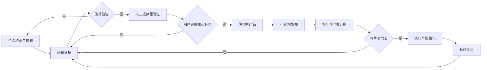

# 独立开发者产品实战手册：从问题到可持续产品

独立开发者同时承担产品、研发、设计、获客、客服和经营责任。最大的风险不是能力不够，而是把公司产品的协作流程原样搬到个人项目：先写大 PRD、先搭完整架构、先做几十个功能，最后才发现没有用户、没有分发渠道，也没有人愿意付费。

本手册提供一条适合个人项目的产品闭环：**找到真实问题 → 用最低成本验证价值 → 打通一条薄切片 → 找到可重复的获客与留存 → 再投入执行和规模化**。

它不替代核心能力、方法论和产品边界章节，而是把那些内容压缩成一个人可以每周执行的决策系统。

关联阅读：

- [从工程师到产品经理：思维切换指南](./01-mindset-shift.md)：纠正解法先行、技术完美主义和输出导向。
- [产品经理核心能力模型](./02-core-skills.md)：理解执行型与创造型产品工作的差异，以及六大硬技能。
- [产品经理日常工作流与全生命周期指南](./03-workflow.md)：公司团队中的完整流程与交接方式。
- [产品经理常用方法论框架速查](./04-frameworks.md)：JTBD、RICE、MVP、AARRR、漏斗和同期群等框架。
- [产品工作的边界与权责划分](./06-product-boundaries.md)：明确产品规格和研发实现的边界。
- [内置独立开发 Agent 技能：pm-solo-builder](../.agents/skills/pm-solo-builder/SKILL.md)：可直接在对话中执行个人约束过滤、事实证据评级 (Level 0~4)、一页 MVP 契约、单人周冲刺与 11 维红队压力测试。

---

## 一、先建立正确的独立开发模型

### 1. 独立开发不是缩小版公司项目

公司产品可以把工作拆给产品、设计、研发、市场、销售、客服和运营；独立开发者必须把这些角色串成一条短链路。因此，独立开发的核心竞争力不是“一个人把所有事都做满”，而是：

1. **更快得到真实反馈**：减少等待和交接，让假设尽早接触真实用户。
2. **更小的决策半径**：把一次决策限制在可逆、可观察、可撤回的范围内。
3. **更窄的产品边界**：只服务一类用户的一项高频任务，不提前解决所有相关问题。
4. **更低的维护负担**：每一个功能都要考虑支持、数据、合规、迁移和退出成本。
5. **更清晰的经营账**：个人时间、云服务、第三方 API、退款和客服都属于产品成本。

独立开发者应该坚持一个最小闭环：

> **一个明确的问题 + 一条端到端薄切片 + 一个可观察指标 + 一次真实决策。**

“上线”不是闭环终点。只有当真实用户完成目标、愿意再次使用或付费，并且你根据证据决定继续、调整或停止，闭环才算完成。

### 2. 创造型与执行型工作的切换

独立开发通常先以**创造型产品工作**为主：问题、用户、方案和商业模式至少有一项未验证。此时优先做访谈、观察、原型、人工服务和小实验，不急着把猜想工程化。

当用户价值被重复验证后，工作逐步转向**执行型产品工作**：稳定交付核心路径、降低失败率、完善计费和支持、控制成本、扩大渠道。执行型不等于机械接需求，仍然需要持续做取舍和结果管理。

判断当前应该使用哪种工作模式：

| 判断问题 | 主要回答“是” | 工作重心 |
| :--- | :--- | :--- |
| 用户是否已经明确表达过同一问题，并采取过代价明显的替代行动？ | 是 | 可以开始做执行型薄切片；否，则继续问题验证 |
| 用户是否能在不听你推销的情况下复述价值，并主动完成核心行为？ | 是 | 优化激活、留存、质量和规模化 |
| 你是否还在争论“谁需要、为什么需要、用什么方式解决”？ | 是 | 创造型探索，不要先做完整平台 |
| 产品每增加一个用户，支持和交付成本是否大幅增加？ | 是 | 先处理交付模型和边际成本，再扩大流量 |

### 3. 产品闭环总览



这张图不是固定项目计划，而是一组阶段门。每到一个阶段门，都要回答“继续投入的证据是什么”。没有证据时，缩小范围、换验证方式或停止投入，都是合格的产品决策。

---

## 二、从个人约束开始选题

### 1. 先算自己能长期承担什么

产品选择不能只看市场规模，还要看你能否持续接触用户、交付价值并承担支持。开始选题前，写下以下约束：

- 每周能投入多少稳定时间，而不是理想情况下的空闲时间。
- 你能接触哪些用户，是否能持续获得反馈。
- 你掌握哪些技术、行业知识或渠道资源。
- 你不愿承担哪些合规、安全、客服和线下交付责任。
- 你能承受多长时间没有收入，以及最多投入多少现金。
- 产品是否需要实时响应、人工审核、现场部署或长期售后。

约束不是消极因素，而是选题过滤器。例如，一个人很难同时承担强监管数据、全天候客服、复杂线下交付和快速迭代；如果这些责任都无法外包或自动化，项目应在立项前缩小或放弃。

### 2. 用机会卡筛选候选问题

不要先列产品名称，先列问题。每个候选问题用一张机会卡记录：

```markdown
# 机会卡：

- 目标用户：谁在什么角色下遇到这个问题？
- 触发场景：问题通常在什么时候发生？
- 任务目标：用户真正想完成什么？
- 当前替代方案：现在怎样解决？包括人工、表格、脚本和竞品。
- 代价：时间、金钱、风险、情绪或机会成本是什么？
- 发生频率：偶发、周期性还是高频？证据是什么？
- 可达性：我怎样在一周内接触到至少一批真实用户？
- 个人优势：我为什么比普通团队更容易理解或解决它？
- 交付负担：支持、审核、合规、数据和售后会增加什么责任？
- 最小验证：不用完整开发，怎样让用户完成一次核心任务？
- 暂不做：本轮明确排除什么？
```

### 3. 选窄问题，不选大愿景

“帮助所有人提高效率”不是问题定义；“让经常处理某类文件的自由职业者，在提交前自动发现三种高频错误”才接近可验证问题。

好的首个问题通常具备以下特征：

- 用户群体可以被具体找到，而不是“所有人”。
- 触发场景清楚，用户能回忆最近一次发生。
- 当前替代方案已经存在，说明问题不是凭空想象。
- 失败代价足够明显，用户愿意付出时间或金钱改善。
- 你可以在较短周期内观察结果，而不是等待数月才知道对错。
- 核心价值不依赖同时获得大量用户或复杂生态。

市场大不等于适合独立开发。冷启动困难、销售周期长、强交付依赖和高合规风险，都会把表面上的市场机会变成个人项目的负担。

---

## 三、先验证问题，再设计产品

### 1. 问题陈述模板

使用下面的句式写问题，不能填入产品功能：

> **当 `[目标用户]` 在 `[具体场景]` 下需要 `[完成的任务]` 时，他们因为 `[现有障碍]` 只能用 `[当前替代方案]`，造成 `[可观察代价]`。**

示例：

> 当小型独立开发团队准备公开发布时，他们需要确认隐私说明、计费和错误恢复是否完整，但缺少系统化检查，只能靠发布前临时自查，容易漏掉会导致退款、投诉或重新发布的关键问题。

这个句子仍然只是待验证假设。它不代表用户已经承认问题，也不代表你的方案成立。

### 2. 用过去行为访谈，而不是征集想法

访谈的目标是重建事实，不是收集用户对你点子的礼貌评价。优先追问：

- 上一次发生这个问题是什么时候？请从头复盘过程。
- 当时你试过哪些办法？为什么没有完全解决？
- 你为这个问题付出过多少时间、金钱或人工？
- 哪一步最容易出错？出错后会带来什么后果？
- 这个问题多久发生一次？谁最受影响？
- 如果不解决，接下来会怎么做？
- 你最近是否主动寻找、购买或切换过替代方案？

避免这些问题：

- “如果我做一个这样的产品，你会不会用？”
- “你觉得这个功能应该加什么？”
- “这个设计是不是很方便？”
- “你愿不愿意推荐给朋友？”

用户的观点可以帮助你理解语言和情绪，但**过去的行动、付费和持续使用**才是更强证据。访谈后记录原话、行为、替代方案和代价，不要只记录自己的结论。

### 3. 证据分级与继续条件

| 证据等级 | 代表性信号 | 产品含义 |
| :--- | :--- | :--- |
| 0 | 你自己觉得有用 | 只能形成假设，不能立项 |
| 1 | 用户说“听起来不错” | 说明表达可理解，不能证明需求 |
| 2 | 用户主动描述过去问题和替代方案 | 问题可能真实，继续观察相似样本 |
| 3 | 用户愿意提供数据、预约试用或改变现有流程 | 已出现行为承诺，可以做最小验证 |
| 4 | 用户重复使用、付费或主动带来同类用户 | 价值得到较强验证，进入交付和留存优化 |

阶段门不应只看访谈数量。五个具体行为证据，通常比几十个泛泛的“我会用”更有价值。这里的数字是起步建议，不是成功保证；样本是否足够取决于用户群体、问题差异和决策风险。

### 4. 识别伪需求和错误用户

出现以下信号时，暂停开发，回到问题验证：

- 用户只讨论功能，不愿描述最近一次真实经历。
- 用户说“所有人都会需要”，却说不出谁今天最痛。
- 你必须不断解释产品，用户仍无法说出价值。
- 用户愿意给建议，但不愿提供数据、试用、预约或付费承诺。
- 只有你自己高频使用，目标用户没有相同习惯。
- 需求来自一次性大客户，但无法判断是否代表更广泛市场。
- 解决方案需要先建平台、生态或复杂网络效应，才能验证核心价值。

---

## 四、把价值假设变成可交易的承诺

### 1. 一句话价值主张

使用下面的模板，不要把实现方式写成价值：

> **为 `[目标用户]`，在 `[关键场景]` 中，通过 `[核心结果]`，比 `[当前替代方案]` 更好地解决 `[高代价问题]`。**

例如：

> 为需要独自维护产品的开发者，在公开发布前，通过一份可执行的发布检查和风险回收流程，减少遗漏计费、隐私和错误恢复问题，比临时凭经验自查更可靠。

“AI 驱动”“实时”“一站式”“下一代”不是价值结果。除非用户能因此更快完成任务、降低风险、获得收入或减少成本，否则它们只是实现或营销形容词。

### 2. 把竞品理解为替代方案

独立开发者最常见的竞争对手不是同类软件，而是：

- 用户继续用表格、备忘录或脚本。
- 用户把任务外包给自己、同事或咨询服务。
- 用户忍受问题，不认为解决它值得切换。
- 用户购买一个更大的工具，只使用其中很小一部分。

因此，竞品分析至少要回答：

| 问题 | 要得到的结论 |
| :--- | :--- |
| 用户现在如何完成任务？ | 你的产品要替换的真实流程是什么 |
| 为什么现有办法还没被替换？ | 迁移成本、信任、价格、习惯或数据壁垒是什么 |
| 用户最不满意哪一步？ | 首个薄切片应该改善什么，而不是复制全部功能 |
| 用户为什么会选择你？ | 你的差异化是结果、速度、专业度、隐私、体验还是渠道 |
| 用户如何发现你？ | 产品价值和分发渠道是否匹配 |

### 3. 尽早设计交换，而不是最后才定价

定价不是上线后的装饰，而是价值假设的一部分。早期可以用以下方式验证交换意愿：

- 付费试用或预售：验证用户是否愿意为明确结果付款。
- 人工交付的付费服务：先验证价值，再决定哪些步骤值得自动化。
- 受限免费版：只在有明确转化路径和可控成本时使用。
- 订阅、按量或一次性收费：根据价值发生方式选择，不要只模仿竞品。
- 企业试点：明确试点目标、数据范围、支持边界和结束条件。

个人时间也必须计入成本。一个看似免费的功能，如果每个用户都需要你手工处理，规模越大可能越亏。

可以用简化账本估算产品是否值得继续：

$$
\text{单用户贡献} = \text{用户收入} - \text{第三方与基础设施成本} - \text{交付与支持时间成本}
$$

这是决策工具，不是财务报表。退款、税费、获客支出、合规工具和迁移成本也应逐步纳入。没有实测数据的成本和转化假设要标注 `[待基线实测]`，不要用精确小数制造确定感。

---

## 五、设计真正能验证价值的 MVP

### 1. MVP 是最小验证载体，不是残缺平台

MVP 的标准不是功能少，而是能否让真实用户完成一次核心任务，并让你观察到下一步决策所需的证据。

错误拆法：

```text
先做账号体系 → 再做权限 → 再做后台 → 再做完整数据模型 → 最后才让用户完成核心任务
```

更好的拆法：

```text
先让一类用户完成一次核心任务 → 记录结果和失败原因 → 再补充重复使用所必需的能力
```

MVP 可以是：

- **人工服务**：你手工完成后台步骤，用户只体验最终结果。
- **表单或脚本**：验证输入、输出和任务频率。
- **可交互原型**：验证理解成本、流程和关键状态。
- **单功能工具**：只解决一个高频问题。
- **受限试点**：限定用户、数据量、场景和支持范围。

只要用户能感知结果，并且你能据此做决策，就可能是有效的 MVP。技术形态不重要，证据质量重要。

### 2. 写一页 MVP 契约

```markdown
# MVP 契约

## 目标用户
- 本轮只服务：
- 明确不服务：

## 核心任务
- 用户进入前的触发条件：
- 用户要完成的一个任务：
- 成功结果是什么：

## 最小流程
1. 用户提供什么输入：
2. 产品完成什么处理：
3. 用户拿到什么输出：
4. 用户如何确认结果有价值：

## 本轮不做
- 不做的功能：
- 不做的平台能力：
- 不支持的设备、行业或数据类型：

## 验证假设
- 价值假设：
- 可用性假设：
- 可行性假设：
- 商业假设：

## 观察指标
- 核心成功行为：
- 失败行为：
- 护栏指标：
- 数据口径和时间窗口：

## 继续或停止条件
- 满足什么证据后继续：
- 出现什么证据后调整：
- 出现什么风险后停止：
```

### 3. 只建设一条薄切片

薄切片必须从用户入口贯通到价值结果，哪怕内部有人工步骤。以文件处理工具为例，第一条薄切片可以是“上传一种文件 → 处理一个关键错误 → 输出可下载结果 → 用户确认是否解决”；不必同时做团队空间、批量处理、复杂权限和十种格式。

每加入一项功能，都问三个问题：

1. 它是否让用户更接近核心结果？
2. 它是否让你更快验证一个关键假设？
3. 如果本轮不做，用户是否无法完成任务或无法安全使用？

三个问题都答不上来，就放入候选池，不进入当前版本。

### 4. 保留必要的质量底线

低成本验证不等于可以忽略基本责任。以下内容应从第一版就明确：

- 收集了什么数据，为什么收集，保留多久，用户如何删除。
- 哪些输入不支持，错误时如何提示和恢复。
- 第三方 API 或模型不可用时，产品如何降级或停止。
- 付费、退款、取消和数据导出如何处理。
- 涉及健康、金融、儿童、身份、安全或实体设备时，哪些功能不能自动化。
- 用户是否知道结果由自动化系统生成，哪些内容需要人工确认。

涉及真实安全、法律或身体风险的场景，不能用“先上线看看”替代专业评估。产品边界应写进 MVP 契约，而不是藏在实现细节里。

---

## 六、用一个人能承受的节奏构建产品

### 1. 每周只保留一个主问题

独立开发最容易陷入上下文切换：上午修 Bug，下午改首页，晚上研究竞品，周末又重写架构。建议每周只设一个主问题：

> **本周要减少哪一个最大不确定性？用什么最小行动得到证据？**

典型主问题：

- 用户是否真的愿意为结果付费？
- 新用户能否独立完成第一次核心任务？
- 为什么用户完成一次后不回来？
- 当前第三方成本是否会随使用量失控？
- 哪个渠道能稳定带来目标用户？

### 2. 推荐的个人周循环

| 时段 | 产品动作 | 产出 |
| :--- | :--- | :--- |
| 周初 | 看上周数据、反馈和未决假设 | 本周唯一主问题与决策门 |
| 前段 | 访谈、观察、客服或销售对话 | 原始证据和问题更新 |
| 中段 | 设计并完成一条薄切片或实验 | 可被真实用户使用的变化 |
| 后段 | 发布给小范围用户并观察 | 行为数据、失败日志和原声反馈 |
| 周末 | 复盘成本、价值和风险 | 继续、调整、暂停或停止决定 |

这不是固定日历。用户反馈或生产事故出现时，优先处理用户信任和数据安全；但处理完要回到主问题，避免被随机任务接管。

### 3. 技术建设的投入顺序

个人项目的技术投入顺序应该由产品风险决定，而不是由技术兴趣决定：

1. 先验证核心路径能否产生用户结果。
2. 加入必要的错误处理、日志、数据保护和可恢复性。
3. 让用户能独立上手、付费、取消和获得支持。
4. 处理已经发生的性能、成本和稳定性瓶颈。
5. 只有在证据证明需要时，才做平台化、抽象化和规模化重构。

工程质量不是“以后再说”，而是与风险匹配。对不可逆数据损坏、隐私泄露、扣款错误和安全问题，第一版也必须设底线；对尚未验证的扩展性，不必提前建设复杂平台。

### 4. AI 工具的正确位置

AI 可以减少独立开发者的切换成本，但不能代替真实用户和产品判断：

| 环节 | AI 适合做什么 | 不能交给 AI 决定什么 |
| :--- | :--- | :--- |
| 研究 | 整理访谈、聚类原话、生成反例问题 | 用户是否真的有痛、是否愿意付费 |
| 定义 | 生成方案对比、补充边界、检查遗漏 | 哪个问题值得投入个人时间 |
| 构建 | 生成样板代码、测试、文档和迁移脚本草稿 | 安全、隐私、数据一致性和发布责任 |
| 发布 | 改写文案、生成帮助内容、准备 FAQ | 对外承诺、定价和合规边界 |
| 复盘 | 汇总日志、分析漏斗、提出假设 | 继续、转向、暂停或停止的最终决策 |

使用 AI 生成的代码或内容时，至少检查输入数据是否泄露、依赖是否可信、错误路径是否可恢复、输出是否会误导用户。不要把未验证的 AI 结论包装成用户事实。

---

## 七、发布不是一次活动，而是完整的交付承诺

### 1. 发布前最小集合

个人项目不需要大型发布会，但需要让用户能够理解、尝试、完成任务并在失败时找到帮助：

- 一句话说明服务谁、解决什么问题、结果是什么。
- 一个真实可用的演示或示例，不用夸张的概念宣传。
- 一条从进入到核心结果的最短路径。
- 清楚的价格、试用、退款、取消和限制说明。
- 隐私、数据处理、第三方依赖和支持方式说明。
- 错误提示、重试、人工联系或替代路径。
- 最小事件记录，能够知道用户在哪一步成功或失败。
- 回滚或关闭入口的办法，尤其是涉及扣款和数据处理时。

### 2. 先选用户所在的渠道

分发不是把链接到处发布，而是进入目标用户已经交流、搜索和解决问题的地方。每个渠道都要验证三件事：

1. 目标用户是否真的在这里表达问题或寻找替代方案。
2. 你能否用有价值的内容或服务进入，而不是只投放广告。
3. 用户从看到内容到完成核心任务的路径是否足够短。

渠道可以包括专业社区、开发者社区、内容搜索、合作伙伴、直接触达、插件/应用市场和已有客户网络。不要同时经营太多渠道；先选择一个能持续产出反馈的入口。

### 3. 小范围发布顺序

推荐按风险递增的方式发布：

```text
自己完成核心路径
      ↓
少量目标用户试用
      ↓
邀请用户付费或预约
      ↓
公开发布并观察支持负担
      ↓
扩大渠道与自动化交付
```

每一层都要记录失败原因。公开流量不能修复一个尚未跑通的核心路径，只会把问题放大。

### 4. 发布后的用户承诺

独立开发者的优势是直接，但直接也意味着用户会把你视为产品责任人。对外明确：

- 当前支持什么、不支持什么。
- 问题如何反馈，什么情况下会回复。
- 数据是否用于改进，如何删除或导出。
- 服务中断或第三方依赖失败时如何处理。
- 产品停止维护时，用户如何取回自己的数据。

不要承诺你无法持续履行的全天候响应、无限容量或永久支持。可信的边界比夸大的承诺更能降低长期支持成本。

---

## 八、用最小指标判断下一步

### 1. 指标分层

独立开发初期不需要几十个看板，但必须区分真实价值和表面热闹：

| 层级 | 要回答的问题 | 示例 |
| :--- | :--- | :--- |
| 核心价值指标 | 用户是否完成了核心任务并获得结果？ | 成功完成核心任务的用户数或有效次数 |
| 激活指标 | 新用户多久能第一次获得价值？ | 首次价值完成率、首次价值时间 |
| 留存指标 | 用户是否在相似场景再次回来？ | 按首次核心行为分组的后续使用率 |
| 变现指标 | 价值是否能转成可持续收入？ | 付费转化、净收入、退款和单位贡献 |
| 渠道指标 | 哪个入口带来合适用户？ | 各渠道到核心行为的转化和支持成本 |
| 护栏指标 | 产品是否以不可接受的代价换取增长？ | 错误率、投诉、退款、隐私事件、第三方成本 |

不同阶段只选一个主指标，其他指标用于解释和护栏。没有足够样本时，先记录事件和原始分母，不要把波动包装成结论。任何目标值都应以实际基线和业务约束为依据，缺少测量时标注 `[待基线实测]`。

### 2. 最小事件集合

根据产品实际流程选择事件，不要为了“完整埋点”记录一切：

```text
进入产品
  → 完成新手步骤
  → 开始核心任务
  → 核心任务成功或失败
  → 查看或使用结果
  → 再次回来
  → 付费、取消或退款
  → 提交反馈或报错
```

每个事件至少定义用户标识、发生时间、产品版本、场景、结果和错误原因。涉及隐私的数据只收集必要字段，避免为了分析方便保存原始敏感内容。

### 3. 每周复盘问题

```markdown
# 周复盘：

- 本周主问题：
- 本周做的最小改变：
- 哪些用户完成了核心任务？他们是谁？
- 哪一步流失或失败最多？证据是什么？
- 用户原话中出现了什么新信息？
- 收入、成本、支持时间发生了什么变化？
- 哪个假设被证伪？
- 下周只验证哪个问题？
- 决策：继续 / 缩小 / 转向 / 暂停 / 停止
```

### 4. 用证据做五种决策

- **继续**：核心行为重复发生，失败原因可解释，投入与回报方向合理。
- **缩小**：只有某个细分用户或场景有明确价值，先服务它，不扩张人群。
- **转向**：问题真实但方案、用户或收费方式不成立，保留证据，重写假设。
- **暂停**：产品有价值，但当前个人时间、渠道或成本约束不允许继续。
- **停止**：经过合理验证仍没有行为证据，或风险和支持负担超过可承受范围。

停止不是失败。及时回收时间、域名、云资源和认知资产，通常比继续投入沉没成本更理性。

---

## 九、从一次性工具走向可持续产品

### 1. 先解决交付，再追求增长

当用户开始增加，独立开发者会从“做功能”转向“经营系统”。优先检查：

- 新用户能否不依赖你完成核心任务。
- 付费、退款和取消是否可解释、可追踪。
- 常见错误是否有自助恢复路径。
- 每个用户的支持时间是否在下降或可控。
- 第三方服务、模型和基础设施费用是否随使用量合理增长。
- 用户数据是否可导出、删除和迁移。
- 你是否有能力在休假、故障或停止项目时维持基本承诺。

### 2. 什么时候做自动化

人工步骤不一定是坏事。它可以帮助你理解任务、发现例外并验证用户愿意付费。但以下情况出现时，应评估自动化：

- 相同步骤重复发生，规则已经稳定。
- 人工步骤成为用户等待的主要原因。
- 人工错误开始损害信任或产生退款。
- 单个用户的交付时间超过收入能够覆盖的范围。
- 自动化后的失败路径仍然可观察、可恢复和可解释。

不要因为“看起来不专业”就过早自动化。先把流程做对，再决定哪些部分值得工程化。

### 3. 维护与退出策略

产品一旦被用户依赖，就产生维护责任。上线前就写下：

- 依赖服务涨价、限流或停止时的替代方案。
- 关键数据的备份、导出和删除方式。
- 版本升级、迁移和回滚规则。
- 安全漏洞、数据错误和扣款问题的处理路径。
- 如果停止服务，提前多久通知，用户如何完成迁移。

这不是悲观设计，而是降低单人项目的单点故障风险。

---

## 十、独立开发者的红队自检

在投入较大开发或公开发布前，用下面的问题攻击自己的方案：

| 风险 | 红队问题 | 低成本对策 |
| :--- | :--- | :--- |
| 没人需要 | 谁在最近一次真实场景中为此付出过代价？ | 访谈、观察、复盘现有替代方案 |
| 只有自己使用 | 陌生用户能否不听讲解完成核心任务？ | 可用性测试和人工陪跑记录 |
| 没有分发 | 第一批用户会从哪里来？为什么愿意点进来？ | 先验证一个已有用户聚集的渠道 |
| 做得太大 | 哪个功能不影响核心验证却占掉大部分时间？ | 写 Non-Goals，砍掉平台化能力 |
| 价格不成立 | 用户愿意为结果付费，还是只愿意点赞？ | 付费试点、预售或明确报价 |
| 支持拖垮 | 每个用户需要多少人工解释和处理？ | 记录支持时间，优先做自助恢复 |
| 成本失控 | 使用量增长时，第三方和人工成本如何变化？ | 建立成本账本，设置护栏和限额 |
| 数据与合规 | 收集的数据是否必要？用户能否删除和导出？ | 最小化采集，明确政策和退出路径 |
| AI 误导 | 生成结果出错时，用户是否会作出高风险决定？ | 限定场景、展示不确定性、保留人工确认 |
| 指标自嗨 | 哪个数据真正代表用户获得价值？ | 只保留核心行为、留存、收入和护栏 |
| 不会停止 | 什么证据出现后仍会继续投入？ | 预先写停止条件和复查日期 |

红队不是为了把项目审成零风险，而是要尽早暴露最可能让个人项目失败的风险，并为每个风险选择最低成本的验证方式。

---

## 十一、30 天起步计划

下面是一份可调整的起步节奏，不是保证成功的时间承诺。

### 第 1 周：选题和问题证据

- 写出 3 张机会卡，不写产品功能清单。
- 为每个候选问题找到可接触的目标用户。
- 进行访谈或观察，记录过去行为和替代方案。
- 选择一个证据最强、交付负担可承受的问题。
- 写一页问题陈述、非目标和停止条件。

### 第 2 周：价值和交换验证

- 写出一句话价值主张。
- 画出用户从触发到结果的最短路径。
- 选择人工服务、原型、表单或小脚本作为验证载体。
- 让目标用户完成一次核心任务。
- 尝试预约、付费试点或其他明确行为承诺。

### 第 3 周：打通薄切片

- 只实现核心路径和必要的错误恢复。
- 记录核心成功、失败和支持事件。
- 补齐隐私、数据删除、计费和退出边界。
- 让少量目标用户在不依赖你讲解的情况下完成任务。
- 按失败原因修正，不按功能愿望扩张。

### 第 4 周：小范围发布和复盘

- 发布一页清晰的产品说明和真实演示。
- 选择一个目标用户已有的分发渠道。
- 观察激活、核心行为、留存、收入和支持成本。
- 记录用户原话和失败路径。
- 做出继续、缩小、转向、暂停或停止的决定。

如果四周后还没有形成清晰证据，不要用增加功能掩盖问题。回到最薄的价值假设，换一个验证载体或重新选择用户场景。

---

## 十二、可直接复制的独立开发者产品简报

```markdown
# Product Brief

## 1. 一句话定义
为 [目标用户] 在 [具体场景] 中解决 [高代价问题]，让他们获得 [可观察结果]。

## 2. 当前证据
- 用户原话：
- 过去行为：
- 当前替代方案：
- 时间、金钱或风险代价：
- 已有行为承诺：

## 3. 本轮产品边界
- 只服务：
- 核心任务：
- 成功结果：
- 本轮不做：
- 不支持的场景：

## 4. 最小验证
- 验证方式：人工服务 / 原型 / 脚本 / 薄切片 / 试点
- 用户需要提供：
- 产品需要完成：
- 用户需要看到：
- 预计收集的证据：

## 5. 经营假设
- 收费对象：
- 收费方式：
- 主要成本：
- 获客入口：
- 支持边界：

## 6. 指标与护栏
- 核心价值指标：
- 激活指标：
- 留存指标：
- 变现指标：
- 护栏指标：
- 数据口径：

## 7. 决策门
- 继续条件：
- 调整条件：
- 停止条件：
- 下次复查日期：
```

独立开发的目标不是证明自己能独立完成一套复杂系统，而是用可持续的个人投入，持续把真实问题转化成用户愿意使用、愿意付费、也能被你长期维护的产品。
