# 独立开发者的 PM 之道：从“公司内部协商”到“自我无情仲裁”

> 适用对象：程序员独立创业者（Solo Founder）、独立开发者（Indie Hacker）、全栈自由职业者与想做副业产品的工程师。

---

## 一、 核心心智转变：两种 PM 的本质异构

在公司内部做产品经理（Corporate PM），与独立开发者做自己的产品经理（Solo Builder PM），其底层逻辑、博弈对象与生存环境是**彻底对立**的：

```
┌─────────────────────────────────────────────────────────────────────────────┐
│                          【两种 PM 的本质异构对比】                          │
├──────────────────────────────┬──────────────────────────────────────────────┤
│ 维度                         │ 大厂 / 公司内部 PM                           │ 独立开发者 PM (Solo Builder)                │
├──────────────────────────────┼──────────────────────────────────────────────┤
│ **核心博弈对象**             │ **他人**（研发、设计、业务方、老板、合规）    │ **自己**（自嗨、架构虚荣心、逃避现实）        │
│ **权力与约束**               │ **有责无权**：必须靠沟通、对齐和推动他人交付│ **绝对集权**：从 PRD 到写代码全是自己一个人 │
│ **核心致命陷阱**             │ 政治内耗、跨部门扯皮、需求频繁变更          │ **无人阻拦的盲目研发**（写了几万行无人要代码）│
│ **文档的核心作用**           │ **交底与甩锅契约**（厚达数十页防漏测漏写）   │ **自我防线与止损围栏**（一页纸限制自己瞎做） │
│ **价值验证载体**             │ 上线大盘、年终汇报 PPT、业务 KPI / OKR        │ **真实用户掏钱**、自发回访、痛点解决凭证    │
│ **失败代价**                 │ 晋升受阻，但下个月工资与五险一金照常发放    │ **真金白银的云账单 + 沉没数月的真实人生**   │
└──────────────────────────────┴──────────────────────────────────────────────┘
```

### 1. 为什么工程师转型独立开发，最大的死穴是“假装在做公司项目”？
绝大多数技术人单飞做产品时，会下意识复刻大公司的标准动作：
- *“先搭一个微服务架构，把用户鉴权、RBAC 角色权限、多租户做好。”*
- *“再花两周写一个好看的后台管理系统（Admin Dashboard）。”*
- *“再买个漂亮的域名，写一份长达 30 页的功能规划书。”*

**这是在用“战术上的工程勤奋”，掩盖“战略上的商业怯懦”。**  
在公司里，做这些是领工资的日常；但在独立开发中，**在没有验证用户付费意愿之前写下的任何一行通用基础设施代码，都是沉没负债。**

---

## 二、 六大维度的剧烈蜕变 (The 6 Fundamental Shifts)

```mermaid
flowchart LR
    subgraph Corporate ["大厂公司 PM 模式 (人际博弈)"]
        direction TB
        C1["需求来源: 老板/竞品/销售单"]
        C2["文档形态: 40页功能详细 PRD"]
        C3["开发方式: 横向大积木 (基础先行)"]
        C4["精力分配: 80% 开会吵架与对齐"]
        C5["成本观念: 算公司大盘虚荣 GMV"]
        C6["失败处理: 甩锅业务/继续苟到年终"]
    end

    subgraph Solo ["独立开发者 PM 模式 (自我仲裁)"]
        direction TB
        S1["需求来源: 真实过去代价 (Level 2+)"]
        S2["文档形态: 一页 MVP 契约与止损线"]
        S3["开发方式: 纵向极窄薄切片 (Thin Slice)"]
        S4["精力分配: 40%抓用户 + 30%交付 + 30%分发"]
        S5["成本观念: 算个人每小时支持成本与API费"]
        S6["失败处理: 单周冲刺，两周无证据立即止损"]
    end

    Corporate ==>|心智彻底翻转| Solo
```



### 维度 1：需求来源——从“老板与竞品输入”到“过去事实证据 (Evidence Level)”
- **公司 PM**：需求往往来自老板拍脑门、大客户销售的定制承诺、或是竞品上了某个功能导致全员恐慌。PM 的核心工作往往是“把既定解法合理化”。
- **独立开发者 PM**：没有既定流量，没有销售兜底。你必须用《The Mom Test》法则去市场上淘金：
  - **Level 0 (自嗨猜想)**：你自己觉得有用，但没和任何人验证过 —— **严禁动手写代码**。
  - **Level 1 (礼貌赞美)**：朋友说“想法很酷，做出来我一定用” —— **这是虚假糖衣，严禁立项**。
  - **Level 2 (痛苦事实)**：用户详述上周为了凑合解决该问题，花了 3 个小时手工折腾 Excel 或被罚了款 —— **允许做轻量验证**。
  - **Level 3 (真金白银承诺)**：用户愿意支付定金、交付生产敏感数据或签署排期 —— **允许写第一行业务薄切片**。

### 维度 2：文档定位——从“数十页甩锅契约”到“一页自我围栏”
- **公司 PM**：PRD 之所以长，是为了在架构评审、设计交底和 QA 提测时划清责任界面，防止线上故障时被归因为“产品需求没提清”。
- **独立开发者 PM**：自己就是研发兼测试，写 40 页 PRD 纯属精神内耗。
  - **Solo PRD 只有一个形态：一页纸 MVP 契约（One-Page Contract）**。
  - 文档不是写给别人看的，而是写给“深夜亢奋想加酷炫功能的那个技术自己”看的。
  - **核心篇幅全部用于写“绝对不做清单（Non-Goals）”与“止损退出条件”**。

### 维度 3：切片理念——从“横向基础设施大饼”到“纵向极致薄切片 (Thin Slice)”
- **公司 PM**：习惯按架构分层推进，先做底层数据模型、中间层服务，最后拼前端。
- **独立开发者 PM**：必须执行**纵向薄切片法则**。
  - **错误切片（横向）**：第 1 周做登录注册，第 2 周做设置中心，第 3 周做支付接入，第 4 周才开始做核心功能。如果第 4 周发现没人要，前面 3 周彻底归零。
  - **正确切片（纵向）**：不做登录（直接用 LocalStorage 或 URL Token），不做支付（直接放个人微信/Stripe 赞赏码），不做后台（直接用飞书多维表格/Google Sheet）。**在第 2 天就把输入、核心转换与输出打通，直接交给真实用户试用。**

### 维度 4：精力与时间分配——从“人际对齐”到“全链路短闭环”
- **公司 PM**：80% 的时间在开会、写汇报 PPT、拉齐跨部门认知、催促排期。
- **独立开发者 PM**：
  - **40% 泡在用户生态中**：在 Reddit、X、V2EX、微信垂直群看用户抱怨、私信交流。
  - **30% 极速交付核心价值**：用最糙但好用的代码解决核心痛点。
  - **30% 搞分发、写文档与做客服**：直接感知用户在使用中遇到的每一个 Bug 与阻碍。

### 维度 5：经营与成本账——从“烧公司预算”到“算个人支持黑洞”
- **公司 PM**：服务器算力由基础设施部门兜底，客服由专职运营负责，API 消耗在公司账上只是一个细小类目。
- **独立开发者 PM**：每一个功能都在直接消耗你的真实人生。
  - **功能边际成本**：每增加一个花哨功能，就意味着未来每周多出 5 封答疑邮件和 2 个潜在 Bug。
  - **防破产护栏**：对于调用 LLM API 或云算力的产品，必须从第一天起在端侧做好频率限制（Rate Limit）与单用户 Quota 熔断，避免被恶意爬虫刷爆个人信用卡。

### 维度 6：决策与止损机制——从“苟且推进”到“冷血砍项目”
- **公司 PM**：即使发现项目方向不对，为了团队士气和汇报稳定，往往也会硬着头皮做完 V1.0，等年度复盘才撤裁。
- **独立开发者 PM**：必须设定**单问题周冲刺（1-Problem Weekly Sprint）**与**两周止损门（Drop-dead Date）**。
  - 规定自己：如果连续两周内，核心路径没有超过 3 个真实用户自发完成闭环，必须果断启动止损门：**封存代码、停掉服务器，绝不在无证据的死马身上浪费下一个月。**

---

## 三、 独立开发者 PM 的实战五步作战法

```
┌─────────────────────────────────────────────────────────────────────────────┐
│                       【独立开发者 PM 实战五步作战法】                      │
├─────────────────────────────────────────────────────────────────────────────┤
│ 步骤 1：个人约束与商业红队 ──► 不做需要 7x24 客服、重度线下交付或高危合规项目│
│ 步骤 2：事实取证与代偿行为 ──► 寻找过去痛苦事实，或观察笨拙拼装代偿操作     │
│ 步骤 2.5：≤4h 技术探针门禁 ──► 单点高风险技术验尸，探针不通不立契约         │
│ 步骤 3：一页契约与架构红队 ──► 砍掉 70% 边缘功能，内嵌自发酵分发抓手         │
│ 步骤 3.5：阶梯式 Micro-Spec ──► 单步切片下发 Coding Agent，杜绝幻觉大包崩溃  │
│ 步骤 4：单问题周冲刺决策门 ──► 每周只解决一个核心不确定性，无证据冷血止损   │
└─────────────────────────────────────────────────────────────────────────────┘
```

### 步骤 1：用个人现实约束过滤项目
在选方向时，先不要做天马行空的头脑风暴，先写下你个人的残酷约束：
1. **可用工时上限**：每周能稳定投入多少小时？（5 小时？15 小时？）
2. **冷启动人脉**：能不能在一周内找到 5 个目标用户直接聊上天？
3. **技术长板复用与技术栈锁死**：已有的底层积累是什么？绝不在全新未知技术上重新爬坡。在驱动 Coding Agent（Cursor/Claude Code/Aider）交付薄切片时，**必须死死锁住个人掌控力最高的技术栈围栏**（如 Go 框架 go-zero / CloudWeGo Hertz / net/http + SQLite + React TS 前端，或 Android Kotlin + NDK C++20，或 Python FastAPI + LiteLLM），严禁任由 AI 自由生成开发者不熟悉、无法在一分钟内肉眼审查代码的陌生依赖（如 Node/Java/Vue/复杂微前端脚手架）。
4. **排除清单**：凡是涉及强金融风控、医疗合规、7x24 实时客服响应的，单人概不立项。

### 步骤 2：过去行为事实取证与新物种代偿行为（拒绝假设性提问）
去与潜在客户交流时，**永远不要问：“如果我做一个 X，你会用/会买吗？”**（人人都出于礼貌说会）。  
**必须问**：
- *“你上一次遇到这个问题是什么时候？当时你是怎么搞定的？”*
- *“为了搞定它，你手头买了什么软件？或者折腾了哪个脚本？花了多长时间？”*
- *“那个工具最恶心你的地方是什么？你为什么不换掉它？”*

**针对新物种与全新交互形态**：用户过去未曾购买过类似产品时，重点提取**代偿行为 (Compensatory Behavior)** 与**绿野仙踪试验 (Concierge)**：
- 观察用户是否在自发拼装极其别扭的临时方案（如一边敲代码一边自言自语、手动在网页与 IDE 频繁切屏）；
- 只要证实存在真实的时间损耗与注意力断层，即可认定达到 **Level 2 (事实代偿痛点)**。

### 步骤 2.5：≤ 4 小时技术可行性探针门禁 (Spike Gate)
针对涉及端侧 AI、实时音频、底层 NDK/Cgo、桌面系统悬浮窗等高风险项目，**严禁跳过技术验证直接立契约**：
1. **硬顶预算**：投入严格限制在 **≤ 4 小时内**；
2. **极简代码**：写一段 ≤ 50 行的孤立脚本验证单点断点，0 数据库、0 UI；
3. **探针阻断原则**：**探针不通，契约不立！** 若 4 小时内核心技术断点（如麦克风无法低延迟回调、端侧模型推理导致 CPU 满载）无法打通，项目强制降级或刹车终止。

### 步骤 3：起草《一页 MVP 契约》（必须包含内嵌分发抓手）
在打开 IDE 写代码前，白纸黑字在根目录创建 `MVP_CONTRACT.md`：

```markdown
# [产品名] V1.0 MVP 契约

## 1. 狭窄闭环
- **只服务**: 某类特定角色（如：每周需要向客户发英文周报的跨境自由职业者）
- **触发时刻**: 周五下午准备交差前
- **输入**: 粘贴一段凌乱的中文工作流水账
- **输出**: 自动生成符合海外专业规范的 Markdown 交付周报
- **价值确认**: 用户复制该报告并直接发给了客户

## 2. 绝对不做 (Non-Goals)
- [ ] 不做账号系统（首版直接保存在用户本地浏览器 LocalStorage）
- [ ] 不做复杂自定义模板（首版仅锁定 1 种最普适行业模板）
- [ ] 不做在线多端同步与团队协同

## 3. 内嵌自发酵分发抓手 (Built-in Distribution Hook / 传播钩子)
- **零成本分发载体**: 生成周报底部附带不可篡改的“由 [产品名] 10秒整理，点击免费生成你的周报”微型水印与专属引流链接。
- **预期自传播**: 目标每 5 份发送给客户的周报，带来 1 个新独立访问。

## 4. 止损退出红线 (Drop-Dead Condition)
- **观察期**: 14 天
- **目标**: 获得 10 个有效周报生成用户，且至少 2 人表达愿以 $9/月 购买
- **止损裁决**: 若 14 天后活跃用户 < 2 人，立即归档项目，不再投入工时
```

### 步骤 3.5：将契约编译为《阶梯式 Micro-Spec 任务规格》（防 Agent 幻觉大包崩溃）
独立开发者**不向任何人汇报，PRD 的第一消费对象是 Coding Agent**。必须将一页契约转译为包含极简技术栈、端侧限流与确定性验收断言的 Task Spec：
- **阶梯式切片下发 (Step-by-Step Micro-Specs)**：严禁将整套大系统一次性作为 Monolithic Prompt 投喂给 Claude Code 或 Cursor。必须强制拆为 **Slice 1 (骨架与 UI 状态机) ──► Slice 2 (单点信号探针流) ──► Slice 3 (全双工闭环)** 阶梯下发，单步编译增量验收；
- **锁死技术栈**：明确指定开发者专属栈（如 Frank 基准：Go 框架首选 go-zero 或 CloudWeGo Hertz / net/http，或 Python FastAPI + SQLite WAL；前端指定 React + TypeScript (Vite + Tailwind CSS)；移动/车载端指定 Android Kotlin + NDK C++20），白纸黑字写明严禁引入 Node.js 后端、严禁 Java/Spring；首切片优先单机零依赖，但对于需要高并发缓存、异步削峰与容器编排的**复杂项目**，**完全支持并推荐引入 Redis、NSQ / RabbitMQ 与 Docker Compose**；
- **防破产护栏**：强制加设单 IP 频率限制（Rate Limit，如 5次/分）与单用户每日 Token/API 调用硬顶，绝不让个人信用卡承担无限账单风险；
- **单机一键启动与容器化**：首版确保一键本地构建运行，复杂多服务项目统一编写规范的 `docker-compose.yml`。
### 步骤 4：单问题周冲刺与决策门
把周期压缩到以“周”为单位，每周只验证一个假设：
- **第 1 周主问题**：目标用户在不用任何说明书的情况下，能否在 60 秒内拿到可用结果？
- **第 2 周主问题**：如果在界面放一个真实预售折扣按钮，到底有没有人点击并跳转支付页？

周末根据实测数据做出五选一冷血裁决：
`🟢 继续推进` | `🟡 缩小客群` | `🟠 方案转向` | `⏸️ 暂时封存` | `🔴 彻底砍掉`

---

## 四、 独立开发者双阶段解耦 11 维自检红队军规

在决定投入每一个新功能前，先用以下双阶段 11 条军规打自己两巴掌：

### Phase 1：需求与商业红队（Stage 1 机会卡完成后前置排雷）
1. **没人需要**：谁曾因为没这个功能而在网上发帖抱怨？截图给我看。
2. **专家自嗨**：是不是只有你自己这个全栈极客才需要这个花哨功能？
3. **缺乏分发**：第一批 10 个种子用户你打算从哪个具体微信群/Reddit 板块挖过来？契约里是否有内嵌分发抓手？
4. **价格落空**：用户夸你点子好，但真的有人愿意掏出信用卡预付或付定金吗？
5. **虚荣指标**：每天盯着 GitHub Star 和访问量，到底几个人完成了关键目标转化？
6. **沉没执念**：已经做了 3 个月没人用，你打算再做几个月才肯认输停手？

### Phase 2：架构与支持红队（Stage 2 一页契约签立前技术排雷）
7. **架构过载**：为什么非要引入 Redis/微服务/K8s？能否用单个 SQLite + 静态托管跑满前半年？
8. **支持拖垮**：每个用户遇到 Bug 是否都需要你远程 Debug 半小时？你顶得住 50 个用户发邮件吗？
9. **边际成本**：API 消耗与 Token 费用是否会随用户乱点出现无限账单？
10. **数据雷区**：如果系统被黑或配置错误，会不会导致用户敏感数据泄漏让你惹上官司？
11. **AI 幻觉责任**：AI 输出错误是否会导致用户遭受商业合同违约或财务损失？

---

## 五、 总结：独立开发 PM 的最高境界

> **公司 PM 的艺术在于“在众人之间求最大公约数”；**  
> **独立开发 PM 的艺术在于“在自己与欲望之间做最小刀法切片”。**

当你不再需要向老板汇报、不再需要和研发评审、不再需要和业务争吵时，你唯一的裁判就是**真实用户的行为与账户里的正向现金流**。克制动手写代码的本能，先把产品价值打薄到极致，你才能在单人战斗中活得足够久。
