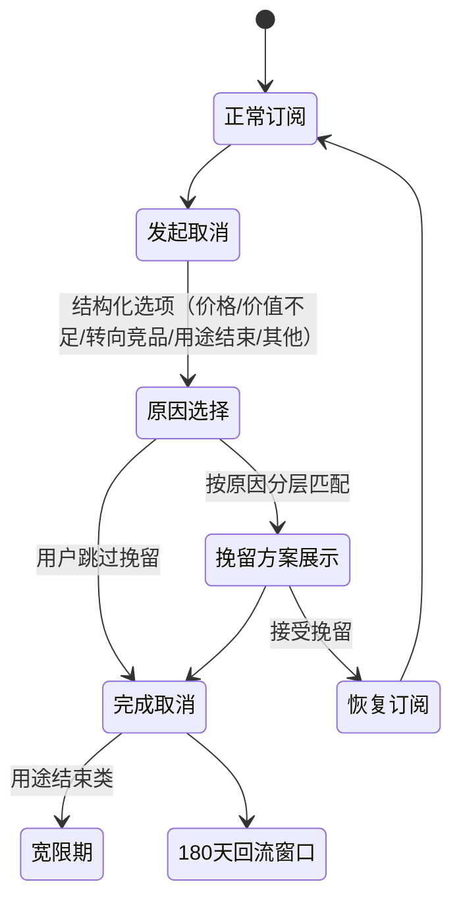

# AI 辅助客户成功与流失挽留

"客户流失了才知道"——支持系统不该是救火成本中心，而是**产品的最后一公里**：运营让用户留下，客户成功让留下的人真正成功，并在想走时给出体面且诚实的挽留。

作为工程师转型的 PM，你的优势是把支持系统做成**可度量、可自助、可回流的产品能力**：分层分流、挽留状态机、单位经济核算，而不是往产品里堆一个客服机器人。借助 AI（Claude Code / Cursor + 对应 `pm-customer-success` Agent Skill），你可以把"人肉填坑"的客服黑洞，压缩成一张每周复盘的决策卡。

> 对应 Agent Skill：`pm-customer-success`（Claude Code / Cursor 安装后自动激活）；Detractor 访谈证据回流 `pm-user-insight`，挽留埋点口径联动 `pm-data-analyst`，召回执行联动 `pm-operations`。

---

## 一、 支持三层分流：严禁所有问题涌向人肉

任何支持体系必须先完成三层分流，并守住一条红线——**用户必须能在 2 步以内触达真人**，任何 3 步以上才能找到"转人工"的设计直接判负：

```
用户进线
   │
   ▼
┌─────────────────────────────────────────────┐
│ L0 自助层：应用内帮助 / FAQ / 知识库          │  ← 目标拦截率 ≥60%
│ 质量验证 = 自助解决后 7 日未重复进线率        │     严禁只追拦截率制造假解决
└──────────────────────┬──────────────────────┘
                       │ 未解决
                       ▼
┌─────────────────────────────────────────────┐
│ L1 脚本层：可复现问题的标准排查脚本           │  ← 首响必须携带脚本，
│（版本/平台/最近成功操作/报错码）              │     严禁"我们看看"
└──────────────────────┬──────────────────────┘
                       │ 触发升级条件
                       ▼
┌─────────────────────────────────────────────┐
│ L2 人工升级层：数据丢失/退款/VIP/安全事件     │  ← 升级单必须携带 L0/L1
│                                              │     上下文，人工接管零询问起步
└─────────────────────────────────────────────┘
```

#### 提示词模板：工单 Top 问题自助化改造
```markdown
我导出过去 30 天的工单数据（脱敏）：[CSV/表格，含问题描述、渠道、处理时长、解决状态、是否重复进线]。

请帮我完成支持分流改造：
1. 聚类出 Top 5 高频问题，逐条改写为 L0 自助层内容（FAQ 条目 / 应用内帮助卡片，给出信息结构而非最终文案）；
2. 为可复现的技术问题编写 L1 标准排查脚本（收集版本 / 平台 / 最近成功操作 / 报错码），标注每个脚本的 SLA 上限；
3. 明确 L2 人工升级触发条件与接管话术，确保升级单携带完整上下文；
4. 核算改造前后：预计拦截率、周支持工时变化、以及"自助解决后 7 日未重复进线率"的验证方案；
5. 检查红线：用户从进线到触达真人是否 ≤2 步？给出路径图。
```

---

## 二、 取消挽留流程 (Save Flow)：是产品流程，不是弹窗堆叠

取消流程本身就是一个产品流程，必须按状态机设计：



1. **结构化取消原因**：必须是结构化选项（价格 / 价值不足 / 转向竞品 / 用途结束 / 其他），严禁仅自由文本——无法聚类的原因无法行动；
2. **按原因分层挽留**：价格 → 限次折扣或换档；价值不足 → 使用数据回顾（"你用了 X 功能 Y 次"）+ 重新激活路径；转向竞品 → 数据导出 + 体面告别 + 180 天回流钩子；用途结束 → 宽限期；
3. **红线（反 Dark Pattern）**：用户必须能**一次点击完成取消**，挽留动作必须显式、可跳过；严禁循环弹窗、隐藏取消按钮、流程埋雷。以"取消完成率"作护栏——若挽留动作显著拖慢取消完成，即使挽留成功率上升也判负，并向用户如实说明代价；
4. **度量**：挽留成功率 = 挽留接受数 / 进入挽留层数，按原因分层；护栏 = 取消流程 P95 时长与取消后 30 日回流率。

#### 提示词模板：挽留流程设计与暗模式审查
```markdown
我的订阅产品取消流程现状：[描述现有流程，含挽留动作]。近 90 天数据：进入取消 [N] 人，完成取消 [N] 人，取消原因分布 [如有]。

请设计挽留流程并做红队审查：
1. 输出状态机（发起取消 → 原因选择 → 分层挽留 → 恢复/完成/宽限/180 天回流），每个转移标注埋点事件；
2. 为五类取消原因各写一套挽留方案（含触发条件与素材结构）；
3. **暗模式审查**：逐条检查是否存在默认跳过挽留、循环弹窗、隐藏取消入口——命中即删除并说明合规风险；
4. 给出度量口径：分层挽留成功率、取消 P95 时长、skip 占比（暗模式护栏）、30 日回流率，与 [05-data-analysis.md](./05-data-analysis.md) 的时区/去重规则对齐。
```

---

## 三、 NPS / CSAT 与不满者访谈：72 小时证据窗口

1. **NPS 分层行动**：Promoter → 接入 `pm-operations` 推荐/裂变机制（见 [08-operations-growth.md](./08-operations-growth.md) 病毒循环）；Passive → 30 天内一次低打扰触点；**Detractor → 72 小时一对一访谈，超期证据失效**；
2. **访谈纪律**：继承《The Mom Test》非引导原则——只问已发生的流失事件、当时的具体操作与心理，严禁问"如果改 X 你会回来吗"；每份访谈产出 JTBD 流失卡（触发情境 → 放弃任务 → 替代方案）；
3. **聚类回流**：Detractor 访谈聚类为流失痛点矩阵，达到 Level 2+ 证据强度后移交 `pm-user-insight` 完成定级排序，严禁把单条访谈直接立为需求；
4. **CSAT 纪律**：仅对人工解决单在关闭后推送；1-5 分单题 + 一条选填评论，严禁超过 2 题；每用户 30 天 ≤1 次推送；均分连续两周下滑立即进入支持负载核算。

#### 提示词模板：Detractor 访谈提纲与 JTBD 流失卡
```markdown
一位 NPS 1 分的流失用户曾在 14 天前取消订阅，取消原因选的是 [价格 / 价值不足 / 转向竞品]。

请为 72 小时内的回访访谈生成提纲：
1. 遵守《The Mom Test》非引导原则：只问已发生的行为——当时在做什么任务、卡在哪一步、最后如何决定取消、取消后用了什么替代方案（要具体产品名与具体动作，不要"体验不好"这类形容词）；
2. 严禁出现"如果……你会回来吗"类假设题，给出 3 个易踩的引导性提问反面示例及改写；
3. 输出 JTBD 流失卡模板：触发情境 → 放弃的任务 → 替代方案 → 可复现的最小改进点；
4. 访谈结束后如何把原声回流给需求侧（交接 `pm-user-insight` 的证据强度标注格式）。
```

---

## 四、 支持单位经济：黑洞红线与三选一裁决

支持是隐性成本，必须显性化核算：

1. **负载核算**：周支持成本 = Σ(工单数 × 单工单分钟数)，输出支持负载表并标注自助化前后对比，口径与 `pm-data-analyst` 锁定一致；
2. **黑洞红线**：支持消耗总工时 **> 30%** 立即触发三选一决策——投资自助化 / 砍功能面（减少问题源）/ 提价过滤低意愿用户，严禁不加裁决地持续人肉填坑；
3. **独立开发者专属**：单人产品自助闭环率 ≥ 80% 方可扩量；达不到时优先砍掉"支持面大、价值密度低"的功能，而非招募外包客服。

#### 提示词模板：支持黑洞核算与三选一裁决
```markdown
我是独立开发者，产品有 [N] 名活跃用户 / [N] 名付费用户。本周支持数据：
- 工单/邮件/私信总量 [N]，分类：[功能困惑 x / 报错 x / 退款 x / 咨询 x]
- 我实际投入的支持工时：[N 小时]，我的时薪基准：[$40/h]
- 付费用户数 [N]，客单 [$N/月]

请核算：
1. 支持成本占总经营工时百分比，是否突破 30% 黑洞红线；
2. 单工单成本 vs 客单价值：哪些工单来源（功能/报错类）的价值密度最低？
3. 给出三选一裁决（投资自助化 / 砍功能面 / 提价过滤）及理由，选出唯一执行项并写成本周"支持黑洞决策卡"：负载占比、自助拦截率、Top 3 未解决问题、执行 owner、下周验证点。
```

---

## 五、 运营防坑铁律（客户成功版）

1. **挽留必须可跳过**：一次点击完成取消是红线，任何 Dark Pattern 都是给品牌与合规埋雷，护栏 = 取消 P95 时长 + skip 占比；
2. **拦截率 ≠ 解决率**：自助拦截后 7 日内重复进线即算假解决，两个指标必须成对报告；
3. **访谈证据有保鲜期**：Detractor 访谈 72 小时窗口，单条访谈严禁直接立项，必须聚类到 Level 2+ 再回流需求侧；
4. **支持负载是产品信号**：某功能贡献 50% 工单却贡献 5% 价值 = 砍功能的第一候选，每周决策卡必须回答"这周填的是哪个坑"；
5. **体面告别有复利**：转向竞品用户给足数据导出与 180 天回流钩子，流失用户池是二次激活资产，不是坏账。
