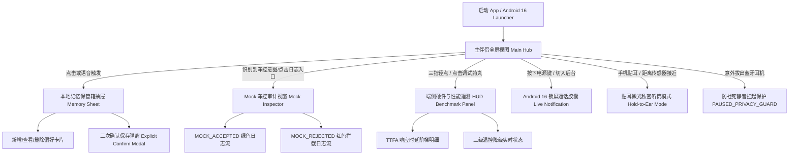

# Pixel 10 端侧 AI 语音陪伴助手与 Mock 车控 UI/UX 设计规范稿

> **文档编号**：UI-SPEC-PIXEL10-VOICE-2026  
> **基准需求**：[PRD_AI_AUDIO_AGENT_v1.0.md](../prd/PRD_AI_AUDIO_AGENT_v1.0.md)  
> **硬件平台**：Google Pixel 10 / 10 Pro (Tensor G5 SoC, 16GB RAM, Android 16)  
> **设计系统**：Material You 3.5 Expressive Dark Mode (OLED 纯黑底色 + AGSL 流体情绪光球)  
> **交付物状态**：Ready for Prototyping & Engineering Review  

---

## 1. 设计概述与设计系统 (Design System Foundations)

### 1.1 场景与定位
本应用专为 Pixel 10 打造，主要承载夜间睡前关灯倾诉、通勤漫步耳机陪伴等**高私密性、低操作负荷**的纯端侧语音交互场景。设计遵循 **“Glanceable & Ambient (微瞥即可感知、无感陪伴)”** 原则：
- **零按键沉浸**：核心交互由全双工 VAD + 流式语音驱动，视觉以流体光球律动反馈状态。
- **OLED 极致节能**：全界面底色采用绝对黑色 (`#000000`)，在息屏或微光状态下使发光像素功耗趋近于零。
- **安全与本地透明**：对本地情感记忆的存取提供**显式二次确认**，对车控意图提供**绝对醒目的 Mock 模拟标识**，消除用户隐私焦虑与控车误解。

### 1.2 颜色系统 (Color Tokens)

| Token 名称 | 变量值 (Hex) | 用途说明 | 无障碍对比度 / 视觉意义 |
| :--- | :--- | :--- | :--- |
| `--bg-base` | `#000000` | 页面绝对底色 (OLED 像素全灭) | 基础暗黑画布 |
| `--surface-container-lowest` | `#0E0F12` | 底部抽屉、常驻控制栏微底色 | 层次分离 |
| `--surface-container` | `#1A1C22` | 卡片底色、HUD 浮层背景 | 与文字保持 > 7:1 超高对比 |
| `--surface-variant` | `#282A32` | 分割线、次级按钮边框、输入框底色 | 边框与微结构 |
| `--text-primary` | `#F0F2F8` | 核心标题、实时字幕主字 | 对比度 > 15:1 (AAA 级) |
| `--text-secondary` | `#9DA3B4` | 次要参数、辅助说明、时间戳 | 对比度 > 5.5:1 (AA 级) |
| `--text-tertiary` | `#636B7E` | 状态标签微字、单位说明 | 对比度 > 4.5:1 |
| `--orb-listening` | `#38BDF8` (Sky Blue) | 聆听与拾音状态流体光晕 | 宁静、倾听、专注 |
| `--orb-thinking` | `#A855F7` (Purple Pulse) | 本地 LiteRT 推理与思考光晕 | 神经元流动、智慧感 |
| `--orb-speaking` | `#34D399` (Emerald Glow) | TTS 语音播放与情感共振光晕 | 温暖、生机、陪伴 |
| `--orb-interrupted` | `#F59E0B` (Amber Flash) | Barge-in 插话打断快速闪缩 | 灵敏、截断响应 |
| `--accent-mock` | `#F97316` (Neon Orange) | Mock 车控专属警示与标识高亮 | 明确标识为“非真实控车模拟” |
| `--status-success` | `#10B981` (Green) | 本地沙盒已保存、MOCK_ACCEPTED | 成功状态反馈 |
| `--status-error` | `#EF4444` (Coral Red) | 异常告警、权限被拒、MOCK_REJECTED | 异常与拦截阻断 |

### 1.3 排版与字体规格 (Typography)

采用 Google 推荐的 Roboto Flex / Google Sans Text 字体族，严格适配 Android 16 动态字重系统：

| 等级 | 字号 (sp/px) | 行高 | 字重 | 用途场景 |
| :--- | :--- | :--- | :--- | :--- |
| **Display Large** | `32px` | `40px` | Medium (500) | 首次启动欢迎标语、锁屏时间微件 |
| **Headline Medium** | `20px` | `28px` | SemiBold (600) | 弹窗标题、记忆管理库页头 |
| **Body Large (Subtitle)** | `16px` | `24px` | Regular (400) | 实时语音转写文本 (ASR/TTS 实时字) |
| **Body Medium** | `14px` | `20px` | Regular (400) | 记忆条目文本、日志详细描述 |
| **Label Small (Mono)** | `11px` | `16px` | Medium / Mono | 遥测 HUD 数据、JSON Lines 日志、延时指标 |

### 1.4 触控与无障碍要求 (Accessibility & Ergonomics)
- **最小触控热区**：所有操作按钮（如挂断、静音、记忆抽屉）尺寸均不低于 `48 × 48 dp`，且相邻热区间隔 `≥ 12 dp`。
- **免视操作设计**：底部三大核心按钮采用外凸胶囊触感设计，支持盲操触控；挂断按钮置于中央红圈保护位，防止睡前误触。
- **全链路触觉反馈 (Haptic)**：
  - 用户开口 VAD 触发：`VibrationEffect.EFFECT_TICK` (微轻短震)；
  - 触发插话打断 (Barge-in)：`VibrationEffect.EFFECT_CLICK` (利落微震)；
  - Mock 车控产生日志：双击微脉冲 (`EFFECT_DOUBLE_CLICK`)。

---

## 2. 信息架构与页面流转 (Information Architecture)



---

## 3. 核心界面设计详述 (Core Screen Specifications)

### 3.1 视图 A：主会话沉浸界面 (Main Companion Hub)

主界面是应用的核心入口，采用极简无干扰的单屏全景布局，中央为 AGSL 流体情绪光球。

#### 布局线框结构 (ASCII Wireframe)
```
+-------------------------------------------------------------+
| 10:28 💬                      📴 飞行模式 [端侧沙盒闭环] 100% | <- Pixel 10 状态栏
|                                                             |
|   [ 🟢 纯端侧离线引擎 | Tensor G5 | 36.5°C 正常 ]              | <- 硬件安全与状态胶囊
|                                                             |
|                                                             |
|                          . - ~ - .                          |
|                      . '           ' .                      |
|                    /     AGSL 流体     \                    |
|                   |      全双工光球     |                   | <- 60fps 动态光球
|                    \   (多模态微律动)  /                    |    (呼吸/收缩/流转/扩散)
|                      . '           ' .                      |
|                          ' - ~ - '                          |
|                                                             |
|           [ 🎙️ 正在倾听... 或 🔊 说话中微气泡 ]                | <- 当前交互状态胶囊
|                                                             |
|   +-----------------------------------------------------+   |
|   | 💬 实时字幕 (双击光球可隐藏):                        |   |
|   | 用户: "记住我喜欢睡前听轻音乐，音量调低一点"          |   | <- 实时流式转写
|   | 伴侣: "好呀，我已经记在你的专属记忆里了，今晚..."    |   | <- 带 <emo:warm> 情绪
|   +-----------------------------------------------------+   |
|                                                             |
|     ( 🎤 闭麦 )           ( 🔴 挂断通话 )        ( 🧠 记忆库 )| <- 底部快捷胶囊操作栏
|      Mute Mic                End Call             Memory    |    (高对比、防误触)
|                                                             |
|   --- 路由: 🔊 扬声器外放 (点击切换为 🎧 Pixel Buds) ---------   | <- 音频路由指示
+-------------------------------------------------------------+
```

#### 元素与设计细节
1. **顶部硬件与环境指示胶囊 (Security & HW Pill)**：
   - 左侧展示 `📴 飞行模式离线运行` 或 `100% 本地沙盒` 徽标；
   - 中间展示当前运行核心：`Tensor G5 NPU/GPU`；
   - 右侧展示机身温度与状态：`36.5°C 清凉`，触碰可展开性能 HUD。
2. **AGSL 流体情绪光球 (Fluid Audio Sphere)**：
   - 尺寸：屏幕宽度占比约 60% (`240dp × 240dp`)。
   - 视觉质感：多层径向渐变混色 + 边缘高斯微模糊（微晶玻璃光感），外加微妙粒子流。
   - 交互反馈：
     - *等待/静息 (Listening)*：冷天蓝 (`#38BDF8`) 慢速柔和呼吸（周期 3.2s）；
     - *用户发声 (Transcribing)*：向心收拢 10%，并随麦克风输入波形产生涟漪震颤；
     - *端侧思考 (Generating)*：蓝紫交融 (`#A855F7`) 内部高速漩涡流动，模拟神经元思考；
     - *语音播放 (Speaking)*：暖翡翠绿 (`#34D399`) 随输出音频振幅向外律动扩散；
     - *被打断 (Barge-in)*：琥珀黄 (`#F59E0B`) 极短促闪变 (80ms 内收回静止)，无缝转入重新倾听。
3. **实时流式字幕微卡片 (Live Streaming Subtitle Card)**：
   - 位于光球正下方，半透明灰黑底色 (`rgba(26,28,34,0.75)`) + 1px 细微光泽边框；
   - 支持动态展示 ASR Partial Streaming 文字（打字机光标）与 TTS 情绪播报分句；
   - 双击光球或微卡片右上方收起按钮，可一键隐去字幕，回归绝对极简黑屏模式。
4. **底部主控制胶囊栏 (Action Bottom Bar)**：
   - 采用标准 3 键对称布局：
     - **左侧**：静音切换键 (`48dp` 胶囊，图标 `mic` / `mic-off`，底色 `#1A1C22`)；
     - **居中**：挂断/拨通键 (`64dp` 圆形主行动键，高亮红色 `#DC2626`，图标 `phone-off`)；
     - **右侧**：本地记忆入口 (`48dp` 胶囊，图标 `brain`，带已存记忆数字 Badge，如 `[3]`)。

---

### 3.2 视图 B：本地情感记忆库抽屉与显式保存确认 (Local Memory Vault)

满足 PRD 4.1：**“普通对话不自动转为长期记忆；用户明确要求记住时，系统先展示待保存内容，确认后写入沙盒”**。

#### 布局线框结构 (ASCII Wireframe)
```
+-------------------------------------------------------------+
| [主界面暗化背板蒙层]                                         |
| +---------------------------------------------------------+ |
| |  ===== (顶部拖拽手柄)                                    | |
| |  🧠 本地情感记忆保管箱 (3 条)          [ 🗑️ 清空本地沙盒 ] | |
| |  🔒 存储位置: Pixel 10 应用专属沙盒 (不联网/不离机)       | |
| | ------------------------------------------------------- | |
| |  +---------------------------------------------------+  | |
| |  | 🏷️ 睡前偏好                                昨天 22:30 |  | |
| |  | "喜欢睡前听轻音乐，音量偏好保持在 25% 以下。"          |  | |
| |  | [ ✏️ 编辑 ]                     [ 🗑️ 滑动/点击删除 ] |  | |
| |  +---------------------------------------------------+  | |
| |  +---------------------------------------------------+  | |
| |  | 🏷️ 情绪习惯                                3天前 23:10 |  | |
| |  | "工作遇到挫折时，更希望得到倾听而非说教建议。"         |  | |
| |  | [ ✏️ 编辑 ]                     [ 🗑️ 滑动/点击删除 ] |  | |
| |  +---------------------------------------------------+  | |
| |                                                         | |
| |   ( 💡 提示: 记忆仅用于个性化对话生成，随时可单条永久销毁 )| |
| +---------------------------------------------------------+ |
+-------------------------------------------------------------+
```

#### 关键子组件：显式保存确认弹窗 (Explicit Memory Confirm Modal)
当用户在对话中说“记住我喜欢睡前听轻音乐”时，不直接静默写入，而是**在主界面或抽屉弹出确认浮层**：

```
+-----------------------------------------------------+
| 💡 确认存入本地长期记忆?                             |
|                                                     |
| 系统检测到您要求记住以下内容:                        |
| +-------------------------------------------------+ |
| | "用户偏好在睡前倾诉时播放轻柔纯音乐，音量柔和。"  | |
| +-------------------------------------------------+ |
| 📍 存放范围: 本机 SQLite-vec 沙盒 (断网可读，永不上云) |
|                                                     |
|    [ ✕ 放弃保存 ]            [ ✓ 确认记住 (Save) ]  |
+-----------------------------------------------------+
```

- **设计规则**：
  - 点击“确认记住”后，弹窗产生细腻绿色微光粒子融入底部“记忆库”图标，并更新 Badge 计数；
  - 伴侣用语音温柔回应：“好，我已经牢牢记在本地了”；
  - 若用户点击“放弃保存”，则系统明确复述：“明白，这次交流不会记录”。

---

### 3.3 视图 C：Mock 车控日志模拟控制台 (Mock Vehicle Control Inspector)

满足 PRD 4.2：**“车控意图只用于验证分类与槽位解析，绝不调用真实控制 API 或车辆硬件，且日志中每条均须标明 simulation=true”**。

#### 布局线框结构 (ASCII Wireframe)
```
+-------------------------------------------------------------+
| 🚗 Mock 车控意图验证控制台           [ ✕ 关闭 ] [ 🧹 清空日志 ] |
| ⚠️ 声明: 本功能仅为端侧模型语义路由与槽位测试，绝无物理车控动作 |
| ----------------------------------------------------------- |
| [ 预设测试注入 ]:                                           |
| [ ❄️ 调空调到24℃ (合规) ]  [ 🚨 超速开窗 (超限违规) ] [ 缺失槽位 ]|
| ----------------------------------------------------------- |
| 📋 结构化日志视窗 (JSON Lines 规范):                         |
| +---------------------------------------------------------+ |
| | [2026-10-27T14:32:01Z] 🟢 MOCK_ACCEPTED                 | |
| | {                                                       | |
| |   "timestamp": "2026-10-27T14:32:01.402Z",              | |
| |   "intent": "adjust_ac_temperature",                    | |
| |   "slots": { "target_celsius": 24.0, "zone": "driver" },| |
| |   "decision": "MOCK_ACCEPTED",                          | |
| |   "reason": "temperature_in_safe_range_18_30",          | |
| |   "simulation": true                                    | |
| | }                                                       | |
| +---------------------------------------------------------+ |
| | [2026-10-27T14:33:15Z] 🔴 MOCK_REJECTED                 | |
| | {                                                       | |
| |   "timestamp": "2026-10-27T14:33:15.110Z",              | |
| |   "intent": "speed_and_window_hazard",                  | |
| |   "slots": { "window_pct": 100, "target_kmh": 160 },    | |
| |   "decision": "MOCK_REJECTED",                          | |
| |   "reason": "hazardous_speed_command_disallowed",       | |
| |   "simulation": true                                    | |
| | }                                                       | |
| +---------------------------------------------------------+ |
| 💡 伴侣语音反馈: "已模拟记录空调调节，当前为纯端侧 PoC 环境。" |
+-------------------------------------------------------------+
```

- **视觉与语义规范**：
  - 顶部醒目标注橙色警示盾牌：`SIMULATION ONLY (无外部副作用)`；
  - 采用 JetBrains Mono 风格等宽代码高亮字体；
  - `MOCK_ACCEPTED` 采用翡翠绿徽标；`MOCK_REJECTED` 采用鲜珊瑚红徽标并附带高亮原因。

---

### 3.4 视图 D：贴耳私密听筒模式与防社死保护 (Privacy & Audio Guard)

满足 PRD 4.1 & 5.2：移动端倾诉专属的硬件自适应保护。

#### 1. 贴耳私密听筒模式 (Hold-to-Ear Privacy Mode)
- **触发条件**：用户在未戴耳机状态下将 Pixel 10 举至耳边，顶部距离传感器被遮挡（`< 3cm`）。
- **界面与硬件表现**：
  - 屏幕在 `150ms` 内完全熄灭（纯黑无光），仅在正上方边缘保留一颗 `1px` 极微弱绿色私密呼吸点；
  - 音频路由毫秒级从底部扬声器切换为**顶部微缝听筒 (Earpiece)**；
  - 语音音量自动收缩至微风级通话分贝，防止旁人窃听；
  - 移开耳边后，屏幕平滑淡入恢复主光球界面。

#### 2. 拔下耳机防社死保护 (Headphone Disconnect Guard)
- **触发条件**：用户在公共场合佩戴 Pixel Buds 倾诉时，耳机被摘下放入充电盒（触发 Android `ACTION_AUDIO_BECOMING_NOISY`）。
- **界面与硬件表现**：
  - **毫秒级静音**：立即置零输出音量，严禁私密对话泄露到扬声器；
  - 伴侣进入 `PAUSED_PRIVACY_GUARD` 挂起状态；
  - 界面弹出防社死全屏横幅警示：
    ```
    +---------------------------------------------------------+
    | 🛡️ 蓝牙耳机已断开 · 音频输出已紧急静音                   |
    | 检测到耳机连接中断，为保护您的隐私，AI 已暂停语音播报。 |
    |                                                         |
    |      [ 🔴 挂断当前通话 ]       [ 🔊 切换为外放继续 ]     |
    +---------------------------------------------------------+
    ```

---

### 3.5 视图 E：Android 16 锁屏通话胶囊与息屏省电微件 (Live Notification Capsule)

满足 PRD 2.3 & 3.3：熄屏揣兜陪伴时，GPU 渲染彻底休眠 (0 FPS)，通过锁屏微件无感感知。

#### 锁屏胶囊视觉结构
```
+-------------------------------------------------------------+
| 10:30               Sunday, October 27                      |
|                                                             |
| +---------------------------------------------------------+ |
| | 🟢 Her Pocket 正在本地陪伴 (12:45)       Tensor G5 离线 | |
| | [ 🎙️ 正在倾听你...]                   [ 🎤 开闭麦 ] [ 🔴 挂断 ]| |
| +---------------------------------------------------------+ |
|                                                             |
| [ 🔒 点击或耳机捏合手势可快速闭麦 ]                          |
+-------------------------------------------------------------+
```

---

### 3.6 视图 F：端侧实时性能与硬件遥测面板 (On-Device Benchmark HUD)

满足 PRD 2.2 核心体验与护栏指标验收：

| 监控项 | 正常指标基准 (Happy Path) | 告警/降级阈值 | UI 展示形式 |
| :--- | :--- | :--- | :--- |
| **端到端首包延迟 (TTFA)** | `P50 ≤ 800ms` / 当前实测: `720ms` | `> 1150ms` 变黄 | 环形仪表盘 + 阶段耗时瀑布流 |
| **打断截断延迟 (Barge-in)** | `≤ 80ms` / 当前实测: `38ms` | `> 100ms` 告警 | 瞬时响应响应条 (绿色超快) |
| **机身温度与热管理** | `< 38°C` (清凉 60 FPS) | `> 41°C` 严重降级 | 3 档色温阶梯进度条 |
| **内存峰值 (PSS)** | `2.8 GB / 16 GB` | `> 3.2 GB` 告警 | 紧凑内存水位计 |
| **纯离线网络证明** | `0 bytes / 0 reqs` (飞行模式闭环) | 任何外联流量直接爆红 | 纯绿安全锁标 |

---

## 4. 状态机与界面响应矩阵 (State Machine & UI Response Matrix)

| 状态机代码 | 状态名称 | 光球视觉表现 | 实时字幕区 | 顶部指示条 | 底部控制项响应 |
| :--- | :--- | :--- | :--- | :--- | :--- |
| `STOPPED` | 初始未连接 | 光球灰暗静息，微微呼吸 | "轻触下方拨号键开启陪伴" | 离线就绪 (Idle) | 绿色拨号键高亮，闭麦与记忆库置灰 |
| `LISTENING` | 正在倾听 | 天蓝色柔和呼吸 (`#38BDF8`) | "正在聆听你的声音..." | Tensor G5 待命中 | 闭麦激活，挂断键就绪 |
| `TRANSCRIBING`| 实时转写 | 局部光球内聚微震 | 实时打字机吐出 Partial ASR | 端侧 Zipformer 解码中 | 支持说话时直接改口 |
| `ROUTING` | 语义意图路由 | 紫蓝交汇旋涡流动 | 解析意图槽位中... | 本地规则校验 | 不可操作 |
| `GENERATING` | 本地大模型思考 | 亮紫色高频流光脉动 | 思考中 (闪烁光标) | LiteRT Gemma-3 生成中 | 支持随时抢话打断 |
| `SPEAKING` | 伴侣语音播报 | 翡翠绿随音频波峰扩散 | 伴侣回复逐句高亮滚动 | Kokoro TTS 流式播放 | **支持 Barge-in (<80ms 截断)** |
| `MOCK_LOGGING`| 车控日志输出 | 橙光短促双闪 | "模拟指令已记录，无实体控车" | 输出 JSON Lines 日志 | 弹窗展示结构化日志 |
| `PAUSED` | 异常/断开挂起 | 浅灰微弱闪烁 | "音频设备已断开，通话挂起" | 暂停保护状态 | 提示点击恢复外放或挂断 |

---

## 5. 设计走查与研发验收清单 (Design QA Checklist)

1. [ ] **纯黑 OLED 规范走查**：主背景必须为 `#000000`，暗部不可有泛灰漏光情况。
2. [ ] **双向流式打断反馈**：在 AI 说话时，用户一旦说话或点击打断，光球必须在 `80ms` 内截断并收缩回蓝色聆听态。
3. [ ] **记忆确认弹窗闭环**：提出记忆请求时必须弹出带有具体提取文本的确认对话框，不可跳过用户确认直接保存。
4. [ ] **Mock 警示标识**：所有车控相关输出区域必须有醒目的橙色 `MOCK / SIMULATION` 警示，绝无歧义。
5. [ ] **防社死测试**：断开耳机时音频增益必须即时为 0，且弹出用户恢复确认条。
6. [ ] **温控降级视觉联动**：当温控进入 `SEVERE` 状态时，界面光球帧率自动限制为 `30 FPS`，提示用户建议熄屏长聊。
