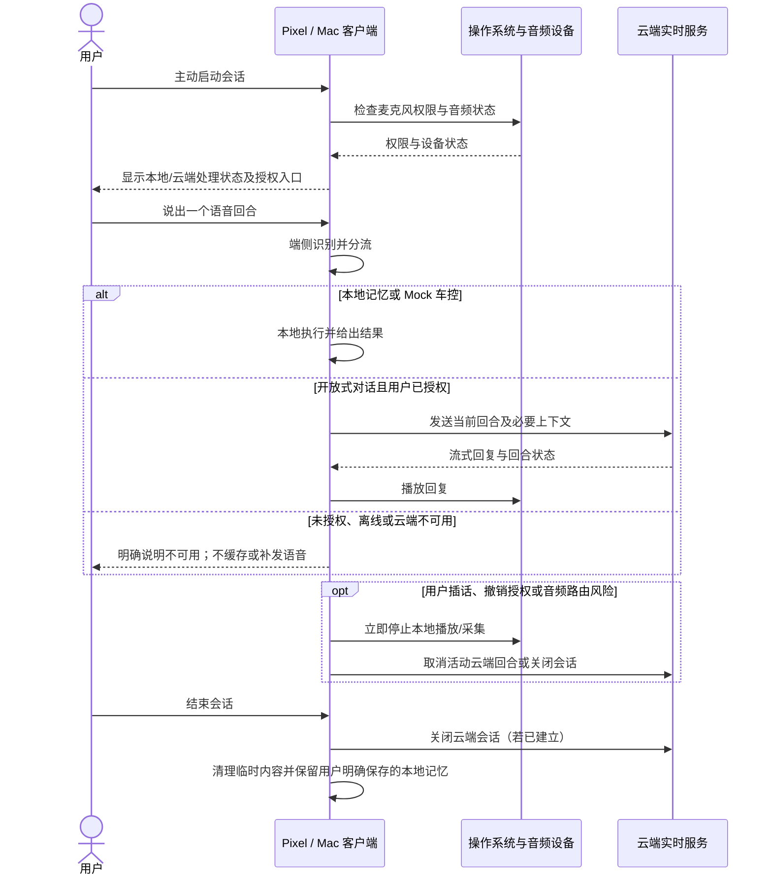

# Pixel 与 Mac 语音陪伴助手客户端 MVP PRD

| 属性 | 内容 |
| :--- | :--- |
| **文档编号** | PRD-EDGE-CLOUD-VOICE-CLIENT-2026 |
| **版本 / 状态** | v1.0 / Draft for PoC |
| **优先级** | P0 |
| **负责人** | @Frank |
| **适用平台** | Pixel 10 / 10 Pro（Android 16）；Mac（测试机型及最低 macOS 版本待冻结） |
| **父级 PRD** | [Pixel 与 Mac 端云协同 PRD](PRD_AI_AUDIO_AGENT_v1.0.md) |
| **服务端契约** | [云端实时对话服务 MVP PRD](PRD_AI_AUDIO_AGENT_SERVER_MVP_v1.0.md) |

## 1. 变更记录

| 版本 | 修改摘要 |
| :--- | :--- |
| v1.0 | 初稿：定义 Pixel 与 Mac 客户端共享的端云职责、会话行为、平台生命周期边界和 PoC 验收要求 |

## 2. 背景、目标与衡量指标

### 2.1 用户问题与目标

希望在睡前、独处、通勤或桌面工作间隙进行语音倾诉的用户，需要在 Pixel 和 Mac 上获得一致的陪伴体验。客户端必须让用户知道语音何时在本地处理、何时发送到云端；网络、权限或系统状态变化时，明确停止、暂停或继续的条件。

本期目标是在 Pixel 10 / 10 Pro 与经确认的 Mac 测试机型上，完成一条可验收的客户端闭环：用户主动启动会话，端侧处理本地记忆和 Mock 车控意图；用户授权后的开放式问题进入云端实时对话；网络中断时本地能力仍可用，断线语音不排队、不自动补发。

### 2.2 成功指标与护栏指标

| 指标 | PoC 目标 | 测量口径 |
| :--- | :--- | :--- |
| 端侧快环响应 | P95 ≤ 150ms；目标须按平台实测确认 | 用户停止说话至本地反馈或 Mock 日志生成；按 Pixel、Mac 和命令类别分别记录 |
| 云端首个回复音频 | P50 ≤ 800ms、P95 ≤ 1150ms；PoC 目标 | 用户停止说话至首个云端回复音频开始播放；按平台及网络条件分别报告 |
| 本地打断响应 | ≤ 80ms；目标须实测确认 | 端侧检测到有效插话至当前本地播放停止；云端取消确认单独记录 |
| 本地路径断网可用 | 断网时本地记忆及 Mock 车控流程仍可完成 | Pixel 与 Mac 分别测试；无云端请求、无断线语音排队或恢复后补发 |
| 本地记忆隔离 | 记忆仅能由创建它的设备检索 | 在 Pixel 与 Mac 分别保存不同内容并交叉验证；不得自动同步 |
| Mock 安全边界 | 每次车控意图恰好产生一条结构化日志，不触发外部动作 | 检查接受、拒绝、缺槽和危险意图；确认日志不含原始转写或音频 |
| 会话稳定性 | 每个平台连续会话 20 分钟无崩溃或非预期终止 | 记录设备/系统版本、温度、耗电、内存、网络和会话模式；不外推为量产指标 |
| 数据最小化 | 原始音频、完整转写、本地记忆正文不进入诊断事件 | 检查本地诊断及云端请求；默认诊断数据只保存在设备上 |

以上数值沿用父级 PoC 目标，不代表已实测达成。Mac 测试机型、最低系统版本以及各平台的资源基线冻结前，相关指标仅作为测量目标。

### 2.3 本期范围

1. 用户主动开始和结束语音会话；会话期间管理麦克风权限、云端处理授权、输入/输出状态和用户可见的运行状态。
2. 每个语音回合由客户端本地分流到本地记忆、Mock 车控或云端开放式对话。
3. 提供本地记忆的明确保存、查看、修改和删除；记忆默认只属于当前设备。
4. 提供不执行真实设备控制的 Mock 车控日志，用于验证分类、槽位和拒绝行为。
5. 对云端会话支持流式回复、端侧立即停止播放、取消当前回合及网络恢复后的新回合处理。
6. 按 Pixel 与 Mac 各自的系统生命周期和音频路由边界暂停、恢复或结束会话。

### 2.4 本期不做

1. 不做全天候后台监听、未经用户操作的自动启动或开机后恢复采集。
2. 不做跨设备会话或记忆同步、长期云端记忆、后台长任务和复杂任务编排。
3. 不连接真实车辆、车辆总线、系统控制 API、短信、闹钟、通知或其他设备操作工具；车控只写 Mock 日志。
4. 不处理摄像头、屏幕截图等多模态输入。
5. 不提供账号注册或身份提供方建设；客户端使用的身份凭证契约依赖外部方案，须与服务端联调前确认。
6. 不规定模型、语音识别/合成、存储引擎、系统 API、应用框架或网络协议等实现选型。
7. 不承诺 Pixel 10 / 10 Pro 与 Mac 以外的设备兼容，也不把 PoC 结果作为量产 SLA。

## 3. 角色、职责与端到端流程

### 3.1 职责边界

| 角色 | 负责事项 | 不负责事项 |
| :--- | :--- | :--- |
| Pixel / Mac 客户端 | 系统权限申请；会话启动/结束；本地语音分流；本地记忆和 Mock 处理；云端授权呈现；音频播放、打断及错误提示；端侧数据清理 | 代替用户授权；将本地意图自动转发到云端；在断线后重放旧语音；执行真实设备或车辆操作 |
| 云端实时服务 | 验证用户、设备、会话和授权；处理客户端明确路由的开放式语音回合；流式回复；取消回合及隔离服务端数据 | 管理操作系统权限；判断本地意图；读取设备记忆；操作 Pixel、Mac 或车辆 |
| 用户 | 明确启动/结束会话；决定是否授权云端处理；确认写入本地记忆；选择是否将单条记忆内容发送给云端 | 无 |
| 操作系统与音频设备 | 提供运行时麦克风权限、设备音频输入/输出和生命周期事件 | 不保证应用进程在强制退出、系统回收或设备休眠后持续运行 |

用户未授权云端处理时，不得建立承载用户音频的云端会话。用户明确选择并确认发送的单条本地记忆，可随对应云端回合发送；客户端不得自行检索并附带其他记忆。

### 3.2 主流程



### 3.3 客户端会话状态

| 当前状态 | 触发事件 | 前置条件 | 下一状态 | 用户可见结果与动作 |
| :--- | :--- | :--- | :--- | :--- |
| **STOPPED** | 用户主动开始会话 | 应用可用 | **PREPARING** | 检查麦克风权限、音频设备和本地能力；不开始隐式采集 |
| **PREPARING** | 权限和本地能力可用 | 麦克风授权有效 | **LISTENING** | 显示当前本地/云端授权状态并等待用户输入 |
| **PREPARING** | 权限拒绝、输入设备不可用或资源未就绪 | 无 | **PAUSED** | 告知缺少条件；不上传音频，提供恢复或结束入口 |
| **LISTENING** | 检测到一个完整语音回合 | 当前输入流有效 | **ROUTING** | 端侧处理该回合；原始音频不持久化 |
| **ROUTING** | 本地记忆或 Mock 车控意图 | 本地处理条件满足 | **LOCAL_PROCESSING** | 不发起云端请求 |
| **ROUTING** | 开放式问题且用户未授权云端 | 无 | **LOCAL_ONLY** | 说明云端处理未启用；不建立会话、不排队语音 |
| **LOCAL_ONLY** | 用户选择继续本地功能 | 本地能力可用 | **LISTENING** | 等待下一回合；本地意图仍在设备处理 |
| **ROUTING** | 开放式问题且授权有效、网络可用 | 会话授权与网络状态有效 | **CLOUD_CONNECTING** | 只提交当前获准回合 |
| **ROUTING** | 开放式问题但网络不可用 | 本地能力可继续 | **OFFLINE** | 明确提示云端不可用；保留本地路径，不缓存语音 |
| **OFFLINE** | 用户输入本地记忆或 Mock 车控回合 | 本地能力可用 | **LOCAL_PROCESSING** | 本地处理该回合；不发起网络请求 |
| **LOCAL_PROCESSING** | 本地操作完成 | 输出结果有效 | **LISTENING** | 播放本地反馈或显示 Mock 结果 |
| **CLOUD_CONNECTING** | 会话/回合建立成功 | 服务端鉴权和授权通过 | **CLOUD_TURN** | 等待当前回合云端回复 |
| **CLOUD_CONNECTING** | 连接失败或超时 | 无 | **LISTENING** | 提示失败；当前回合不自动重放 |
| **CLOUD_TURN** | 首个回复音频到达 | 当前回合仍有效 | **SPEAKING** | 播放当前回复 |
| **CLOUD_TURN / SPEAKING** | 用户有效插话 | 输入仍可用 | **LISTENING** | 立即停止本地播放并取消旧回合；按规则处理新输入 |
| **SPEAKING** | 回复播放完成 | 无新输入 | **LISTENING** | 等待下一回合 |
| **任意活动状态** | 权限撤销、云端授权撤销、系统音频中断、隐私敏感路由变化或进程资源不足 | 无法安全继续 | **PAUSED** | 停止采集和播放；取消活动云端回合；提示用户原因；不得静默恢复 |
| **PAUSED** | 用户解决暂停原因并显式恢复 | 当前平台权限和输入/输出状态有效 | **PREPARING** | 重新检查权限、设备及本地能力；不恢复旧回合 |
| **CLOUD_TURN / SPEAKING** | 网络或云端连接中断 | 本地输入可用 | **OFFLINE** | 停止云端传输和旧回复播放；不自动补发断线回合 |
| **OFFLINE** | 网络恢复 | 用户授权仍有效 | **LISTENING** | 提示云端服务可用；仅处理用户发起的新回合，不补发旧语音 |
| **OFFLINE** | 用户明确启用云端处理 | 授权有效且网络可用 | **LISTENING** | 显示云端处理已启用；等待新的语音回合，不发送之前的内容 |
| **LOCAL_ONLY** | 用户明确启用云端处理 | 授权有效且网络可用 | **LISTENING** | 显示云端处理已启用；等待新的语音回合，不发送之前的内容 |
| **任意状态** | 用户结束会话 | 无 | **STOPPED** | 停止采集/播放，关闭云端会话并按规则清理临时数据 |

## 4. 功能需求与验收准则

### 4.1 会话启动、权限与授权

1. 会话必须由用户明确启动；启动前检查当前平台的麦克风授权和音频输入状态。权限未授予时，不得采集或上传音频。
2. **待确认假设**：首次安装后云端处理默认关闭；用户在看到清楚的数据用途说明后主动启用。授权可在会话中撤销。
3. 客户端分别管理操作系统麦克风权限和产品级云端处理授权；其中一项缺失时不得启动相应采集或上云路径。
4. 账号/凭证的登录界面不属于本期范围；身份方案冻结前，使用受控 PoC 凭证完成联调，不接入公开用户。
5. 用户结束会话、撤销授权或系统要求暂停时，立即停止新的音频采集；已建立的云端会话按服务端契约关闭或取消。

**验收场景**

```gherkin
Scenario: 麦克风权限未授予
  Given 用户未授予当前平台的麦克风权限
  When 用户尝试启动语音会话
  Then 客户端不采集也不上传音频
  And 显示所需权限及恢复方式

Scenario: 用户未授权云端处理
  Given 麦克风权限有效但用户未启用云端处理
  When 用户提出开放式问题
  Then 客户端不建立承载音频的云端会话
  And 不缓存该回合以供之后自动发送
```

### 4.2 端侧分流与本地快环

1. 每个语音回合均由客户端分流到本地记忆、Mock 车控或云端开放式对话；联网状态不得改变本地意图的归属。
2. 低置信度、部分识别、缺少必要槽位或不满足本地规则的意图必须追问或拒绝；不得猜测后写入记忆或生成可能被理解为真实设备动作的结果。
3. 用户可明确将被误分到本地的开放式问题转交云端；转交前说明该回合将发送至云端，并检查当前授权。不得自动转交。
4. 本地路径在无网络时可用；如果本地能力或模型资源不可用，客户端应清楚提示并保留结束/重试入口，不得把内容静默转到云端。

**验收场景**

```gherkin
Scenario: 联网时本地车控意图仍由本地处理
  Given 云端会话已建立
  When 用户输入一个符合 Mock 规则的本地车控意图
  Then 客户端只生成一条 MOCK_ACCEPTED 日志
  And 不将该回合发送到云端或调用外部设备接口

Scenario: 本地意图不完整时不猜测执行
  Given 用户输入缺少必要槽位的 Mock 车控意图
  When 客户端完成本地识别
  Then 客户端追问或输出 MOCK_REJECTED
  And 不调用外部动作或将该回合转发到云端
```

### 4.3 本地记忆

1. 用户明确提出保存偏好时，客户端先展示或复述待保存内容；只有用户确认后才写入当前设备的应用私有存储。
2. 用户可查看、修改和删除记忆；删除成功后再次检索不得返回该条内容。保存或删除失败时，显示失败状态，不伪称成功。
3. 普通对话、云端回复或 Mock 车控日志不得自动变成长时记忆。原始麦克风音频不得持久化；会话文本持久化默认关闭。
4. Pixel 与 Mac 的记忆互相隔离，不自动同步。用户选择并确认发送某条记忆时，只将该条内容作为对应云端回合的临时上下文。
5. 本地加密存储和密钥管理方案完成评审前，只允许使用合成或非敏感测试数据，不得保存真实敏感个人记忆。

**验收场景**

```gherkin
Scenario: 用户确认后保存本地记忆
  Given 用户提出一条明确的保存请求
  When 客户端展示待保存内容且用户确认
  Then 记忆保存在当前设备
  And 未确认内容不被保存或发送到云端

Scenario: 删除的记忆不再被检索
  Given 当前设备保存有一条用户记忆
  When 用户删除该记忆并收到成功结果
  Then 后续本地检索不返回该记忆
  And 其他设备上的记忆不受影响
```

### 4.4 Mock 车控日志

1. 所有车控意图仅用于本地分类、槽位和拒绝逻辑验证；不得调用系统 API、网络服务、车机或车辆接口。
2. 每条意图恰好生成一条 JSON Lines 日志，字段为 `timestamp`、`intent`、`slots`、`decision`、`reason`、`simulation`。`timestamp` 使用 UTC RFC 3339；`slots` 为 JSON object；`decision` 仅允许 `MOCK_ACCEPTED` 或 `MOCK_REJECTED`；`simulation` 必须为布尔值 `true`。
3. 缺少必填槽位、超出规则边界或命中危险意图时输出 `MOCK_REJECTED` 和原因。日志不包含原始语音或完整转写，不得被用户或其他组件解释为真实动作。
4. 日志仅保存在设备本地；不作为云端分析事件上传。用户清除本地诊断数据时一并清除。

### 4.5 云端实时对话与中断

1. 只有开放式对话且当前会话已授权、网络可用时，客户端才建立或复用云端会话并发送当前语音回合及必要上下文。
2. 不发送本地记忆、Mock 车控回合、未获授权语音或与当前请求无关的设备数据。用户明确选择并确认的单条记忆内容除外。
3. 云端回复只用于当前会话播放。用户有效插话时，客户端立即停止本地播放并请求取消当前回合；旧回合的迟到内容不得播放。
4. 连接建立失败、超时或上/下行中断时，当前回合标记失败；断网期间不缓存或自动重放语音。恢复网络后，只有用户发起的新回合可以进入云端。
5. 用户撤销云端授权或结束会话后，停止后续上行并关闭/取消云端会话；撤销前已发送数据按服务端已评审的数据生命周期处理。
6. 本期不包含可在用户打断后继续执行的云端后台任务。

**验收场景**

```gherkin
Scenario: 获授权的开放式对话进入云端
  Given 用户已启用云端处理且网络可用
  When 用户提出开放式问题
  Then 当前语音回合发送到云端并播放对应回复
  And 请求不包含本地长期记忆或无关设备数据

Scenario: 用户插话后旧回复停止
  Given 云端回复正在生成或播放
  When 用户开始有效插话
  Then 客户端立即停止本地播放并请求取消旧回合
  And 旧回合的后续内容不再播放
  And 新输入按当前授权和分流规则处理

Scenario: 云端回合中断后不自动重放
  Given 客户端正在发送语音或播放云端回复
  When 网络连接中断后恢复
  Then 客户端提示当前回合失败或已结束
  And 不重放旧语音或旧回复，等待用户发起新回合
```

### 4.6 平台生命周期与音频隐私保护

#### Pixel 10 / 10 Pro

1. 用户主动开始的会话可在屏幕关闭时继续，前提是 Android 系统仍允许会话运行；屏幕关闭不代表启动新的监听。
2. 会话进行中提供平台允许的清晰会话状态及结束入口。应用被用户强制关闭、系统终止或设备重启后，不得自动恢复采集或补传内容。
3. 蓝牙/有线耳机移除、输出设备变化可能导致私密回复转为外放时，先暂停播放并提示用户选择后续音频方式；不得静默把私密音频切到扬声器。
4. 系统电话、音频焦点中断、麦克风权限撤销或设备音频异常时，立即暂停采集和播放；恢复须符合平台授权且用户可感知。

#### Mac

1. 会话由用户在 Mac 客户端主动启动；本期目标设备和最低 macOS 版本在测试矩阵冻结前标记为待确认。
2. **待确认假设**：PoC 仅保证 Mac 处于唤醒状态时的会话行为；系统睡眠/休眠导致的会话中断须暂停并由用户显式恢复，不得自动重放之前的音频。
3. 麦克风权限被拒绝或撤销、输入/输出设备不可用或系统音频中断时，暂停采集与播放并明确提示；不尝试规避系统权限。
4. 输出设备移除导致音频可能转到扬声器时，暂停当前回复并要求用户明确选择恢复方式。

**验收场景**

```gherkin
Scenario: Pixel 屏幕关闭期间保持用户已启动的会话
  Given 用户已在 Pixel 上主动启动会话且系统允许后台音频运行
  When 用户关闭屏幕
  Then 当前会话按原授权状态继续
  And 不启动额外采集或隐式恢复已终止会话

Scenario: Mac 进入系统睡眠后不自动恢复旧回合
  Given 用户在 Mac 上进行云端语音会话
  When 系统睡眠或休眠中断会话后恢复唤醒
  Then 客户端将旧回合标记为中断并停止旧音频
  And 只有用户显式恢复会话后才处理新回合

Scenario: 私密音频输出设备被移除
  Given 回复正在通过耳机或外接音频设备播放
  When 该输出设备被移除且系统可能切换到扬声器
  Then 客户端先暂停播放
  And 未经用户明确选择不恢复到扬声器
```

## 5. 非功能要求、数据处理与诊断

### 5.1 可靠性与性能

1. Pixel 与 Mac 分别按父级 PRD 的端侧快环、云端 TTFA 和打断目标测量；必须报告 P50/P95、样本数、设备和系统版本、网络条件及应用/服务版本。
2. 弱网、连接超时、双向断线、服务器不可用和身份凭证失效时，客户端保留本地能力并给出明确状态；不得自动改道至未授权路径。
3. 一台设备同一时间只处理一个当前语音回合。重复点击开始/结束、快速插话或旧回复迟到不得导致重复会话、重复播报或旧回复覆盖新回合。
4. 资源不足或系统回收时，客户端停止安全边界无法保证的采集/播放；不以静默失败代替用户提示。
5. Pixel 仅验收 Android 16 的 Pixel 10 / 10 Pro。Mac 只验收冻结后的指定测试机型和最低 macOS 版本；本期不承诺旧系统兼容矩阵。

### 5.2 隐私与数据生命周期

1. 原始麦克风音频仅用于当前回合处理，不得持久化到客户端诊断日志或长期存储。
2. 会话文本默认不持久化。用户主动保存的记忆留在创建它的设备；未经用户选择和确认，不得进入云端请求。
3. 客户端诊断默认只在设备本地记录非内容元数据；不得记录原始音频、完整转写、完整回复、记忆正文、身份凭证或授权令牌，也不得自动上传诊断文件。
4. 用户可清除当前设备的会话、记忆和诊断数据；删除失败须明确告知，不得显示成功。
5. 真实敏感记忆的 PoC 验收以本地加密存储和密钥管理评审通过为前置条件；云端数据保留规则由服务器端 PRD 管理。

### 5.3 客户端诊断事件

以下事件默认只写入本地 PoC 诊断数据，用于按平台验证行为和性能；是否增加远程分析上报须另行完成隐私评审与授权。

| 事件 | 触发时机 | 允许记录的属性 |
| :--- | :--- | :--- |
| `client_session_started` | 用户主动启动会话成功 | 平台、应用版本、会话模式、时间戳；不含账号或内容 |
| `client_turn_completed` | 当前语音回合完成 | 回合路由、本地/云端阶段耗时、网络状态摘要、结果类别 |
| `client_turn_cancelled` | 用户插话或主动取消 | 取消阶段、原因类别、停止播放耗时 |
| `client_session_interrupted` | 网络、权限、设备或系统生命周期中断 | 中断原因类别、平台状态摘要；不含录音或转写 |
| `mock_action_recorded` | 生成 Mock 车控日志 | 受控 intent、decision、reason code、simulation；不含自由文本 |
| `local_memory_operation` | 用户执行记忆新增/查看/修改/删除 | 操作类型、成功/失败；不含记忆内容 |

## 6. 验收、试点与回滚

### 6.1 跨平台功能门禁

1. Pixel 与 Mac 均完成云端授权、开放式对话、本地分流、断网降级、本地记忆 CRUD、Mock 接受/拒绝和会话结束场景。
2. Pixel 与 Mac 分别完成未授权、授权、撤销授权和麦克风权限变化的隐私验证；确认本地记忆和 Mock 回合未进入云端请求。
3. 两个平台分别完成弱网、建连超时、上/下行中断、服务不可用、凭证失效、输出设备移除和系统音频中断验证；确认无自动补发、旧回复播放或不安全外放。
4. 每个平台采集至少 100 轮端侧快环和 100 轮云端回合，分别报告 P50/P95 与设备、系统、网络、应用/服务版本；指标未实测达到父级目标前不得标记通过。
5. 每个平台进行 20 分钟本地和云端连续会话；记录崩溃、非预期终止、温度、耗电和内存，作为 PoC 基线。
6. Mac 测试机型与最低系统版本、授权默认状态、本地模型/资源交付方式、本地存储加密与密钥管理评审须在真实用户试点前冻结。

### 6.2 试点与回滚

1. 先在 Pixel 与冻结后的 Mac 测试机型进行受控内部 PoC；公开注册不在本期范围。
2. 云端能力须可通过客户端入口关闭，并可由服务端停止创建新会话。关闭后客户端继续提供经本地资源支持的记忆与 Mock 能力，并明确提示云端不可用。
3. 发生数据越界、旧回合继续播放、未经授权上传、外放隐私风险或平台稳定性问题时，停止云端会话入口；修复并重新通过相应门禁后再恢复试点。

## 7. 发布前待确认事项

1. Mac 测试机型、最低 macOS 版本及系统睡眠/锁屏期间的最终会话支持矩阵。
2. 云端授权默认状态、同意文案及授权证据与服务端验证的契约。
3. Pixel 屏幕关闭会话在目标系统版本上的实际运行条件与可见控制方式。
4. 两平台本地模型或识别资源的分发、首次可用条件和存储空间预期。
5. 记忆存储加密与密钥管理方案、允许进入真实用户 PoC 的数据范围。
6. 最大语音回合时长、无有效输入后的会话提示与自动停止策略。
7. 本地诊断数据的最大保留期和用户清除入口；远程遥测在另行评审前保持关闭。

上述事项在联调或真实用户试点前完成确认；未确认的功能不得标记为已验收。

## 8. 红队边界自检

| 风险 | 强制行为 | 验收重点 |
| :--- | :--- | :--- |
| 麦克风权限撤销或系统音频被占用 | 立即停止采集/播放并暂停会话 | 权限变化后无新音频进入云端；用户收到明确状态 |
| 蓝牙/外接音频设备移除 | 在可能切换为扬声器前暂停输出 | 无未经用户确认的私密音频外放 |
| 用户快速插话或重复点击 | 只保留一个当前有效回合；旧回合失效 | 无重复会话、旧回复插入或迟到音频播放 |
| 弱网、断网和恢复 | 标记当前回合失败；恢复后只处理新输入 | 无断线录音补发、重复提交或旧回复恢复 |
| 云端授权撤销或凭证失效 | 停止新的云端传输并关闭/取消会话 | 撤销后没有新音频上行；已有回复停止播放 |
| 本地记忆误发或跨设备串线 | 仅发送用户明确选定的单条内容；默认设备隔离 | 未确认内容不出设备；Pixel 与 Mac 检索结果互不影响 |
| 应用强制结束、系统回收或 Mac 睡眠 | 不自动恢复采集或重放旧回合 | 重启/唤醒后需用户显式启动或恢复 |
| 本地存储删除失败 | 保留可见失败结果，不伪称删除成功 | 重启后检查真实数据状态与用户提示 |
| 本地诊断泄露 | 不记录内容/凭证，不自动上报 | 成功、失败、中断和取消路径均通过日志检查 |
