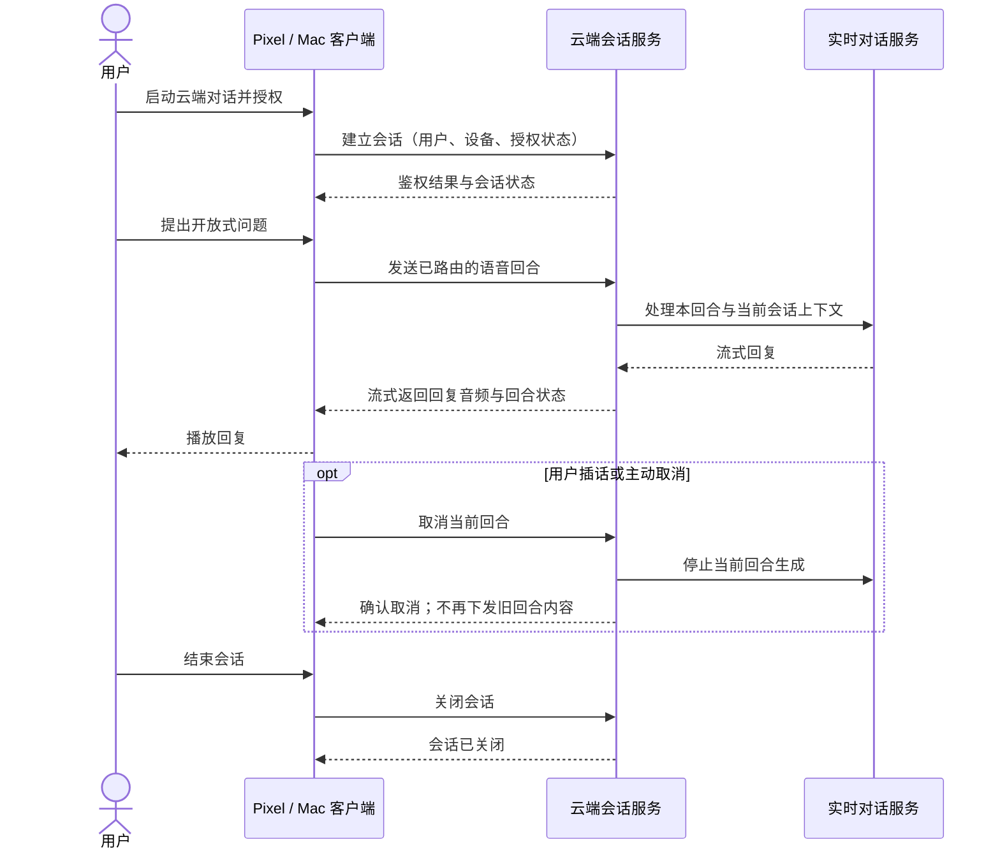

# Pixel 与 Mac 语音陪伴助手云端实时对话服务 MVP PRD

| 属性 | 内容 |
| :--- | :--- |
| **文档编号** | PRD-EDGE-CLOUD-VOICE-SERVER-2026 |
| **版本 / 状态** | v1.0 / Draft for MVP |
| **优先级** | P0 |
| **适用客户端** | Pixel 10 / 10 Pro（Android 16）与 Mac（测试机型、最低 macOS 版本待冻结） |
| **服务范围** | 用户授权后的实时语音对话会话服务 |
| **父级 PRD** | [Pixel 与 Mac 端云协同 PRD](PRD_AI_AUDIO_AGENT_v1.0.md) |
| **负责人** | 待指定 |

## 1. 变更记录

| 版本 | 修改摘要 |
| :--- | :--- |
| v1.0 | 初稿：定义 Pixel 与 Mac 共用的云端实时语音对话 MVP 范围、验收与发布门禁 |

## 2. 背景与目标

### 2.1 用户问题

用户在 Pixel 或 Mac 上发起开放式语音对话时，需要比端侧模型更强的理解与生成能力。云端应提供连续、可打断的实时语音回复，同时让客户端保留意图分流、本地记忆和离线能力。用户须知道哪些语音会被发送到云端；断网或服务异常时，不得静默重放已中断的语音。

### 2.2 MVP 目标

验证 Pixel 与 Mac 客户端能够使用同一云端服务完成经授权的实时语音对话，包括会话鉴权、语音回合处理、回复流式返回、用户打断、异常终止和会话数据清理。

### 2.3 成功指标与护栏指标

| 指标 | MVP 目标 | 测量口径 |
| :--- | :--- | :--- |
| 端到端首个回复音频时延 | P50 ≤ 800ms、P95 ≤ 1150ms；PoC 目标，须在目标网络实测确认 | 客户端记录用户停止说话至首个回复音频开始播放；按 Pixel、Mac 和网络条件分别报告 |
| 服务端首个回复音频时延 | 待基线测量后确定 | 服务端记录收到有效语音回合至首个回复音频可发送；与端到端数据分开统计 |
| 会话建立成功率与服务可用性 | 待基线测量后确定 | 分别统计鉴权通过、服务建立会话、首轮成功完成及服务端故障；不得将客户端网络失败算作服务端成功 |
| 打断与过期回复 | 取消的回合不得继续产生可播放回复 | 客户端插话取消后，服务端不再下发旧回合音频或文本片段 |
| 数据最小化 | 服务日志不含原始音频和完整转写文本 | 检查服务端日志、诊断事件、故障追踪及会话结束后的数据清理 |

服务端时延、可用性、并发容量和错误率目标均须根据部署基线、供应商能力及 PoC 测量确定；未完成基线与隐私评审前，不得宣称达到生产 SLA。

## 3. 范围与职责边界

### 3.1 服务端 MVP 范围

1. 验证客户端身份，并将用户、设备、会话和回合关联起来。
2. 接收客户端对本次会话及云端处理授权状态的声明；未授权时拒绝处理用户语音。
3. 处理客户端明确路由至云端的开放式语音回合，并向该客户端流式返回回复。
4. 支持关闭会话、取消当前回合、服务超时、连接中断及可识别的失败结果。
5. 在服务端侧隔离不同用户、设备、会话和回合的数据；仅保留完成当前会话所需的临时上下文。
6. 提供不包含音频和完整转写文本的服务运行指标，支持故障定位与 MVP 验收。

### 3.2 客户端职责

| Pixel / Mac 客户端负责 | 服务端不代替客户端完成 |
| :--- | :--- |
| 麦克风权限、用户云端处理授权和会话结束操作 | 申请或管理操作系统权限、展示授权界面 |
| 每个语音回合的本地分流 | 判断本地记忆或 Mock 车控意图 |
| 不上传本地记忆、Mock 车控回合及未授权内容 | 读取客户端本地记忆或运行本地功能 |
| 管理音频播放、本地 VAD 打断和网络状态提示 | 操作手机或 Mac 的系统 API、调用实体车辆 |
| 断线后决定是否发起新的云端回合 | 自动重放断线期间的语音或已取消回合 |

用户明确选择并确认发送的单条本地记忆内容，可以作为该次云端回合的临时上下文。服务端不得将其写入长期记忆，或用于其他用户、设备及会话。

### 3.3 本期不做

1. 不负责客户端意图分类、语音唤醒、本地 ASR、端侧快环、本地 TTS 或本地记忆存储。
2. 不实现云端后台长任务、复杂任务编排、跨设备会话同步或长期云端记忆。
3. 不提供端侧反向工具调用（Client Tool / MCP），不调用 Android、macOS、车机或车辆控制接口。
4. 不处理摄像头、屏幕截图及其他多模态输入；本期只支持实时语音对话。
5. 不规定具体模型供应商、云基础设施、编程语言、网络协议或内部数据库设计。
6. 不包含账号注册、登录界面或身份提供方建设；服务身份与凭证验证依赖外部身份方案，方案须在联调前确认。

## 4. 主要流程与状态

### 4.1 云端对话流程



### 4.2 服务端会话状态

| 当前状态 | 触发事件 | 前置条件 | 下一状态 | 服务端行为 |
| :--- | :--- | :--- | :--- | :--- |
| **NEW** | 客户端请求建立会话 | 用户与设备身份有效；云端授权证据有效 | **READY** | 验证凭证与授权，建立隔离的会话上下文 |
| **NEW** | 身份缺失、无效或授权未通过 | 无 | **REJECTED** | 拒绝会话；不接收或处理用户音频 |
| **READY** | 收到云端路由的语音回合 | 会话有效且授权有效 | **PROCESSING** | 关联会话与回合，开始处理当前回合 |
| **PROCESSING** | 首个回复片段可发送 | 会话仍有效、回合未取消 | **STREAMING** | 流式返回回复并关联回合标识 |
| **STREAMING** | 当前回合回复正常完成 | 会话有效且回复未取消 | **READY** | 关闭当前回合；保留会话级临时上下文供后续回合使用 |
| **PROCESSING / STREAMING** | 客户端取消当前回合 | 取消请求匹配活动回合 | **READY** | 停止该回合生成；使后续迟到片段失效 |
| **PROCESSING / STREAMING** | 服务错误或连接中断 | 当前会话仍有效 | **READY** 或 **CLOSED** | 标记当前回合失败并停止生成；连接仍可用时返回明确错误，不自动重放 |
| **READY** | 客户端结束会话 | 会话身份匹配 | **CLOSED** | 停止接收新回合并清理临时会话上下文 |
| **PROCESSING / STREAMING / READY** | 用户撤销授权或会话身份失效 | 撤销事件匹配当前用户与会话 | **CLOSED** | 停止活动回合并清理临时会话上下文 |

## 5. 功能需求与验收准则

### 5.1 身份、会话和授权

1. 每个云端会话必须绑定已验证的用户身份、客户端设备身份和唯一会话上下文；不同用户、设备或会话之间不得共享会话内容。
2. 客户端必须提交当前会话的云端处理授权状态。授权缺失、已撤销或身份凭证失效时，服务端拒绝处理后续语音回合。
3. 每个语音回合必须关联到有效会话和回合标识。过期、重复或不属于当前会话的回合不得覆盖当前会话状态。
4. 账号与身份提供方案是外部依赖。MVP 联调开始前须冻结身份凭证的签发方、验证责任和失效处理规则；未冻结前不得将身份鉴权标记为通过。

### 5.2 实时回合处理

1. 服务端仅处理客户端已分流至云端的开放式语音回合；客户端本地意图、Mock 车控意图及未授权语音不得送入本服务。
2. 对有效语音回合，服务端须按原会话上下文生成回复，并将回复音频及必要回合状态流式返回发起该回合的客户端。
3. 用户明确选择并确认发送的单条本地记忆内容，仅可用于对应回合；处理完成后不得保存为长期记忆。
4. 服务端错误必须返回可区分的失败状态，使客户端能够停止播放并提示用户。失败不得被伪装成成功回复。

### 5.3 打断、取消与过期响应

1. 客户端取消当前回合时，服务端停止该回合后续生成和下发；已取消回合的迟到结果不得继续发送。
2. 新回合开始后，旧回合产生的延迟片段不得插入新回合或恢复播放。
3. 服务端只取消当前实时回复回合；MVP 不存在需要在播报打断后继续运行的后台长任务。
4. 取消请求未能确认时，服务端必须使该回合失效；客户端不得把收到的迟到片段当作当前回复播放。

### 5.4 数据处理与诊断

1. 原始音频及完整转写文本只用于当前授权回合处理，不得写入通用应用日志、分析事件或模型训练数据。
2. 会话上下文仅在当前会话期间保留。会话结束、授权撤销或会话失效后，服务端按经隐私评审确认的数据生命周期清理临时内容。
3. 服务运行事件只记录排障和验收所需的非内容元数据，例如服务版本、网络/处理阶段、耗时、错误类别和匿名化会话/回合关联标识。
4. 数据保留期限、故障追踪系统接收范围及身份标识匿名化规则须在试点发布前通过隐私评审；未确认时不得接入真实用户数据。

### 5.5 MVP 验收场景

```gherkin
Scenario: 未授权的客户端不能提交语音回合
  Given 客户端未取得用户云端处理授权
  When 客户端请求建立云端会话或提交语音回合
  Then 服务端拒绝请求并返回可识别的授权错误
  And 服务端不处理、不保存该语音内容

Scenario: Pixel 与 Mac 使用隔离的云端会话
  Given 同一用户分别从 Pixel 和 Mac 建立有效会话
  When 两台设备分别提交开放式语音回合
  Then 每个回复只返回到发起该回合的设备
  And 两个会话的临时上下文互不混用

Scenario: 有效语音回合返回流式回复
  Given 客户端身份有效、会话授权有效且云端服务可用
  When 客户端提交已路由的开放式语音回合
  Then 服务端关联该回合并返回流式回复
  And 回复只发送到该会话所属客户端

Scenario: 取消回合后不再发送迟到内容
  Given 服务端正在处理或流式返回一个回合
  When 客户端取消该回合或提交打断事件
  Then 服务端停止该回合的后续生成和下发
  And 该回合迟到的音频或文本不覆盖后续回合

Scenario: 连接中断时不自动重放语音
  Given 服务端正在处理一个有效回合
  When 上行或下行连接中断
  Then 服务端终止或标记该回合失败
  And 网络恢复后服务端不自动重放该回合

Scenario: 会话关闭后清除临时上下文
  Given 有效会话中存在临时对话上下文
  When 用户结束会话或撤销云端授权
  Then 服务端关闭会话并停止接受新回合
  And 临时内容按已评审的数据生命周期清理

Scenario: 诊断事件不包含用户内容
  Given 服务端记录一次成功、失败或取消事件
  When 检查服务日志与诊断事件
  Then 日志不包含原始音频、完整转写文本或本地记忆内容
```

## 6. 非功能要求、数据跟踪与发布

### 6.1 性能与容量

- 端到端响应目标沿用整体 PRD 第 2.2 节，须在 Pixel 与 Mac、不同网络条件下分别验收。
- 服务端分段时延、会话建立成功率、可用性、错误率和并发容量在基线阶段测量后确定；不得以端到端目标代替服务端指标。
- MVP 试点规模、并发上限和过载保护行为是发布前置项；未确认容量及错误处理边界前不得开放公开注册。

### 6.2 服务端事件

| 事件 | 触发条件 | 允许记录的属性 |
| :--- | :--- | :--- |
| `cloud_session_started` | 身份验证和会话建立成功 | 客户端平台、服务版本、匿名会话标识、建立耗时 |
| `cloud_session_rejected` | 身份、授权或会话校验失败 | 客户端平台、错误类别、服务版本；不记录凭证或音频 |
| `cloud_turn_completed` | 一个云端回合成功完成 | 匿名会话/回合标识、阶段耗时、结果类别；不记录转写与回复正文 |
| `cloud_turn_cancelled` | 客户端取消当前回合 | 匿名会话/回合标识、取消阶段、取消处理耗时 |
| `cloud_turn_failed` | 上下行中断或服务处理失败 | 匿名会话/回合标识、错误类别、失败阶段、网络状态摘要 |
| `cloud_session_closed` | 用户结束会话、授权撤销或会话失效 | 匿名会话标识、关闭原因、临时数据清理结果 |

### 6.3 发布与回滚门禁

1. **联调门禁**：身份验证、授权、回合关联、流式回复、取消和关闭流程均通过 Pixel 与 Mac 客户端联调。
2. **隐私门禁**：身份方案、数据保留期限、日志字段和故障追踪范围通过隐私评审；确认无音频、全文转写和未授权本地内容进入日志。
3. **可靠性门禁**：覆盖连接建立失败、超时、双向断线、身份凭证失效、会话关闭和服务过载场景；失败后不产生自动重放或过期回复。
4. **性能门禁**：分别报告 Pixel、Mac 与代表性网络条件下的端到端和服务端分段基线；产品确认阈值后再判定通过。
5. **试点门禁**：先进行受控内部试点，再按获批范围逐步开放；用户规模、并发和服务可用性目标在试点前确认。
6. **回滚门禁**：服务端须能停止创建新云端会话；关闭云端能力后，客户端仍可使用本地记忆和 Mock 快环，并展示云端不可用状态。

## 7. 发布前待确认事项

1. 身份提供方、客户端凭证签发与验证责任，以及用户授权状态的服务端验证契约。
2. 云端会话临时内容的保留时限、删除语义、故障追踪系统范围和用户告知文案。
3. Mac 测试机型、最低 macOS 版本及与 Pixel 共用的客户端会话契约。
4. 服务端 TTFA 分段目标、会话成功率、并发容量、可用性和过载保护门槛。

以上事项须在真实用户试点前完成评审与验收标准冻结。

## 8. 红队边界自检

| 风险 | 处理要求 | 验收重点 |
| :--- | :--- | :--- |
| 身份凭证失效或授权撤销 | 立即拒绝新回合，停止当前会话后续数据处理 | 撤销凭证或授权后无新音频进入实时服务 |
| 上下行中断、服务超时 | 终止当前回合并返回明确错误，不做自动回放 | 重连后不出现旧回复或重复处理 |
| 客户端快速插话、重复取消 | 以当前有效回合为准，使旧回合失效 | 旧音频片段不能插入新回复 |
| 多设备会话并行 | 按用户、设备和会话隔离上下文与结果 | Pixel 与 Mac 的回复和临时上下文不串线 |
| 本地记忆意外随请求上传 | 仅处理客户端经用户确认包含的单条内容 | 未确认内容和其它本地记忆不进入服务端请求 |
| 故障日志泄露用户内容 | 日志与诊断事件仅记录非内容元数据 | 检查成功、失败、取消和过载路径的日志 |
| 实时服务或身份依赖不可用 | 明确失败并让客户端保持本地功能可用 | 不把服务端错误伪装为正常回复，不发起隐式降级执行 |
