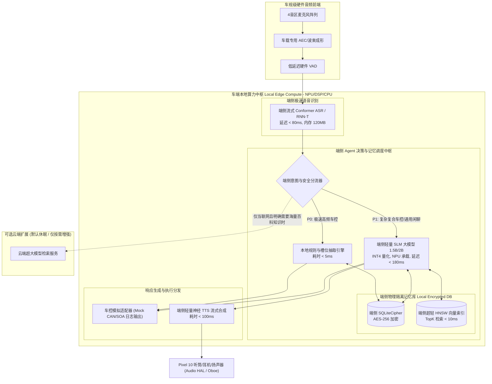
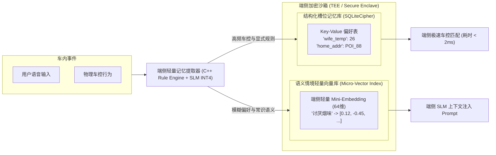

# 端侧算力优先 AI 语音陪伴助手 (Edge-First AI Voice Companion & Agent) 产品需求文档 (PRD)

---

## 1. 文档元数据与版本管理 (Metadata & Changelog)

| 属性 | 内容 |
| :--- | :--- |
| **文档编号** | PRD-EDGE-AUDIO-COMPANION-2026-V1.1 |
| **产品定位** | **端侧算力优先 (Edge-First / Local-Compute-Dominant)** 的全双工 AI 陪伴助手（支持车机/移动端多态适配） |
| **参考硬件平台** | **主力落地设备：Google Pixel 10 / 10 Pro (Tensor G5 SoC, 16GB RAM, Android 16)**<br>兼容环境：车机 8295 / Orin-X (NPU 16~30 TOPS, 专用可用 RAM 1.5~2.2 GB) |
| **运行与验证范式** | **100% 端侧独立闭环**；无物理座舱总线时**降级为“AI 陪伴助手 + Mock 控车日志规范输出 (Simulated CAN/SOA Logging)”** |
| **文档状态** | **Approved RC (已更新 Pixel 10 伴侣形态与 Mock 控车规范)** |
---

## 2. 业务背景、核心价值与指标体系 (Why & ROI)

### 2.1 战略背景与双模运行范式 (Dual-Mode Paradigm)
1. **目标设备基准（Pixel 10 移动伴侣优先）**：
   - 以 **Google Pixel 10 / 10 Pro (Tensor G5 SoC + 16GB RAM + Android 16)** 为核心运行环境，依托 MediaPipe/LiteRT 跑通本地小模型（Gemma-3-4B / Qwen2.5-3B INT4），具备低功耗、全天候兜里陪伴能力。
2. **物理环境解耦：无座舱环境下的“AI 陪伴助手 + Mock 控车日志”**：
   - **陪伴核心**：承载情感共情、倾诉对话、记忆检索、主动关怀与闲聊；
   - **车控解耦**：车窗、空调、座椅等物理控制解耦为**标准结构化日志 (Mock CAN/SOA Log)** 输出，严格验证端侧分流、意图提取与安全拦截，无需依赖实体车辆总线。
3. **端侧本地自闭环核心价值**：
   - **绝对隐私 (Absolute Privacy)**：用户最私密的对话与家庭偏好数据 100% 留存在本地 SQLite 加密沙箱，绝不上云；
   - **无网可用 (100% Offline)**：在弱网、飞行模式、地下停车场均保持毫秒级流畅响应；
   - **确定性时延 (Sub-300ms)**：跳过蜂窝网络 RTT，提供类真人“电话粥”式的即时反馈。

| 指标维度 | 指标项 | 目标值 (Target) | 统计口径与验收条件 |
| :--- | :--- | :--- | :--- |
| **性能 (Performance)** | **本地高频车控端到端时延** | **≤ 280ms** | 说话结束 (VAD Cut) 到 SOA/CAN 指令发出并触发首帧 TTS 发声 |
| **体验 (Experience)** | **全双工打断触发时延 (Barge-in)**| **≤ 120ms** | 用户开始说话到当前播放 TTS 物理被硬件静音 (Mute) |
| **自闭环 (Self-Sufficiency)**| **无网/断网任务执行成功率** | **≥ 99.8%** | 地库、无人区隧道等完全离线状态下，本地功能库执行闭环率 |
| **隐私 (Privacy)** | **高敏记忆与原始音频出车率** | **0.00% (绝对禁止)** | 原始麦克风 PCM 帧及家庭私密记忆严禁上云，仅限车内 SQLite 加密库 |
| **护栏 1 (Safety)** | **行车报警中断率** | **100% 绝对阻断** | 仪表/ADAS 发出 P0 报警时，Agent 强制静音，耗时 ≤ 30ms |
| **护栏 2 (Stability)** | **端侧模型 72h 内存漂移** | **0 KB (零泄漏)** | 连续 72 小时压力测试，端侧常驻内存上限死锁在 2.0GB 以下 |

---

## 3. 端侧算力优先系统架构与流水线 (Architecture & Pipeline)

### 3.1 端侧全闭环核心架构拓扑



### 3.2 4音区本地全状态机 (State Machine)

| 当前状态 | 触发事件 | 校验条件 | 目标状态 | 本地动作与副作用 |
| :--- | :--- | :--- | :--- | :--- |
| **IDLE (待机)** | VAD 能量触发 | 音区独立隔离，信噪比 SNR > 10dB | **LISTENING** | 开启 4 音区环形缓冲，预留 2MB 临时帧内存 |
| **LISTENING** | 命中唤醒词或免唤醒词槽位 | 声纹或方位角判定通过 | **LOCAL_INFERENCE** | 压制 (Duck) 该音区背景媒体，仪表显示动效 |
| **LOCAL_INFERENCE** | 命中端侧安全规则槽位 | 属于空调/车窗/座椅等舒适域 | **FAST_EXEC** | 直接下发本地 SOA，跳过端侧大模型，延时 < 80ms |
| **LOCAL_INFERENCE** | 属于个性化复合意图 | 需组合记忆查询或条件推理 | **SLM_REASONING** | 唤醒端侧 1.5B INT4 模型，挂载本地 Memory 上下文 |
| **SPEAKING** | 说话人本音区打断 (Barge-in) | 语义置信度 > 0.85 且非自身回声 | **ABORTING** | **硬件瞬时静音当前音区 TTS**，清空正在推理的 Token 队列 |
| **ANY_STATE** | ADAS 紧急行车报警 | 底盘/辅助驾驶发出 P0 安全帧 | **EMERGENCY_SILENCE** | **全局强行静音，冻结 Agent 5秒**，优先保障行车生命安全 |

---

## 4. 详细功能规格：端侧自闭环个性化记忆系统 (Edge Memory Engine)

### 4.1 核心设计：为什么端侧记忆必须摒弃云端方案？
在“本地算力优先”原则下，**数据的主权、存储、提炼、检索必须 100% 发生在车端**。不能依赖云端算力跑后处理，也不允许将用户私密习惯上传。

### 4.2 本地双轨记忆引擎规格 (Local Dual-Track Memory Architecture)



### 4.3 端侧双轨数据存储格式与规范

1. **结构化槽位库 (Deterministic Slot DB)**：
   - 介质：车端 SQLiteCipher（基于 OpenSSL AES-256-CBC 单机文件加密）。
   - 存储结构：
     ```sql
     CREATE TABLE local_user_memory (
         profile_id VARCHAR(64) NOT NULL,    -- 绑定车机当前驾驶员/乘员 ID
         memory_key VARCHAR(128) NOT NULL,   -- 如: "seat_heat_preference"
         memory_val TEXT NOT NULL,          -- JSON: {"level": 2, "temp_trigger": 10}
         confidence REAL DEFAULT 1.0,       -- 显式设定=1.0; 习惯统计=0.1~0.99
         trigger_count INT DEFAULT 1,       -- 本地触发/确认次数
         last_updated TIMESTAMP,
         PRIMARY KEY (profile_id, memory_key)
     );
     ```
2. **轻量语义向量库 (Micro-Vector Engine for Edge)**：
   - 架构实现：纯 C++ 单头文件轻量 HNSW 索引（类似 sqlite-vec 裁剪版），**内存占用限制在 32MB 以内**。
   - 维度控制：裁剪至 **64 维或 128 维微向量**，严禁使用 1536 维重型模型。
   - 检索性能：Top-3 近邻余弦检索耗时 **≤ 8ms (CPU 单核即可完成)**。

### 4.4 验收准则 (Acceptance Criteria - Gherkin)

```gherkin
Scenario: 离线状态下端侧独立完成偏好学习与执行
  Given 车辆处于完全无网的长隧道中 (Network: Disconnected)
  And 主驾驶员发出指令："记住，我副驾上的朋友怕冷，以后她坐副驾自动把空调设为25度"
  When 端侧 1.5B 模型在 180ms 内完成实体与意图抽取 [Target: Passenger, Action: AC_25C]
  Then 端侧播报："已在本地为您记录，无网环境下也可生效。"
  And 数据写入车端本地加密 SQLite 表，数据不发生任何公网传输
  And 下一次副驾乘员落座时，本地系统直接从 SQLite 调取该规则并精准执行
```

---

## 5. 红队架构审查与极限 QA 边界自检 (Red-Team Audit)

> **审计视角**：座舱系统首席架构师 (System Architect) + 车规功能安全与 QA 总监 (Safety & QA Director)

### 5.1 算力争抢与 NPU 资源饥饿 (Resource Starvation & Priority Inversion)
* **红队发现 1：泊车/环视与语音 Agent 争抢端侧 NPU 引发语音爆音或卡死**
  - **严重级**：**P0 (致命)**
  - **真实场景**：用户在狭窄车位进行 360 APA 自动泊车，底盘与感知算法正以 30Hz 跑目标检测（占满 80% NPU）。此时驾驶员因紧张大喊：“立刻关掉所有车窗！”，语音助手的端侧 SLM 强行向 NPU 发起大算力推理请求，引发 NPU 显存交换调度抖动，导致车机显示帧率暴跌、车控延迟高达 3 秒甚至漏执行。
  - **架构防线 (Architecture Defense)**：
    1. **硬编码静态路由熔断 (Static Rule Fast-Path)**：
       - 所有安全与舒适域高频车控（开关窗、开闭车门、空调调节）**严禁经过端侧 SLM 大模型**，必须通过 **0 算力依赖的 C++ 正则与静态槽位提取器** 处理，CPU 耗时 < 3ms，物理隔绝 NPU 负载。
    2. **QoS 优先级调度锁定 (NPU Priority Pinning)**：
       - 在底层 NPU 运行时（如 QNN / TensorRT）中，将自动驾驶感知设为 `PRIORITY_HIGH`，语音 SLM 设为 `PRIORITY_LOW`。当整车处于 R 挡或自动泊车激活时，语音助手自动降级为“纯轻量规则模式”，完全卸载 SLM。
  - **QA 验收用例**：
    - 台架运行 APA 自动泊车满载感知用例，同时向语音助手注入连续 50 条复杂指令，验证 APA 帧率不掉帧（≥ 29.5 FPS），车控指令延时严格小于 200ms。

---

### 5.2 闪存寿命与高频写穿 (eMMC Wear-Out & Write Amplification)
* **红队发现 2：端侧本地频繁记录记忆导致车规级 eMMC 闪存提前报废**
  - **严重级**：**P1 (重大硬件损耗)**
  - **真实场景**：在端侧算力优先下，Agent 试图将每一次对话的转折、每一次微小的车速变化都作为短期情境记录到本地 SQLite 中。由于车规级 eMMC 闪存具有写入寿命（P/E Cycles），高频的单条小数据写入引发严重的写放大（Write Amplification），导致车机使用 2 年后车规芯片报废，车主启动黑屏。
  - **架构防线 (Architecture Defense)**：
    1. **内存 WAL 缓存与惰性落盘 (In-Memory WAL with Lazy Flush)**：
       - 所有日常会话状态仅常驻在 Linux/QNX 系统的 `tmpfs` (RAM 内存盘) 中。
       - 只有当用户发出显式指令（“记住这一条”）或统计算法聚类沉淀为高置信度偏好时，才进入落盘待写队列。
    2. **整车熄火批量原子刷盘 (IGN_OFF Atomic Sync)**：
       - 本地记忆写盘操作**仅在检测到车辆下电 (IGN_OFF) 的 5 秒安全延时窗口内统一触发一次批量写入**，全天行车过程中的单次行程落盘次数上限锁死为 ≤ 3 次。
  - **QA 验收用例**：
    - 挂载 I/O 监控工具（`iotop` / `blktrace`），执行持续 24 小时模拟行驶交互，要求语音服务对物理 eMMC 的总写盘量 **严格控制在 ≤ 5MB/天**。

---

### 5.3 极端断电与内存死锁 (Cold Reboot & OOM Cascade)
* **红队发现 3：端侧大模型加载时发生小电瓶断电，引发数据库死锁与重启循环**
  - **严重级**：**P0 (导致系统瘫痪)**
  - **真实场景**：端侧正在向加密 SQLite 写入新学到的偏好，此时车主断开蓄电池负极或低压小电瓶瞬间掉电。重新点火后，SQLite 的 journal/wal 日志损坏，语音启动服务在读取本地记忆时触发 SIGSEGV 崩溃，并被 Android/Linux 的 watchdog 反复拉起、反复崩溃，占满 CPU 导致整车座舱屏幕黑屏。
  - **架构防线 (Architecture Defense)**：
    1. **双备份原子置换 (A/B Double-Buffer Atomic Swap)**：
       - 本地持久化文件采用双槽位设计（`user_memory_A.bin` 与 `user_memory_B.bin`）。
       - 写入时始终写在非激活槽位，写入完成并计算 SHA-256 校验和正确后，才通过原子重命名指针完成切换。
    2. **Watchdog 故障自愈熔断**：
       - 若语音服务在 60 秒内连续 Crash 超过 2 次，自动触发“安全急救模式 (Safe Mode)”：**隔离并归档当前记忆数据库**，以出厂默认空白记忆体启动，优先恢复基础车控与语音导航功能，严禁整车瘫痪。
  - **QA 验收用例**：
    - 在自动化测试台架上，在端侧记忆写入与模型加载的高峰期，通过继电器模拟 500 次随机瞬时掉电（Cut Power），验证重启后语音服务 100% 能够自愈恢复正常工作。

---

### 5.4 语音对抗与多音区声音劫持 (Acoustic Hijacking & Spoofing)
* **红队发现 4：副驾或后排乘客通过刻意声波反射劫持主驾权限**
  - **严重级**：**P1 (控制权越权)**
  - **真实场景**：后排乘客通过将声音对着挡风玻璃反射，诱导麦克风阵列的波束成形 (Beamforming) 算法误判声源为主驾驶位置，从而执行“打开全车车窗”甚至影响整车安全的控制指令。
  - **架构防线 (Architecture Defense)**：
    1. **空间多点交叉校验 (Acoustic Multi-Zone Cross-Validation)**：
       - 不能仅依靠单一麦克风的能量大小。端侧算法必须计算 4 个音区麦克风的时延差 (TDOA) 与相位差。若检测到主驾音区的能量与后排音区能量相差小于 3dB，判定为“反射杂散声波”，强行要求声纹二次核验。
    2. **DMS 视觉唇动多模态辅助 (Lip-Motion Fusion)**：
       - 当车速 > 80km/h 且涉及关键权限车控时，端侧视觉感知与语音进行轻量级时间戳对齐：如果主驾音区有声，但 DMS 摄像头显示驾驶员并未动嘴，直接丢弃该指令并记录安全防劫持日志。

---

## 6. 数据埋点与灰度部署策略 (Telemetry & Rollout)

### 6.1 端侧纯本地埋点脱敏规范
- **原则**：所有上报数据**严禁包含原始文本、严禁包含原始音频**。
- **埋点格式**：仅上报指标计数与延时性能，格式如下：
  ```json
  {
    "event": "edge_inference_perf",
    "timestamp": 1729839120,
    "metrics": {
      "asr_latency_ms": 78,
      "nlp_router_latency_ms": 4,
      "slm_ttft_ms": 142,
      "tts_latency_ms": 95,
      "total_latency_ms": 237,
      "npu_peak_mem_mb": 1820,
      "is_offline": true,
      "memory_hit_type": "local_sqlite_deterministic"
    }
  }
  ```

### 6.2 灰度验证与质量门禁 (Canary Quality Gates)
1. **Alpha 阶段 (实验室与台架测试 - 100% 算力压力验证)**：
   - 在高通 8295 / Orin-X 样件台架上，施加 80% CPU + 70% NPU 背景负载，连续 72 小时发送 50,000 条车控与闲聊指令，**要求零 Crash、零 OOM、端到端 P99 延迟 ≤ 350ms**。
2. **Beta 阶段 (50 台内部工程车实车路测 - 极端声学环境验证)**：
   - 重点在长隧道（无网）、暴雨天气（高胎噪高风噪）、车内 85dB 大音量音乐播放等极端环境下进行打断与车控测试。
3. **SOP 交付门禁**：
   - 必须通过由独立红队工程师签发的《车规端侧算力鲁棒性与功能安全签署报告》。
