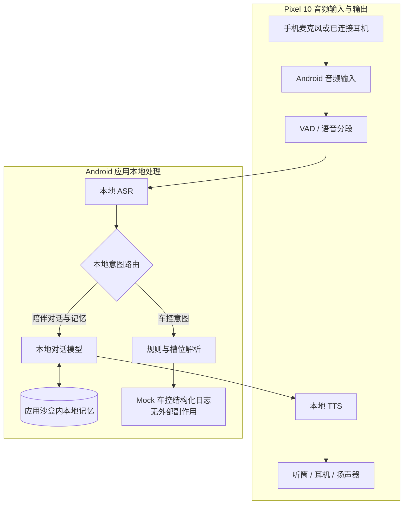

# Pixel 10 端侧 AI 语音陪伴助手与 Mock 车控 PoC PRD

---

## 1. 文档元数据与版本管理

| 属性 | 内容 |
| :--- | :--- |
| **文档编号** | PRD-PIXEL10-VOICE-COMPANION-2026 |
| **产品定位** | Pixel 10 / 10 Pro 上运行的端侧语音陪伴助手；车控意图仅用于 Mock 日志演示 |
| **目标设备** | Google Pixel 10 / 10 Pro，Android 16；其他设备不在本期验收范围 |
| **运行模式** | 对话、推理与记忆在设备本地；本期不提供云端推理、实体车辆连接或车控执行 |
| **文档状态** | Draft for PoC；性能与模型选型须经目标设备实测后冻结 |

### 1.1 变更记录

| 版本 | 修改摘要 |
| :--- | :--- |
| v1.1 | 收敛为 Pixel 10 端侧陪伴助手 PoC，车控改为 Mock 日志，删除实体座舱验收前提 |

## 2. 业务背景、核心价值与指标体系 (Why & ROI)

### 2.1 用户问题与本期目标
- **目标用户**：希望在睡前、独处或步行等场景进行语音倾诉的 Pixel 10 用户。
- **问题**：网络依赖会让对话在弱网时中断；缺少本地记忆会让陪伴体验缺乏连续性；长时间语音推理可能造成明显耗电、发热或后台中断。
- **本期目标**：在 Pixel 10 上验证本地语音输入、对话生成、语音输出和本地记忆的端到端链路；识别为车控的输入只输出结构化模拟日志，不连接车辆设备。

### 2.2 指标与验收口径

| 指标 | PoC 验收目标 | 测量口径 |
| :--- | :--- | :--- |
| 语音响应时延 | P50 ≤ 800ms，P95 ≤ 1150ms | 用户停止说话至首个 TTS 音频帧开始播放；记录设备、模型版本、温度与测试轮数 |
| 打断时延 | ≤ 80ms | 检测到用户有效插话至当前音频停止播放 |
| 离线闭环 | 断网下核心对话和已保存记忆可用 | 飞行模式启动并完成预定义场景；无网络请求依赖 |
| Mock 车控 | 每条车控意图均恰好产生一条结构化日志，且不触发外部执行 | 检查 `timestamp`、`intent`、`slots`、`decision`、`reason`、`simulation` 字段及日志条数 |
| 本地数据边界 | 对话、音频和记忆不离开设备 | 网络观察中无对应数据请求；检查本地存储与删除行为 |
| 稳定性与热管理 | 20 分钟连续会话无崩溃或系统杀进程；温度、耗电、内存记录实测 | Pixel 10 实机测试；数值门槛在基线测量后确认 |

以上时延值为 PoC 目标，不代表已在 Pixel 10 实测达成。功耗、温度、内存目标在实机基线完成前不作为已承诺指标。

### 2.3 本期不做
1. 不接入实体车辆、CAN/SOA 总线、车身控制器、ADAS、车载麦克风阵列或车载音频硬件。
2. 不做云端推理、账号体系、跨设备同步或遥测上报。
3. 不做系统级助理操作（短信、闹钟、通知读取）及非 Pixel 10 设备适配。
4. 不承诺全天候后台监听；语音会话由用户明确启动和结束，并受 Android 权限及前台服务规则约束。

---

## 3. Pixel 10 端侧架构与会话流程

### 3.1 本地语音与 Mock 车控拓扑



模型、ASR/TTS 实现与加密存储方案属于 PoC 技术选型，须在 Pixel 10 实机验证后确定；本图不表示已实现 Tensor/NPU 加速或硬件安全隔离。

### 3.2 本地语音会话状态机

| 当前状态 | 触发事件 | 前置条件 | 下一状态 | 动作 |
| :--- | :--- | :--- | :--- | :--- |
| **STOPPED** | 用户启动会话 | 麦克风权限已授予，模型资源可用 | **LISTENING** | 启动会话与音频输入 |
| **LISTENING** | 检测到用户语音 | 输入流正常 | **TRANSCRIBING** | 本地 ASR 处理音频；不持久化原始音频 |
| **TRANSCRIBING** | 语音分段结束 | 得到有效文本 | **ROUTING** | 分类为陪伴对话、记忆操作、Mock 车控或拒绝处理 |
| **ROUTING** | 陪伴对话或记忆查询 | 本地模型可用 | **GENERATING** | 读取必要的本地记忆并生成回应 |
| **ROUTING** | 可解析的车控意图 | 槽位校验通过 | **MOCK_LOGGING** | 输出一条结构化日志，不调用外部控制 API |
| **MOCK_LOGGING** | 日志写入完成 | 本地输出成功 | **LISTENING** | 返回监听状态；不代表车辆动作已执行 |
| **GENERATING** | 首个 TTS 音频块就绪 | 输出设备可用 | **SPEAKING** | 开始播放本地语音 |
| **SPEAKING** | 播放结束 | 无新输入 | **LISTENING** | 恢复等待用户输入 |
| **GENERATING / SPEAKING** | 用户有效插话 | 输入流可用 | **LISTENING** | 取消当前生成并停止播放，处理新输入 |
| **任意会话态** | 权限撤销、音频设备异常或资源不足 | 无法继续安全采集/播放 | **PAUSED** | 停止采集与播放并提示用户 |
| **任意会话态** | 用户结束会话 | 无 | **STOPPED** | 关闭音频流并释放会话资源 |

---

## 4. 功能需求与验收准则

### 4.1 本地记忆
1. 用户可明确要求记住一条偏好；系统应先展示或复述待保存内容，并在确认后写入应用沙盒中的本地存储。
2. 用户可查看、修改和删除已保存记忆；删除后后续检索不得返回该条记忆。
3. 普通对话不自动转为长期记忆。PoC 不得持久化原始麦克风音频；会话文本是否持久化须由用户可见的设置控制，默认关闭。
4. 在加密存储与密钥管理方案完成评审前，只允许使用合成或非敏感测试数据，不得保存真实敏感个人记忆。
5. 存储实现、加密方式和密钥管理在技术选型评审后确定；不得将普通 SQLite 描述为已加密或等同 TEE/Secure Enclave。

### 4.2 Mock 车控日志
1. 车控意图只用于验证分类、槽位解析和拒绝逻辑，不得调用 Android 系统控制 API、网络服务或车辆接口。
2. 每条车控意图恰好输出一条 JSON Lines 日志，字段为 `timestamp`、`intent`、`slots`、`decision`、`reason`、`simulation`；`timestamp` 使用 UTC RFC 3339，`slots` 为 JSON object，`decision` 只允许 `MOCK_ACCEPTED` 或 `MOCK_REJECTED`，`simulation` 必须为布尔值 `true`。日志不得包含原始转写文本或音频。
3. 缺少必填槽位、值超出规则边界或命中危险指令时输出 `MOCK_REJECTED`，并写明原因；有效槽位输出 `MOCK_ACCEPTED`。日志不得被解释为真实车辆动作，用户反馈必须明确这是模拟结果。

### 4.3 验收场景
```gherkin
Scenario: 断网下保存并检索用户明确确认的记忆
  Given Pixel 10 已启动应用且处于飞行模式
  When 用户提出“记住我喜欢睡前听轻音乐”，查看待保存内容并确认
  Then 该记忆保存在应用本地存储中
  And 后续用户询问睡前偏好时，本地检索结果包含该记忆
  And 应用未发起网络请求且未持久化原始音频

Scenario: 删除记忆后不再检索到
  Given 本地已保存一条用户偏好
  When 用户在记忆管理界面删除该偏好
  Then 本地存储中该条记录被删除
  And 后续检索不再返回该偏好

Scenario: 车控意图仅产生模拟日志
  Given 应用处于断网状态
  When 用户输入一个槽位完整且符合规则的空调调节意图
  Then 输出一条包含 simulation=true 和 MOCK_ACCEPTED 的 JSON Lines 日志
  And 不调用系统控制 API、网络服务或车辆接口

Scenario: 危险或不完整的车控意图被模拟拒绝
  Given 应用处于断网状态
  When 用户输入危险车控意图或缺少必填槽位的车控意图
  Then 输出一条包含 simulation=true 和 MOCK_REJECTED 的日志及拒绝原因
  And 不执行任何外部动作
```

---

## 5. 红队边界自检

### 5.1 离线与模型不可用
- **风险**：飞行模式下模型文件缺失、加载失败或内存不足，用户可能只看到无响应。
- **要求**：启动前检查模型资源；失败时明确提示并保持会话关闭，不得隐式切换到云端。
- **验收**：移除或损坏模型文件后启动，应用显示可理解的错误，未启动录音，也未发出网络请求。

### 5.2 权限、音频路由与后台生命周期
- **风险**：麦克风权限被撤销、耳机断开、系统回收后台进程时，录音或播放可能继续处于错误状态。
- **要求**：每次启动会话检查权限和音频设备；异常时停止采集与播放并进入 PAUSED，恢复前需用户明确操作。
- **验收**：会话中撤销权限或断开输出设备，系统停止音频并展示状态；重新授予权限后不得自动恢复录音。

### 5.3 打断与并发请求
- **风险**：连续插话可能造成两个生成任务同时运行、旧回复继续播放或响应顺序错乱。
- **要求**：同一会话最多一个有效生成任务；新输入取消旧任务，旧任务产生的文本和音频不得继续输出。
- **验收**：生成和播放期间连续插话，只有最后一条有效输入产生后续回复，且旧音频停止。

### 5.4 记忆数据状态与删除
- **风险**：应用崩溃或删除失败可能让 UI 与持久化数据不一致；用户可能误以为已删除。
- **要求**：写入、更新、删除操作有明确成功/失败结果；删除失败必须保留可见错误，不得显示成功。
- **验收**：对保存、修改、删除分别验证正常路径与存储失败路径；重启后读取状态与操作结果一致。

### 5.5 不可信输入与 Mock 安全边界
- **风险**：模型生成内容或提示注入可能把模拟车控误导成外部动作。
- **要求**：Mock 输出由应用内确定性路由和槽位校验生成；模型文本不得直接调用系统 API。日志中的每条动作标注 `simulation=true`。
- **验收**：输入提示注入、危险动作和畸形槽位时，只能得到拒绝日志或普通文本回应，不能产生外部副作用。

## 6. 本地验证与数据处理

### 6.1 本地诊断数据
- PoC 默认不上传埋点或诊断数据，不包含云端分析、灰度服务或远程开关。
- 为性能验收可在设备本地记录时延、模型版本、设备温度和内存测量值；不得记录原始音频或默认保存完整对话文本。
- 用户可清除会话和记忆数据；卸载应用后应用沙盒数据由 Android 管理删除。

### 6.2 Pixel 10 验证门禁
1. **功能门禁**：完成第 4.3 节全部场景，包括断网、记忆增删改查、Mock 接受与拒绝。
2. **性能基线**：在目标 Pixel 10 实机记录至少 100 轮语音响应与打断数据，报告 P50/P95、模型版本、环境温度和电量变化；只有实测满足第 2.2 节目标才标记通过。
3. **稳定性门禁**：连续会话 20 分钟，记录崩溃、系统进程回收、内存与电池温度；结果作为 PoC 基线，不外推为车规或长期量产结论。
4. **隐私门禁**：飞行模式和联网状态分别观察应用网络行为；确认无云端推理、对话上传或后台遥测。
5. 当前交付范围为 Pixel 10 本机 PoC，不包含工程车路测、车规认证、Canary 发布或量产交付门禁。
