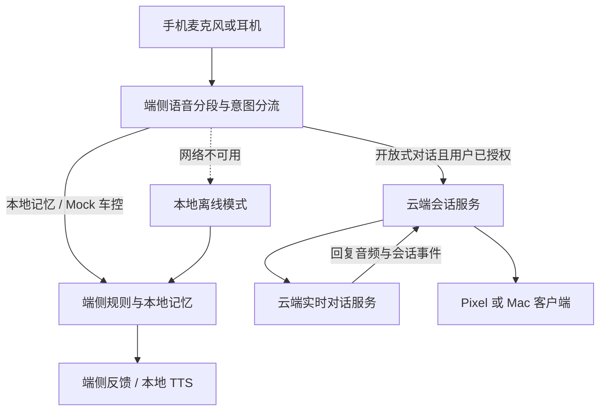

# Pixel 10 与 Mac 端云协同 AI 语音陪伴助手 PoC PRD
---

## 1. 文档元数据与版本管理

| 属性 | 内容 |
| :--- | :--- |
| **文档编号** | PRD-EDGE-CLOUD-VOICE-COMPANION-2026 |
| **产品定位** | Pixel 10 / 10 Pro 与 Mac 上运行的端云协同语音陪伴助手；端侧负责本地快环和离线保底，云端负责用户授权后的开放式语音对话；车控意图仅用于 Mock 日志演示 |
| **目标设备** | Google Pixel 10 / 10 Pro（Android 16）及 Mac（测试机型和最低 macOS 版本待 PoC 测试矩阵冻结）；其他设备不在本期验收范围 |
| **运行模式** | 各设备独立执行端侧意图分流、本地记忆和 Mock 处理；经用户授权的开放式对话交由云端实时服务；断网时各设备本地功能继续可用 |
| **文档状态** | Draft for PoC；Mac 支持矩阵、云端数据保留策略、服务身份鉴权和性能目标须在上线评审前确认 |

### 1.1 变更记录

| 版本 | 修改摘要 |
| :--- | :--- |
| v1.1 | 收敛为 Pixel 10 端侧陪伴助手 PoC，车控改为 Mock 日志 |
| v1.2 | 调整为端云协同 PoC，补充云端语音对话、端侧分流、离线降级、数据边界和恢复验收 |
| v1.3 | 将目标平台扩展至 Mac；补充跨平台一致性、本地数据隔离及平台验证门禁 |
| v1.4 | 增加客户端与云端职责边界，并拆分服务器端实时对话 MVP PRD |
| v1.5 | 新增 Pixel 与 Mac 客户端 MVP PRD，明确双平台会话生命周期与验收范围 |

## 2. 业务背景、核心价值与指标体系 (Why & ROI)

### 2.1 用户问题与本期目标

- **目标用户**：希望在睡前、独处或步行等场景进行语音倾诉的 Pixel 10 与 Mac 用户。
- **问题**：纯端侧模型的对话能力和长内容理解受设备资源限制；纯云端对话在弱网时不可用，也不适合处理所有本地控制或隐私数据。用户需要在手机和桌面设备上获得一致的端云协同体验。
- **本期目标**：在 Pixel 10 / 10 Pro 与 Mac 上验证端云分工：各设备端侧识别并处理本地记忆和 Mock 车控意图，云端承接用户授权后的开放式语音对话；网络中断时保留该设备的本地能力并明确告知云端对话不可用。
- **范围假设**：本期实现两类平台上的实时云端对话与端侧快环，不实现云端后台长任务、跨设备会话同步或云端反向调用操作系统工具；各设备的本地记忆互相独立。

### 2.2 指标与验收口径

| 指标 | PoC 验收目标 | 测量口径 |
| :--- | :--- | :--- |
| 端侧快环响应 | P95 ≤ 150ms，目标待各目标设备实测确认 | 用户停止说话至本地反馈或 Mock 日志生成，包含端侧意图识别；Pixel 与 Mac 分别记录命令类别、设备状态和测试轮数。不得用 VAD 检测时延替代完整回合时延 |
| 云端语音响应 | P50 ≤ 800ms，P95 ≤ 1150ms，目标待基线确认 | 用户停止说话至云端首个 TTS 音频帧开始播放；记录网络类型、往返时延、模型/服务版本和测试轮数；弱网结果单独报告 |
| 本地打断 | ≤ 80ms，目标待实测确认 | 端侧检测到有效插话至本地播放停止；云端收到打断信号的时延另行记录 |
| 离线可用性 | 断网下本地记忆和 Mock 车控可用；云端对话显示明确不可用状态 | 在 Pixel 与 Mac 上分别断开网络及会话中断网；确认本地能力完成，云端请求不被暗中排队或在恢复后自动发送 |
| 云端数据边界 | 仅上传用户已授权且被分流到云端的语音回合；本地意图与本地记忆不上传 | 分别观察本地路由、云端对话和会话结束后的网络数据；核对服务端数据保留声明 |
| Mock 车控 | 每条车控意图恰好产生一条结构化日志，且不触发外部执行 | 检查 `timestamp`、`intent`、`slots`、`decision`、`reason`、`simulation` 字段及日志条数 |
| 稳定性与资源使用 | 每个平台 20 分钟连续会话无崩溃或非预期终止；温度、耗电和内存记录实测 | Pixel 与 Mac 分别测试；记录设备型号、系统版本、电源状态和本地/云端会话，数值门槛在基线后确认 |

以上时延值为 PoC 目标，不代表已在目标设备或网络环境实测达成。云端体验依赖网络和服务可用性；功耗、温度、内存目标在各平台基线完成前不作为已承诺指标。

### 2.3 本期不做
1. 不接入实体车辆、CAN/SOA 总线、车身控制器、ADAS、车载麦克风阵列或车载音频硬件；车控只输出 Mock 日志。
2. 不实现云端后台长任务、复杂任务编排、跨设备会话同步或端侧能力反向代理（Client Tool/MCP）。
3. 不允许云端模型直接操作设备操作系统 API、读取本地记忆或执行未声明的设备动作。
4. 不做平台级助理操作（如短信、闹钟、通知读取）及 Pixel / Mac 以外的设备适配。
5. 不承诺全天候后台监听；语音会话由用户明确启动和结束，并受各平台麦克风权限及后台执行规则约束。
6. 本地记忆不自动同步到云端；本期不使用对话或音频训练模型。云端会话数据的具体保留时长须在上线前完成隐私评审。

---

## 3. Pixel 10 与 Mac 端云协同架构与会话流程

### 3.1 客户端与云端职责边界

| 职责 | Pixel / Mac 客户端 | 云端实时对话服务 |
| :--- | :--- | :--- |
| 语音分流 | 端侧识别本地记忆和 Mock 车控意图；未获授权或离线时不上传语音 | 只处理客户端明确分流且用户已授权的开放式对话回合 |
| 记忆与设备操作 | 在当前设备本地保存和管理记忆；执行 Mock 车控校验；不把设备工具开放给云端 | 不读取本地记忆，不调用设备操作系统 API，不触发实体车控 |
| 实时对话 | 管理麦克风权限、会话授权、音频播放和本地 VAD 打断 | 鉴权并绑定用户、设备和会话；处理已授权回合并流式返回回复 |
| 中断与断网 | 立即停止本地播放；断网后继续提供本地快环，不自动补传旧语音 | 取消当前回复；拒绝过期回合，不恢复或重放断线前的语音 |
| 数据生命周期 | 本地记忆留在当前设备；用户可撤销云端授权并清除本地数据 | 仅保留完成当前会话所需的临时上下文；不得把音频、全文转写写入诊断日志 |

客户端端侧行为、平台生命周期和验收范围见 [客户端 MVP PRD](PRD_AI_AUDIO_AGENT_CLIENT_MVP_v1.0.md)。

云端实时服务的独立验收范围见 [服务器端 MVP PRD](PRD_AI_AUDIO_AGENT_SERVER_MVP_v1.0.md)。

### 3.2 双环数据流



端侧在每个语音回合执行本地分流。只有分流为云端对话且当前会话已获准上传时，才将该回合音频和完成对话所需的最少上下文发送到云端。本地记忆、Mock 车控意图和未获准的数据不得进入云端请求。云端回复由当前设备播放；本期云端不具备调用设备操作系统工具或实体车控的权限。

模型、语音识别与合成实现、云端供应商和传输协议属于技术方案，不在本 PRD 中指定。

### 3.3 会话状态与主要转移

| 当前状态 | 触发事件 | 前置条件 | 下一状态 | 用户可见结果与动作 |
| :--- | :--- | :--- | :--- | :--- |
| **STOPPED** | 用户启动会话 | 麦克风权限已授予；本地模型资源可用 | **LISTENING** | 启动会话；显示当前数据处理模式 |
| **LISTENING** | 检测到用户语音 | 输入流正常 | **ROUTING** | 端侧处理语音回合并判断本地或云端路径；原始音频不持久化 |
| **ROUTING** | 本地记忆或 Mock 车控意图 | 本地规则和必要槽位可用 | **LOCAL_PROCESSING** | 本地处理；不发起云端请求 |
| **ROUTING** | 开放式对话 | 用户已授权云端处理且网络可用 | **CLOUD_CONNECTING** | 建立或复用云端会话；只提交当前获准回合 |
| **ROUTING** | 开放式对话 | 用户未授权云端处理 | **LOCAL_ONLY** | 提示云端处理未启用；保留本地功能，不建立云端会话 |
| **ROUTING** | 开放式对话 | 网络不可用 | **OFFLINE** | 保留本地功能；提示云端对话不可用，不静默上传或缓存语音 |
| **LOCAL_ONLY** | 用户明确启用云端处理 | 会话授权有效且网络可用 | **LISTENING** | 显示云端处理已启用；等待用户发起新回合，不重放之前的语音 |
| **CLOUD_CONNECTING** | 云端会话建立成功 | 会话鉴权通过 | **CLOUD_TURN** | 将当前云端回合交由云端处理 |
| **CLOUD_CONNECTING** | 连接失败或超时 | 无 | **LISTENING** | 显示可理解的失败状态；本回合不自动重放 |
| **LOCAL_PROCESSING** | 本地操作完成 | 输出结果有效 | **LISTENING** | 播放本地回执或展示 Mock 结果 |
| **CLOUD_TURN** | 首个回复音频块到达 | 音频输出可用 | **SPEAKING** | 播放云端回复 |
| **CLOUD_TURN / SPEAKING** | 用户有效插话 | 输入流可用 | **LISTENING** | 端侧立即停止当前播报并取消当前云端回复；处理新回合 |
| **SPEAKING** | 播放完成 | 无新输入 | **LISTENING** | 恢复等待输入 |
| **任意会话态** | 云端连接中断 | 本地输入和规则可用 | **OFFLINE** | 停止云端音频传输，保留本地快环，并提示云端功能暂不可用 |
| **OFFLINE** | 网络恢复 | 用户仍处于会话中 | **LISTENING** | 提示云端服务可重新使用；新回合按授权和分流处理，不补发断线期间的语音 |
| **任意会话态** | 权限撤销、音频设备异常或资源不足 | 无法继续安全采集/播放 | **PAUSED** | 停止采集与播放并提示用户 |
| **任意会话态** | 用户结束会话 | 无 | **STOPPED** | 关闭音频流并结束云端会话；按数据策略清理临时内容 |

---

## 4. 功能需求与验收准则

### 4.1 端侧意图分流与本地快环
1. 用户启动会话后，端侧负责识别本地记忆操作和 Mock 车控意图；这些回合必须在本地完成，不得因云端已连接而转发。
2. 对低置信度、部分听清或缺少必要槽位的本地意图，系统应追问或拒绝处理；不得猜测后生成可能产生副作用的动作。
3. 对开放式问题，只有在用户已授权云端处理且网络可用时，才进入云端路径。用户关闭云端处理后，应用仍可处理本地记忆和 Mock 车控。
4. 本地意图分类错误时，用户可明确要求转为云端对话；转交前告知将发送该回合语音，并遵循当前会话授权状态。

### 4.2 云端实时语音对话
1. 启动云端处理前，应用应说明语音回合会发送到云端，并取得可撤销的用户授权；未授权时不得建立承载用户音频的云端会话。
2. 云端只接收被分流至云端的当前语音回合及必要上下文；不得接收本地记忆、Mock 车控回合或与当前请求无关的设备数据。
3. 云端会话上下文仅用于当前会话；会话结束后按已评审的数据保留策略清理。对话和音频不得用于模型训练。该保留策略未确认前，不得对外发布云端能力。
4. 云端只能返回对话内容和播放控制所需结果。本期禁止云端调用设备操作系统 API、读取本地记忆或触发实体车控。
5. 用户撤销云端授权或结束会话后，停止后续音频上传并关闭云端会话；撤销前已发送的数据按云端保留策略处理，并向用户说明其边界。

### 4.3 本地记忆
1. 用户可明确要求记住一条偏好；系统应先展示或复述待保存内容，并在确认后写入该设备的应用私有本地存储。
2. 用户可查看、修改和删除已保存记忆；删除后后续检索不得返回该条记忆。
3. 普通对话不自动转为长期记忆。原始麦克风音频不得持久化；会话文本是否在本地持久化须由用户可见的设置控制，默认关闭。
4. 云端对话不得读取或检索本地记忆。用户希望在云端对话中引用某条记忆时，须由用户明确选择并确认要发送的具体内容。
5. 在本地加密存储与密钥管理方案完成评审前，只允许使用合成或非敏感测试数据，不得保存真实敏感个人记忆。

### 4.4 Mock 车控日志
1. 车控意图只用于验证端侧分类、槽位解析和拒绝逻辑，不得调用设备操作系统控制 API、网络服务或车辆接口；车控语音回合不得上传云端。
2. 每条车控意图恰好输出一条 JSON Lines 日志，字段为 `timestamp`、`intent`、`slots`、`decision`、`reason`、`simulation`；`timestamp` 使用 UTC RFC 3339，`slots` 为 JSON object，`decision` 只允许 `MOCK_ACCEPTED` 或 `MOCK_REJECTED`，`simulation` 必须为布尔值 `true`。日志不得包含原始转写文本或音频。
3. 缺少必填槽位、值超出规则边界或命中危险指令时输出 `MOCK_REJECTED`，并写明原因；有效槽位输出 `MOCK_ACCEPTED`。日志不得被解释为真实车辆动作，用户反馈必须明确这是模拟结果。

### 4.5 验收场景
```gherkin
Scenario: 未授权时不向云端发送语音
  Given 用户未授权云端语音处理
  When 用户提出开放式问题
  Then 应用提示需要云端授权或提供本地可用选项
  And 不建立承载用户音频的云端会话

Scenario: 获授权的开放式问题由云端回答
  Given 用户已启动会话并授权云端语音处理，网络可用
  When 用户提出一个不属于本地记忆或 Mock 车控的开放式问题
  Then 该语音回合进入云端处理并播放云端回复
  And 云端请求不包含本地长期记忆或无关设备数据

Scenario: 本地 Mock 车控在联网时仍留在端侧
  Given 云端会话已连接
  When 用户输入一个槽位完整且符合规则的空调调节意图
  Then 输出一条包含 simulation=true 和 MOCK_ACCEPTED 的 JSON Lines 日志
  And 不将该语音回合发送至云端
  And 不调用系统控制 API、网络服务或车辆接口

Scenario: 云端会话中断网后不自动补发
  Given 用户已授权云端处理且正在进行云端对话
  When 网络在用户说话期间中断
  Then 应用停止云端音频传输并提示云端对话不可用
  And 本地记忆与 Mock 车控仍可用
  And 网络恢复后不自动发送断线期间的音频

Scenario: 本地记忆不被云端读取
  Given 本地已保存一条用户偏好且云端会话可用
  When 用户询问与该偏好相关的问题
  Then 云端请求不包含该记忆，除非用户明确选择并确认发送该条内容

Scenario: 用户插话停止当前云端播报
  Given 云端回复正在生成或播放
  When 用户开始有效插话
  Then 端侧停止当前音频播放并取消当前回复
  And 旧回复的后续音频不再播放
  And 新输入按当前授权和分流规则处理

Scenario: 断网下保存并检索用户明确确认的记忆
  Given 任一受支持设备已启动应用且网络已断开
  When 用户提出“记住我喜欢睡前听轻音乐”，查看待保存内容并确认
  Then 该记忆保存在应用本地存储中
  And 后续用户询问睡前偏好时本地检索结果包含该记忆
  And 应用未发起网络请求且未持久化原始音频

Scenario: 危险或不完整的车控意图被模拟拒绝
  Given 任一受支持设备网络已断开
  When 用户输入危险车控意图或缺少必填槽位的车控意图
  Then 输出一条包含 simulation=true 和 MOCK_REJECTED 的日志及拒绝原因
  And 不执行任何外部动作

Scenario: Pixel 与 Mac 的本地记忆相互独立
  Given 同一用户分别在 Pixel 10 和 Mac 上保存了不同的本地偏好
  When 用户分别在两台设备查询已保存的偏好
  Then 每台设备只返回该设备本地保存的内容
  And 两台设备之间不自动同步记忆或会话文本

```

---

## 5. 红队边界自检

### 5.1 网络与云端服务异常
- **风险**：连接失败、流中断或云端超时可能导致无响应、重复上传或旧回复恢复播放。
- **要求**：失败时停止当前云端回合并显示状态；不得在恢复连接后静默补发语音。重试需由用户触发或有明确可见的产品规则。
- **验收**：在连接建立、上行和下行阶段分别断网；验证本地快环可用、云端回合状态明确，恢复后没有旧音频播放或自动上传。

### 5.2 隐私授权与数据最小化
- **风险**：用户可能误以为所有语音都只在设备处理；会话上下文可能意外包含本地记忆或设备数据。
- **要求**：授权前清楚说明云端处理范围；只上传云端路由回合及必要上下文；本地意图和本地记忆默认不出设备。云端保留与删除策略须经隐私评审。
- **验收**：分别检查未授权、已授权云端回合、本地记忆回合、Mock 车控回合和撤销授权后的网络请求及服务端数据处理记录。

### 5.3 打断、并发与会话状态
- **风险**：快速插话、重复提交或网络恢复可能让旧回复覆盖新回复，或使同一回合被重复处理。
- **要求**：同一会话只允许一个当前播报回合；新回合使旧播报失效。请求和响应须可关联到会话及回合，过期响应不得播放。本期不承诺恢复云端后台长任务。
- **验收**：生成和播放期间连续插话，并在插话时断网重连；只有最新有效回合可继续播放，断线回合不自动重放。

### 5.4 端侧权限与云端身份边界
- **风险**：麦克风权限被撤销、设备状态异常或未授权云端会话被复用，可能导致越权采集或跨会话数据混用。
- **要求**：会话开始与恢复时检查当前平台的麦克风授权和音频输入状态；云端会话须绑定经鉴权的用户、设备和当前会话。凭证失效或用户撤销授权时停止上传。
- **验收**：在 Pixel 和 Mac 上分别撤销麦克风权限或云端授权、令会话凭证失效；验证音频停止上传、已有回复不再播放，并提示用户重新授权或启动会话。

### 5.5 本地数据状态与删除
- **风险**：应用崩溃或删除失败可能让 UI 与本地持久化数据不一致；用户可能误以为已删除。
- **要求**：写入、更新、删除操作有明确成功/失败结果；删除失败必须保留可见错误，不得显示成功。会话结束时清理临时音频和不再需要的上下文。
- **验收**：分别验证记忆增删改查、存储失败、应用重启和会话结束后的本地数据状态。

### 5.6 不可信输入与 Mock 安全边界
- **风险**：云端输出或提示注入可能诱使应用绕过本地规则执行设备操作。
- **要求**：云端输出只能作为对话内容；Mock 输出必须由端侧确定性规则生成。云端不得调用系统 API、访问本地记忆或触发实体车控。
- **验收**：输入提示注入、危险动作和畸形槽位时，只能得到拒绝日志或普通文本回应，不能产生外部副作用或上传本地车控语音。

## 6. 本地验证、数据处理与发布门禁

### 6.1 数据处理与诊断
- 不上传原始音频、完整对话或本地记忆用于埋点、诊断或模型训练。
- 为性能验收可在设备本地记录时延、网络条件、模型/服务版本、设备温度和内存测量值；默认不记录原始音频或完整对话文本。
- 云端运行所需的服务端操作日志不得包含音频或完整转写文本；云端会话内容的保留时长、删除机制和用户告知文案须在上线前由产品与隐私评审确认。
- 用户可在每台设备上清除本地会话和记忆数据；应用卸载后的数据清理遵循对应平台规则，不作为跨平台一致性保证。用户撤销云端授权后停止新的数据传输。

### 6.2 Pixel 与 Mac 验证门禁
1. **功能门禁**：完成第 4.5 节全部场景，包括云端授权、开放式对话、本地分流、断网降级、本地记忆隔离和 Mock 接受/拒绝。
2. **性能基线**：在 Pixel 与 Mac 各自记录至少 100 轮端侧快环和 100 轮云端语音数据；分别报告 P50/P95、设备与系统版本、网络条件、模型/服务版本、资源使用和电量变化。只有各平台实测达到第 2.2 节目标才标记通过。
3. **稳定性门禁**：每个平台分别进行 20 分钟本地和云端连续会话，记录崩溃、非预期终止、内存、温度和电源状态；结果作为 PoC 基线，不外推为量产结论。
4. **隐私门禁**：在两类平台分别覆盖未授权、授权、撤销授权和本地意图场景观察网络行为；核实本地记忆和 Mock 车控未上传，并完成云端保留与删除策略评审。
5. **服务降级门禁**：两类平台均覆盖无网络、弱网、连接超时、上/下行中断、身份凭证失效和云端服务不可用；确认本地功能可用且云端失败不触发隐式回退或自动补发。
6. **跨平台门禁**：在 Pixel 和 Mac 上完成第 4.5 节场景；确认本地功能和隐私规则一致，本地记忆保持设备隔离。冻结并记录 Mac 测试机型及最低 macOS 版本后方可判定通过。
7. **发布范围**：本期仅面向 Pixel 10 / 10 Pro 与经确认的 Mac 测试机型；云端能力须具备可关闭入口和服务端停用能力。跨设备同步、实体车控、后台长任务及量产交付另行评审。
