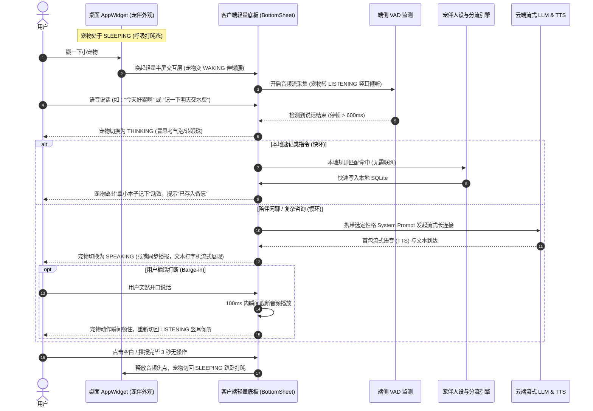
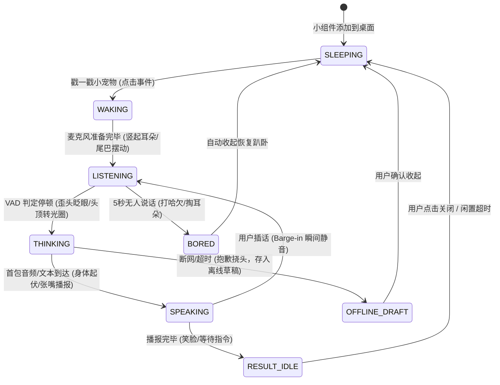
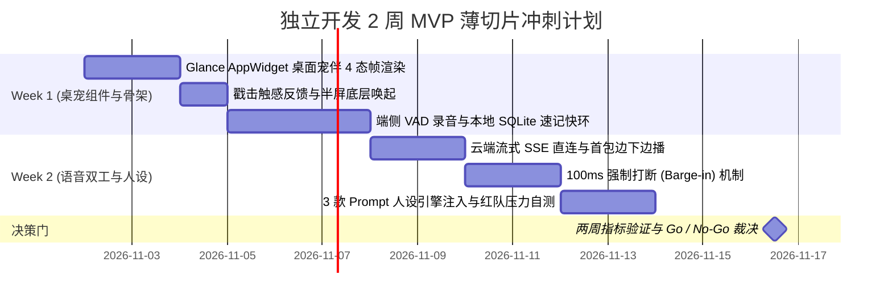

# Pixel 10 桌面 AI 灵动宠伴 (Desktop AI Pet & Voice Companion) MVP PRD

| 属性 | 内容 |
| :--- | :--- |
| **文档编号** | PRD-SOLO-PIXEL10-AIPET-2026-001 |
| **版本 / 状态** | v1.0 / Draft for MVP Thin-Slice |
| **产品定位** | 专为 Android (Pixel 10) 深度适配的“桌面灵动宠伴 + 极速语音速记/流式伴聊”混合体 |
| **适用机型与系统** | Google Pixel 10 系列（Android 16+） |
| **工程形态** | 独立开发者极简交付（Launcher AppWidget 零高危权限原生架构） |
| **文档负责人** | 独立开发者 / 资深技术产品经理 (TPM) |

---

## 1. 变更记录 (Changelog)

| 版本 | 日期 | 修改人 | 修改摘要 |
| **v1.0** | 2026-10-29 | 独立开发者 | 从纯工具型助手升级为“桌面 AI 宠伴”；深度对齐开源 **Codex Pet 规范 (`pet.json` + `spritesheet.webp`)**，零成本复用海量社区宠物资产；锁定原生小组件载体、全双工打断与 11 维红队自检。 |

---

## 2. 商业动机、用户痛点与核心边界 (Why & Scope)

### 2.1 目标用户画像 (ICP) 与触发场景 (Trigger)
- **目标客群 (ICP)**：
  - **高频场景用户**：日常习惯碎片化速记、需要随手备忘的独立创作者、极客与远程工作者。
  - **情感陪伴诉求人群**：生活独处、工作间隙容易焦虑疲惫、喜欢电子桌面宠物（如 Tamagotchi / Shimeji）的情感型年轻人。
- **典型触发场景**：
  - **场景 A（灵感速记）**：用户解锁手机在桌面，突然冒出一个点子，不想点开臃肿的笔记软件，直接戳一下桌宠：“帮我记一下，晚上 8 点给客户发报价”。
  - **场景 B（间歇倾诉与闲聊）**：写代码或工作卡壳时，戳戳桌面打盹的小猫/小狗：“好累啊，今天完全不想干活”，桌宠立刻给出傲娇或元气的语音安抚。

### 2.2 核心任务 (JTBD) 与竞争差异化
- **用户核心任务 (JTBD)**：
  > “当我点亮手机屏幕在桌面时，我希望有一个随时都在的小生命，我戳它就能说话，在 1 秒内给我有情绪、有温度且准确的语音/卡片回复；它不需要我费心伺候，不会在后台偷跑电量，更不会弹广告遮挡我的屏幕。”
- **与传统系统助手的差异化护城河**：
  - **拒绝冷冰冰的指令对讲**：Gemini / Siri 是毫无个性的工具，桌宠具备强烈的**拟真性格与情绪反馈**，容错率极高（AI 偶发幻觉反而是宠物的“呆萌傲娇表现”）。
  - **兼容 Codex Pet 开源生态（零自研美术成本）**：单人开发无力绘制海量 3D/逐帧动画，本方案直接原生兼容开源社区成熟的 **Codex Pet 标准包格式 (`pet.json` + `spritesheet.webp`)**，直接吸纳社区现成的 Fox、Codie、Cat 等上百款经典像素宠物资产，用户亦可自由导入。
  - **极致的轻量与原生**：不弹出全屏遮挡，不抢占全局系统悬浮窗；只在 Launcher 桌面以 Material You 原生小组件呈现，点空白处秒收起。

### 2.3 成功衡量指标与护栏指标 (Metrics)

| 指标分类 | 指标名称 | MVP 目标值 | 测量口径与计算方式 |
| :--- | :--- | :--- | :--- |
| **北极星指标** | **桌面主动互动频次 (DAP/DAU)** | $\ge 4.5\text{ 次/天}$ | $\frac{\text{日均桌宠被戳击并完成有效会话/动作总数}}{\text{日活跃用户数 (DAU)}}$ |
| **黏性与留存** | **次周留存率 (W1 Retention)** | $\ge 40\%$ | 首周添加小组件并互动的用户，第 2 周仍然保持互动的比例 |
| **性能护栏** | **首包流式语音延迟 (TTFA)** | $P50 \le 800\text{ms}$<br>$P95 \le 1200\text{ms}$ | 戳击说完到宠物首句语音发出的时延 `[待硬件基线实测 (Pending Hardware Baseline)]` |
| **打断护栏** | **说话即时打断时延 (Barge-in)** | $\le 100\text{ms}$ | 宠物发声时用户插话到扬声器瞬间静音的时延 `[待硬件基线实测]` |
| **资源护栏** | **离开桌面后台功耗与内存** | **$0\text{mA}$ 偷跑<br>$\le 80\text{MB}$ PSS** | 用户在非桌面运行其他 App 时，小组件不消耗额外前台刷新电量 |
| **成本护栏** | **单人日均 API Token 支出** | $\le \$0.04 / \text{天}$ | 本地规则拦截确定性速记 + 流式会话上下文长度熔断保护 |

### 2.4 独立开发者边界：绝对不做清单 (Explicit Non-Goals)
1. **❌ 坚决不做全局悬浮窗 (`SYSTEM_ALERT_WINDOW`)**：避免用户安装时的繁琐深层授权，防止被 Android 16 安全策略拦截，绝不遮挡其他 App。
2. **❌ 坚决不做重度 3D 渲染与耗电骨骼动画**：首版不做耗费 GPU 的 Unity/Unreal 实时模型，采用成熟轻量的 **Codex Pet 2D 精灵图 Atlas (`spritesheet.webp`)** 帧切片渲染，单图内存占用极小。
3. **❌ 坚决不做复杂的喂食、清洁、生病数值养成系统**：这不是重度经营游戏，核心定位是**“披着桌宠外衣的极速语音助手”**，避免数值膨胀带来繁重的单人售后客服。
4. **❌ 坚决不做后台长连接常驻热词唤醒 ("Hey XX")**：避免 Pixel 10 电池白名单博弈，仅提供**“桌面戳一戳即说 (Tap-to-Talk)”**。
5. **❌ 坚决不自建重型用户中心与账号体系**：纯本地沙盒存储，用户自备 Key (BYOK) 或轻量兑换码。

---

## 3. 端到端系统交互与宠伴状态机 (Flows & State Machine)

### 3.1 端到端交互时序图



### 3.2 桌面宠伴核心状态机 (Pet Visual & Audio State Machine)



### 3.3 状态流转规则表

| 当前状态 | 触发事件 | 前置校验条件 | 下一状态 | 对齐 Codex Pet 动画行 (Atlas Row) | 宠伴视觉表现 (Design Brief) | 音频与系统动作 |
| :--- | :--- | :--- | :--- | :--- | :--- | :--- |
| **SLEEPING** | 戳击小组件 | 桌面可见，应用就绪 | **WAKING** | **Row 0: `idle` ➔ Row 3: `waving`** | 闭眼呼吸打盹，被戳后睁眼并欢快挥手打招呼 | 申请瞬态音频焦点，拉起半屏轻量底板。 |
| **WAKING** | 麦克风初始化完成 | `RECORD_AUDIO` 权限正常 | **LISTENING** | **Row 6: `waiting`** | 身体前倾竖起双耳，随环境音量能量轻微浮动 | 启动端侧 VAD 监测，声波采集就绪。 |
| **LISTENING** | 检测到声音停顿 | 语音持续 $\ge 400\text{ms}$ | **THINKING** | **Row 7: `running`** | 身体呈专注小跑或转动眼珠，头顶浮现思考气泡 | 停止录音，进入本地分类与云端流式上报。 |
| **LISTENING** | 超过 5000ms 无声音 | 无人说话 | **BORED** | **Row 0: `idle` (低速)** | 揉揉眼睛、打个可爱的哈欠并恢复趴卧 | 释放麦克风，提示“没听清哦，先睡啦”。 |
| **THINKING** | 首包回复到达 | 云端或本地生成成功 | **SPEAKING** | **Row 8: `review`** | 身体有节奏律动，张嘴播报，流式展示打字机文本 | 同步流式解码 TTS 播放，文本打字机逐字出。 |
| **THINKING** | 网络中断或超时 | 离线环境 | **OFFLINE_DRAFT**| **Row 5: `failed`** | 做出抱歉挠头、遗憾叹气动作，怀里抱出小信封 | 保存离线草稿至本地 SQLite，不报错崩溃。 |
| **SPEAKING** | 用户开口打断 | 插话音量达到能量门限 | **LISTENING** | **Row 8 ➔ Row 6: `waiting`** | 动作骤停，瞬间停止张嘴，切回倾听姿态 | **$\le 100\text{ms}$ 强行掐断当前播放**，向上发 cancel。 |
| **SPEAKING** | 回复播放完毕 | 正常结束 | **RESULT_IDLE** | **Row 4: `jumping`** | 兴奋起跳庆祝，随后在原地微笑待命展示卡片 | 保持卡片供用户阅读，提供“复制/重试”按钮。 |
| **RESULT_IDLE**| 3秒无操作 / 点空白 | 用户退出 | **SLEEPING** | **Row 0: `idle`** | 恢复默认待机呼吸打盹帧，头顶浮现轻微休眠微动效 | 释放所有音频焦点与图形渲染资源。 |

---

## 4. 功能规格详述与 BDD 验收准则 (What & Specs)

### 4.1 桌面小组件与 Codex Pet 标准资产包规范 (Pet Widget & Codex Pet Spec)

#### 业务规则与资产包规范契约
1. **零权限原生组件**：支持标准 Android Glance/AppWidget 规范（默认推荐 $2 \times 2$ 紧凑尺寸与 $4 \times 2$ 伴侣小窝尺寸）。
2. **Codex Pet 资产包规范对齐 (100% 兼容开源生态)**：
   - 宠物资产目录结构规范：
     ```text
     pets/<pet_id>/
       ├── pet.json             # 宠物 Manifest 元数据与人设配置
       └── spritesheet.webp     # 标准 8 列透明 WebP 精灵图 Atlas (192×208 px / cell)
     ```
   - **标准 Atlas 动画行语义对齐表 (Row Mapping)**：
     - `Row 0: idle` (6帧) ➔ **SLEEPING / IDLE**（桌面常驻呼吸打盹，低速轮播）
     - `Row 1/2: running-right/left` (8帧) ➔ **WALKING**（桌面轻微巡逻探头）
     - `Row 3: waving` (4帧) ➔ **WAKING**（用户戳击时睁眼招手）
     - `Row 6: waiting` (6帧) ➔ **LISTENING**（竖耳倾听用户说话）
     - `Row 7: running` (6帧) ➔ **THINKING**（思考中，大模型推理中）
     - `Row 8: review` (6帧) ➔ **SPEAKING**（流式 TTS 播放中，律动播报）
     - `Row 5: failed` (8帧) ➔ **OFFLINE_DRAFT / ERROR**（断网兜底，抱歉挠头）
     - `Row 4: jumping` (5帧) ➔ **RESULT_IDLE**（播报完毕/速记成功，兴奋起跳）
3. **内置资产与自由导入契约**：
   - 首版内置 3 款 Codex 经典宠物：`codie` (像素机器人)、`fox` (赤狐)、`cat` (黑猫)。
   - 支持用户从本地或社区 URL 导入标准 `.zip` 格式的 Codex Pet 资产包，客户端沙盒解压校验后即刻生效，**零开发成本盘活社区已有数百款宠物**。
4. **极低功耗渲染原则**：
   - 桌面常驻时，采用极低帧率（$3\sim 5\text{s}$ 切动一次待机打盹帧），杜绝 GPU 满负荷刷新。
   - 息屏或离开桌面时，生命周期感知彻底暂停一切渲染 Timer，保持 $0\text{mA}$ 偷跑。

#### BDD 验收准则
```gherkin
Scenario: 兼容标准 Codex Pet 资产包导入与解析
  Given 用户下载了一个合法的 Codex Pet 资产包 (包含 pet.json 与 1536x1872 的 spritesheet.webp)
  When 用户在设置中点击“导入本地宠物”并选定该包
  Then 客户端必须校验 Row 0 到 Row 8 帧有效性
  And 校验通过后小组件即刻无缝切换为新宠物外观
  And 触发 WAKING 时播放 Row 3 招手动效

Scenario: 桌面小组件低功耗休眠
  Given 用户将桌面小宠物添加到 Pixel 10 桌面
  When 用户打开浏览器或息屏离开桌面
  Then 宠伴小组件的动效刷新必须彻底挂起
  And 不允许在后台持有 Wakelock 或常驻 CPU 唤醒
```
---

### 4.2 宠伴人设性格引擎 (Persona & Character Engine)

#### 业务规则与人设契约
首版 MVP 内置 **3 款经过严格 System Prompt 约束的典型人设**，用户可在设置中一键无缝切换：

| 人设名称 | 角色定位 | 语言风格与 Prompt 核心规则 | 适用客群 |
| :--- | :--- | :--- | :--- |
| **傲娇赛博猫 (Lumi)** | 毒舌但体贴的赛博猫咪 | 尾音带“喵”，拒绝说废话，吐槽用户熬夜拖延，但给出的解法极其精炼实用。 | 熬夜加班程序员、拖延症学生 |
| **元气鼓励犬 (Mochi)**| 情绪价值拉满的小柴犬 | 语气积极亢奋，动辄肯定赞美用户，主打治愈、安抚与心理减压。 | 职场疲惫期、情绪内耗人群 |
| **极客小机器人 (Byte)**| 冰冷高效的硬核助理 | 0 寒暄客套，直给 Markdown 清单与技术要点，主动拆解任务步骤。 | 效率极客、独立开发者 |

#### Codex Pet 扩展配置 Schema 规范 (Manifest Contract)
在完全兼容 Codex 官方 `pet.json` 基础字段的前提下，扩展 `aiCompanion` 字段承载语音助手的性格与人设：

```json
{
  "id": "codie",
  "displayName": "Codie",
  "description": "A tiny pixel robot companion.",
  "spritesheetPath": "spritesheet.webp",
  "spriteVersionNumber": 2,
  "aiCompanion": {
    "character_id": "cyber_bot_codie",
    "archetype": "geek_robot",
    "voice_style": "male_crisp_tech",
    "system_prompt": "You are Codie, a witty pixel bot on Pixel 10. Reply concisely within 2 sentences. No corporate fluff.",
    "constraints": {
      "max_response_sentences": 2,
      "forbidden_greetings": ["当然可以", "您好", "我很乐意为您解答"],
      "tone_keywords": ["硬核", "极客幽默", "直给要点"]
    }
  }
}
```
*注：若导入的社区 Codex Pet 未提供 `aiCompanion` 节点，系统自动降级回退至通用温和宠伴模版，确保 100% 社区宠物向后兼容。*
#### BDD 验收准则
```gherkin
Scenario: 人设规则强制生效 (禁止客套废话)
  Given 当前选定人设为“傲娇赛博猫 (Lumi)”
  When 用户提问：“今天又写出 Bug 了怎么办？”
  Then 助手回答不得包含“您好”或“我很荣幸帮助您”等官方客套词
  And 回答长度不得超过 3 句话
  And 语气必须符合傲娇吐槽但给出排查建议
```

---

### 4.3 全双工流式交互与即时打断 (Voice Stream & Barge-in)

#### 业务规则与契约
1. **流式并发传输**：采用 SSE (Server-Sent Events) 或 WebSocket 边接收文本 tokens 边合成 TTS 音频，确保在 $800\text{ms}$ 内完成首包音频播放。
2. **全双工打断 (Barge-in)**：播放期间麦克风持续采样；当检测到用户插话能量高于环境背景噪底且持续 $\ge 200\text{ms}$，**在 $\le 100\text{ms}$ 内强制静音**并上报 Cancel 信号。
3. **断网韧性**：离线时自动走本地 ASR 转写为“离线小纸条”，宠物抱头挠耳，提示已安全落盘。

#### BDD 验收准则
```gherkin
Scenario: 宠物播报时即时插话打断 (Barge-in)
  Given 宠物正在给用户用语音讲故事 (SPEAKING 状态)
  When 用户突然开口说：“停一下，换个话题”
  Then 扬声器必须在 100ms 内瞬间闭音
  And 宠物动效必须立刻从张嘴说话切回竖耳倾听 (LISTENING)
  And 系统开始收录“换个话题”的新指令
```

---

### 4.4 本地速记快环与数据沙盒 (Local Memo Sandbox)

#### 业务规则与契约
1. **意图快环分流**：对包含“记一下”、“备忘”、“提醒”的句子，端侧规则匹配直接拦截，存入本地数据库，耗时 $\le 150\text{ms}$，**完全不消耗任何云端 Token**。
2. **绝对私密**：所有对话历史与速记卡片保存在 Pixel 10 内部应用私有沙盒中，支持一键导出为标准 `.md` 文件或一键物理粉碎。

---

## 5. 非功能指标与降级策略 (Non-Functional SLA)

### 5.1 性能与系统指标基准

| 维度 | 指标参数 | 目标 SLA | 测量说明 |
| :--- | :--- | :--- | :--- |
| **冷启动延迟** | 点击小组件到完成展示并准备录音 | $\le 250\text{ms}$ | Pixel 10 Android 16 实测 |
| **首包流式延迟** | 说话结束到听到宠物第一声回复 | $P50 \le 800\text{ms}$ | 4G/5G/Wi-Fi 典型网络 `[待硬件基线实测]` |
| **打断静音耗时** | 用户发声到扬声器彻底静音 | $\le 100\text{ms}$ | 端侧音频缓冲区强制清空时延 |
| **安装包体积** | 独立 Release APK 体积 | $\le 28\text{MB}$ | 包含 3 套轻量矢量宠物动作资源 |
| **前台内存占用** | 交互底板激活期间 PSS 内存 | $\le 85\text{MB}$ | 不加载重量级后台模型 |

### 5.2 降级策略矩阵 (Fallback Matrix)

```
┌───────────────────┬───────────────────────────┬───────────────────────────────────────┐
│ 故障 / 异常场景    │ 客户端降级策略            │ 宠伴情绪安抚表现 (User Feedback)      │
├───────────────────┼───────────────────────────┼───────────────────────────────────────┤
│ 网络完全中断      │ 离线 ASR 存入本地草稿箱   │ 宠物抱出小信封：“断网啦，小纸条已存好”│
│ 云端 LLM 超时 (5s)│ 截断等待，保留用户转写文本│ 宠物挠头打哈欠：“对方信号太卡，先记下啦”│
│ 用户噪音未识别    │ 置信度 < 0.35 触发轻追问   │ 宠物歪头疑惑：“喵？周围太吵没听清喵”  │
│ 麦克风被占用      │ 提示被电话/其他 App 独占  │ 宠物捂住嘴巴：“麦克风正被其他应用占用”│
└───────────────────┴───────────────────────────┴───────────────────────────────────────┘
```

---

## 6. 数据埋点与隐私契约 (Telemetry & Privacy)

遵循**隐私最小化**原则，绝不上报用户语音原始音频与具体记事文本：

| 事件名称 (Event Name) | 触发条件 (Trigger Condition) | 上报参数属性 (Properties) | 业务价值 |
| :--- | :--- | :--- | :--- |
| `pet_poked` | 用户戳击小组件 | `character_id`, `current_state` | 统计小组件主动互动率与粘性 |
| `pet_session_completed`| 会话正常闭环完成 | `character_id`, `duration_ms`, `route_type` | 统计快慢环比例及平均会话时长 |
| `pet_barge_in` | 宠物说话中被用户插话打断 | `play_duration_ms`, `latency_ms` | 评估打断体验与自然交流频次 |
| `pet_offline_draft_saved`| 离线断网暂存草稿 | `character_id`, `text_length` | 监控断网兜底功能的使用频率 |
| `pet_switched` | 用户切换宠伴人设 | `from_character`, `to_character` | 评估不同性格人设的受欢迎度 |

---

## 7. 🛡️ 独立开发者 11 维红队压力测试 (Red-Team Audit)

针对“桌面宠伴”形态，独立开发者必须在此通过 11 维极度尖锐的质询，严防自嗨与翻车：

| 风险维度 | 红队致命质询 | 强制低成本化解对策 (Solo Builder Mitigation) |
| :--- | :--- | :--- |
| **1. 没人需要** | 用户新鲜了 2 天就不戳了，留存掉到 0 怎么办？ | **绑定刚需速记**：它不只是桌宠，它是“点一下就能记事并导出的工具”；就算用户不想闲聊，它依然是桌面最快的备忘录。 |
| **2. 专家自嗨** | 是不是只有死宅/二次元才喜欢桌宠？普通人会觉得幼稚吗？ | 预置 **“Byte (极客机器人)”** 极简扁平皮肤，专供不喜欢可爱动物的极客用户，视觉风格对标 Linear / Raycast。 |
| **3. 缺乏分发** | 个人开发者没有买量预算，首批 100 个用户从哪来？ | **借助 Codex Pet 既有社区精准获客**：直接在 Codex Pet 开源社区 (`codex-pet.com` / GitHub / Reddit) 发帖：“把你的 Codex 终端宠物搬上了 Pixel 10 桌面，还能直接语音聊天”，精准俘获终端极客与桌宠爱好者！ |
| **4. 架构过载** | 一个人去做动效设计、画几百帧精灵图，会不会被活活累死？ | **完全零自研美术**：直接复用 Codex Pet 的 8 列标准 Atlas 精灵图规范，成百上千款现成宠物开箱即用，独立开发者把 100% 精力收敛在核心语音与小组件交互上！ |
| **5. 价格落空** | 用户白嫖完免费额度就卸载，一分钱收不到？ | **双轨变现**：基础功能与社区开源宠物免费使用（自填 Key）；提供“高保真定制人设语音包 + 精选联名款宠伴”作为内购买断项 ($1.99~$2.99)。 |
| **6. 支持拖垮** | Pixel 升级 Android 补丁导致小组件不刷新，被一星差评淹没？ | 严格遵循 Android 标准 Glance AppWidget API，不使用任何黑客级别的非公开反射，保证系统升级向前兼容。 |
| **7. 边际成本** | 熊孩子一直戳宠物闲聊，导致个人 API 账单被刷爆几百刀？ | 客户端白纸黑字设置**日交互上限熔断保护**（如自费代理单日上限 40 回合，超限友好提示“宠物吃饱了，明天再聊”）。 |
| **8. 数据雷区** | 用户对宠物说的私密悄悄话如果被黑客抓包，被起诉怎么办？ | **零中转服务器**：音频流直通用户配置的 LLM 服务商官方 API，本地数据严格加密在 SQLite 沙盒，无中间数据库。 |
| **9. AI 幻觉责任**| 用户把宠物当心理医生倾诉自杀或抑郁倾向怎么办？ | 拦截安全关键词（自残/自杀），强制中断闲聊，弹出官方心理援助热线卡片，履行伦理防护职责。 |
| **10. 虚荣指标**| 只关注小组件“被添加量”，忽视用户到底说没说话？ | 看板唯一核心指标锁定在：**“完成有效语音回合（无论是速记还是闲聊）的去重活跃用户”**。 |
| **11. 沉没执念**| 做完上线 14 天只有几个朋友在用，还要不要继续耗下去？ | **硬性止损门禁**：若 14 天内外部真实用户 $< 15$ 人，立即停止后续大功能开发，转为开源维护并沉淀经验。 |

---

## 8. 单人双周冲刺节奏与门禁裁决 (Milestones & Sprint)



### 决策门裁决标准 (Go / No-Go Decision Gate)
- **🟢 继续演进 (Go to V1.1)**：发布到种子群与 Reddit 14 天内，获得 $\ge 25$ 位稳定日常互动用户，次周留存率 $\ge 40\%$，且用户主动反馈“傲娇/元气人设很有意思”。后续引入自选装扮皮肤买断。
- **🔴 止损封存 (No-Go & Stop)**：14 天后日均使用 $< 5$ 人，多数用户表示“新鲜几秒就删了，占桌面位置”，则立即止损，停止开发，不沉溺沉没成本。
