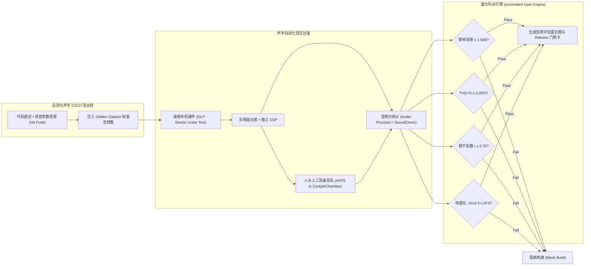

# 智能座舱音效质量量化评估与自动化质量门禁 (Audio Quality Evaluation & Gate) PRD

---

## 1. 文档元数据与版本管理

| 属性 | 内容 |
| :--- | :--- |
| **文档编号** | PRD-COCKPIT-AUDIO-QA-GATE-2026-v1.0 |
| **产品定位** | 面向新一代智能座舱的音频与音效质量端到端评估体系与持续发布质量门禁（Quality Gate）。涵盖客观物理声学测量、国际标准主观双盲听音（ITU-R BS.1534 MUSHRA）、全车动态路噪工况压测与 CI/CD 自动化阻断流水线，彻底终结“音质调优凭玄学”与“OTA 发版音质劣化”问题。 |
| **目标硬件平台** | 车载音频测试台架（Audio Precision / SoundCheck / HATS 人头人工耳）、实车消声室与 7.1.4 / 7.3.4 实车声学系统。 |
| **文档状态** | 基线审定稿 (For Audio Architecture, Acoustic Tuning, Algorithm & System QA Teams)。 |
| **所属模块** | 智能座舱系统 / 音频工程、调音体系与质量保障框架 (Audio Quality Engineering) |

### 1.1 变更记录

| 版本 | 日期 | 修改人 | 修改内容摘要 |
| :--- | :--- | :--- | :--- |
| v1.0 | 2026-11-08 | 资深技术 PM | 初始版本基线创建：确立客观声学六维硬指标、Golden Dataset 固化测试集、ITU-R BS.1534 MUSHRA 主观盲测 SOP、四工况抗噪门禁、自动化流水线阻断规则与红队审查。 |

---

## 2. 业务背景、核心价值与指标体系 (Why & ROI)

### 2.1 业务背景与用户痛点
在车载声学硬件迈向 16~28 扬声器与大功率 DSP 功放的背景下，整车音效的开发、验证与发布面临三大核心失控痛点：
- **评估标准“玄学化”与部门扯皮**：算法工程师声称“数据很平、延迟极低”，调音师抱怨“声音干瘪、缺乏情感”，测试团队无法判断调音版本的好坏，评估流于主观口水战。
- **OTA 发版“音质劣化盲区”**：历次 OTA 迭代中，因底层音频驱动修改、DSP 算力争抢、采样率转换（SRC）错误或应用端音效插件更新，频繁导致用户在论坛集体吐槽“更新后低音被砍”、“声音单薄变尖”，严重伤害座舱品牌声誉。
- **缺乏多工况环境鲁棒性检验**：绝大多数调音仅在静止熄火状态下完成，车辆在高速（120km/h）行驶时，轮胎噪音与风噪掩蔽低频，导致音乐声音单薄刺耳，甚至导航播报被噪音淹没。

### 2.2 核心价值与商业 ROI
1. **建立整车声学资产数字基线**：用可量化、可追溯的物理数据与盲测分值固化调音标准，形成主机厂专属音质数字护城河。
2. **实现音质持续集成与防劣化拦截 (Zero Audio Regression)**：将客观指标集成至自动化测试台架，固化 OTA 质量门禁，任何频响偏离或相位抵消超标版本在代码构建期即被自动 Block。
3. **消除评测主观疲劳偏见**：引入国际标准 MUSHRA 双盲对照法，配置隐蔽基准源与低锚点陷阱，剔除无效打分。

### 2.3 核心指标与质量红线门禁 (Quality Gates)

| 指标维度 | 评测指标 | 门禁通过阈值 (Pass Baseline) | 测量工具 / 口径 |
| :--- | :--- | :--- | :--- |
| **客观频响 (FR)** | 目标曲线跟踪误差 ($\Delta \text{FR}$) | $\text{RMSE} \le 1.5\text{dB}$<br>局部最大偏离 $\le 3.0\text{dB}$ | 7.1.4 消声室环境，使用 Audio Precision (AP) 扫频仪在主/副驾耳位测定 |
| **失真与杂音** | 全频段总谐波失真加噪声 (THD+N) | $\le 0.05\%$ ($100\text{Hz}\sim 10\text{kHz}$)<br>$\le 0.5\%$ ($20\sim 100\text{Hz}$) | $85\text{dBA}$ 标准听音音量输出下测量 |
| **相位相干度** | 左右声道相干系数 ($r$) | $r \in [0.75, 1.0]$ | 空间声/Upmix 场景下全频段计算，严禁 $r < 0$ 出现反相梳状滤波 |
| **动态一致性** | 跨音源集成响度 (Integrated Loudness) | $-24\text{ LUFS} \pm 0.5\text{ LU}$ | 遵循 ITU-R BS.1770-4，采集测试集曲目积分响度计算 |
| **算法延迟** | 整体音效后处理群延迟 (Latency) | $\le 12\text{ms}$ | 脉冲响应 (Impulse Response) 测算信号从输入到物理 DAC 输出差 |
| **主观听感 (MUSHRA)** | 声学金耳朵专家主观综合得分 | $\ge 85.0\text{ 分}$ (100分满分制) | 5 位金耳朵在 ITU-R BS.1534 双盲实验中打分均值 |
| **车规共振 (B&R)** | 车门饰板杂音与共振 (Buzz & Rattle) | **严格 0 处闻及** | $20\sim 200\text{Hz}$ 正弦连续慢扫频（Sweep-sine），音量设至 90% |

### 2.4 本期明确不做事项 (Non-Goals)
1. **不做脱离硬件环境的纯 PC 仿真替代实车测试**：音效最终验收必须以实车座舱或车规级硬件台架测量数据为准，禁止以脱离座舱声场反射特性的 PC 端耳机离线仿真结果作为通过凭证。
2. **不做未经去噪清洗的普通问卷作为放行依据**：普通用户群的随意主观投票仅作为体验满意度参考，不能作为阻断或放行底层 DSP 调音包的工程门禁依据。

---

## 3. 标准音质基准测试集 (Golden Dataset Specification)

评测严禁使用随机网络歌曲，必须采用**座舱声学固化评测曲库（5 大类别，共 20 首无损母带级音频，96kHz/24bit FLAC）**：

| 曲目类别 | 典型测试代表曲目 | 评测考察的核心声学与算法特征 |
| :--- | :--- | :--- |
| **人声中置与纯净度** | 蔡琴《渡口》、Adele《Hello》 | 前中置人声凝聚力、主唱高度感、有无齿音破裂、中频厚度 |
| **三维空间与天空感** | 柴可夫斯基《1812序曲》、电影《沙丘》飞行器音效 | 天空声道高度定位、7.1.4 环绕包围感、纵深感、声场宽度 |
| **低频质感与大动态** | 《加州旅馆》现场版、闫学敏《鼓诗》 | 超低音下潜（Sub-bass）、低音炮与门板瞬态冲击力、无箱体共振破音 |
| **复杂声部与分离度** | 贝多芬《第九交响曲》、Queen《Bohemian Rhapsody》 | 大声压下多乐器声部层次分离度、大动态交响乐有无浑浊失真 |
| **极端边界（相位相干）** | 人工合成反相双耳粉红噪音、单声道白噪音、扫频波 | 相位抵消检测、Mono 信号在空间上混下是否会产生空洞移相与音色变异 |

---

## 4. 自动化客观评测流水线架构与拓扑 (Automated Objective Pipeline)



---

## 5. 主观双盲实验业务规程 (Subjective MUSHRA SOP)

遵循 **ITU-R BS.1534 (MUSHRA)** 与 **ITU-R BS.1284** 标准流程：

1. **测试环境标准化**：
   - 静态车内测试必须在**全消音室或半消音室（底噪 $\le 20\text{dBA}$）**中进行，车窗、天窗完全闭合，空调系统关闭。
   - 评测人员座椅调节至标准驾驶姿态，头枕贴合耳部基准线。
2. **实验盲测设计 (Double-Blind Protocol)**：
   - **隐藏参考源 A (Hidden Reference)**：未经任何二次算法处理的高保真无损母带。
   - **测试源 B (Algorithm Candidate)**：本次待评测的新版 DSP 调音包或算法。
   - **对照源 C (Baseline)**：当前量产版本现存基线音效。
   - **隐蔽低锚点 D (Low Anchor)**：人为经过 $3.5\text{kHz}$ 低通滤波损伤的劣质音源。
3. **打分与置信度过滤机制**：
   - 评委针对五大维度（音色均衡度、空间环绕感、人声聚焦度、低频弹性、算法伪影）分别给出 0~100 分。
   - **数据剔除规则**：如果某评委对“隐蔽低锚点 D”的打分超过 40 分（未能识别出明显残次品），系统自动判定该评委本次打分数据无效，予以全量剔除。

---

## 6. 四工况车载动态抗噪测试矩阵 (Dynamic Environmental Matrix)

| 工况序号 | 测试工况场景 | 环境背景噪音声压级 | 考核声学与算法重点指标 |
| :---: | :--- | :--- | :--- |
| **工况 1** | 全消音室静态驻车 | $\le 20\text{dBA}$ | 基础频响平直度、底噪本底（$\text{SNR} \ge 105\text{dB}$）、纯净度与空间定位 |
| **工况 2** | 实车静止怠速（空调开 2 档） | $38\sim 42\text{dBA}$ | 空调中频风噪掩蔽下的细节可听度、低电平信号动态展现 |
| **工况 3** | 城市综合路面 ($60\text{km/h}$ 柏油路) | $55\sim 58\text{dBA}$ | 车速补偿 EQ（Speed-Compensated EQ）低频线性补偿增益、人声可懂度 |
| **工况 4** | 高速巡航工况 ($120\text{km/h}$ 粗糙沥青) | $65\sim 68\text{dBA}$ (低频为主) | 强路噪下语音传输指数 $\text{STI} \ge 0.70$，功放不出现大动态削波失真 |

---

## 7. 验收标准与 BDD 测试场景 (Acceptance Criteria)

### 场景 1：调音参数变更触发自动化客观频响校验
```gherkin
Given 调音工程师向代码仓库提交了新的 DSP 均衡器 (EQ) 滤波参数包
When 声学自动化流水线 (Audio CI) 在硬件台架上回放 20Hz~20kHz 对数扫频信号
Then 分析仪采集的前中置与左右声道频响曲线与目标曲线误差 (RMSE) 必须 ≤ 1.5dB
And 任何单一 1/3 倍频程频点的增益偏差不得超过 3.0dB
And 流水线自动生成对比折线图并输出客观检测通过证明
```

### 场景 2：算法迭代引入相位反转失真时的自动阻断
```gherkin
Given 空间音频或 Upmix 算法更新了人声分离模型
When 系统输入包含单声道及反相信号的标准评测音源
Then 相位相干性分析模块测得的平均相干系数 r 必须稳定保持在 [0.75, 1.0] 范围内
When 算法导致主驾收听位置的 r 下降至 0.2 以下（触发临界相位抵消）
Then 评测引擎必须立即报错中断，记录失真频段日志
And 自动在 GitLab/Jira 标记当前构建版本为 BLOCK，禁止进入整车 OTA 候选池
```

### 场景 3：主观双盲盲测中的异常评委数据清洗
```gherkin
Given 组织 20 名评测人员进行 MUSHRA 双盲听音测试
When 评测软件分析某位评测人员在 5 首曲目中对“隐蔽低锚点 (Low Anchor)”的打分均值达到 55 分（高于 40 分阈值）
Then 评测系统判定该评委具备听觉疲劳或不具备鉴别能力
And 自动将该评委的所有打分样本标记为 INVALID 并从总体统计中剔除
And 重新计算剩余合格评委的平均分及 95% 置信区间
```

---

## 8. 🛡️ 架构与 QA 红队边界压力自检报告 (Red-Team Audit)

| 潜在致命缺陷 / 风险 | 严重度 | 架构防护机制与拦截策略 |
| :--- | :---: | :--- |
| **金耳朵评委“主观疲劳”导致评分漂移**<br>连续试听超过 40 分钟后，人耳产生听觉疲劳，对高频敏感度下降，导致后面测试的曲目评分失真。 | **HIGH** | **强制休息与曲序随机重排机制**：<br>评测软件强制单次盲测不超过 25 分钟；不同评委听取 20 首 Golden 曲目的顺序由算法完全随机打乱（Latin Square 设计），消除顺序疲劳偏差。 |
| **硬件老化导致的测试台架失准**<br>测试台架上的功放或麦克风在使用半年后发生老化漂移，导致误报算法变差。 | **HIGH** | **每日基准回校（Daily Golden Loopback）**：<br>每日正式跑批前，流水线必须先跑一段标准的纯正弦基准校准文件（1kHz 0dBFS），若采集端偏差超出 $\pm 0.1\text{dB}$，自动挂起测试流水线并报警通知声学管理员校准麦克风。 |
| **静态测试全过，动态行车路噪下惨不忍睹**<br>音效在消声室打分 95 分，但实车开上高速路面（120km/h）后，由于未做低频路噪掩蔽补偿，低音完全被路噪吞没，人声极度单薄。 | **CRITICAL** | **四工况强制定量门禁**：<br>音效定型验收必须覆盖四工况矩阵：① 静态消声室、② 怠速静止、③ 60km/h 粗糙沥青、④ 120km/h 高速工况。在 120km/h 下，系统语音传输指数（STI）必须维持在 $\ge 0.70$，音乐人声可懂度与可听度不下降。 |

---

## 9. 跨部门协作与 OTA 发布门禁流程 (Release Gate SOP)

```
[调音/算法团队] 提交 DSP 固件或参数包
       │
       ▼
[Audio CI/CD 流水线] 触发 AP 自动化客观测试 (FR / THD+N / 相位 / 延迟)
       │
  ┌────┴────┐
  │         │
[Fail]    [Pass]
  │         │
  ▼         ▼
阻断构建   进入金耳朵团队 MUSHRA 双盲评测 (得分需 ≥ 85.0 分)
            │
       ┌────┴────┐
       │         │
     [Fail]    [Pass]
       │         │
       ▼         ▼
     返工      进入实车动态四工况抗噪路试 (STI ≥ 0.70, B&R 0 杂音)
                 │
            ┌────┴────┐
            │         │
          [Fail]    [Pass]
            │         │
            ▼         ▼
          返工      【正式签发 OTA Release 准入许可】
```
