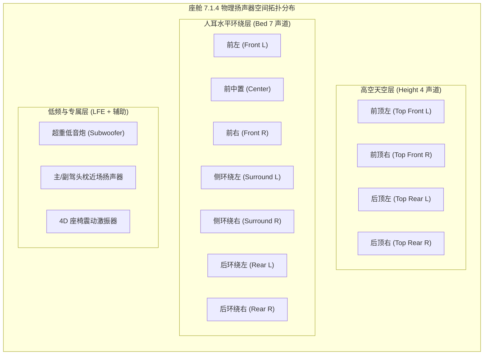
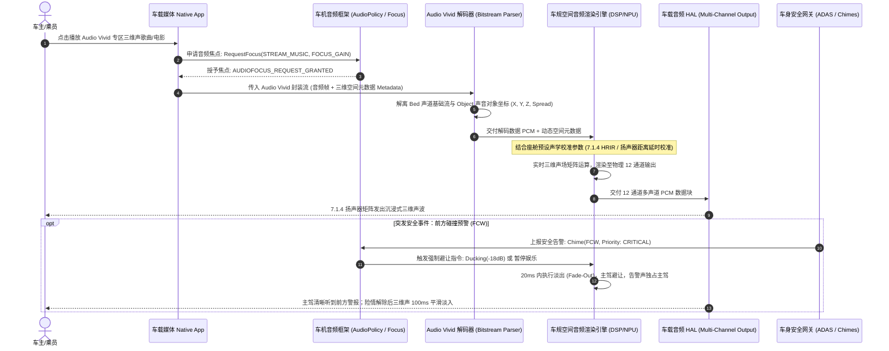
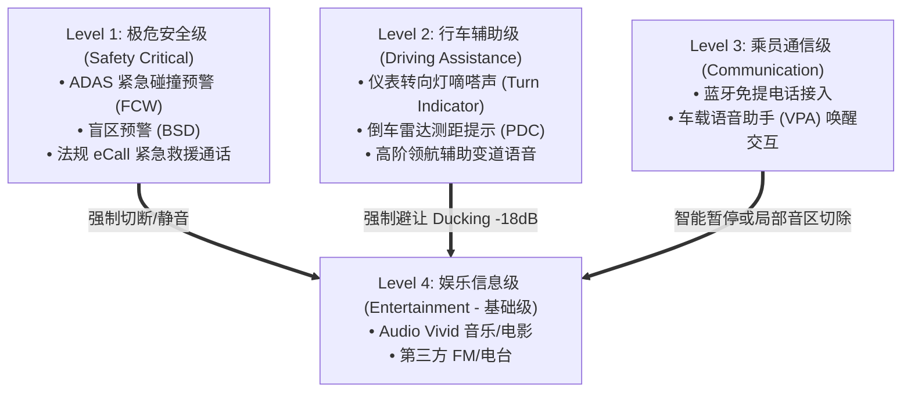

# 智能座舱 Audio Vivid 三维空间音频系统 (3D Spatial Audio System) PRD

---

## 1. 文档元数据与版本管理

| 属性 | 内容 |
| :--- | :--- |
| **文档编号** | PRD-COCKPIT-AUDIO-VIVID-2026-v1.0 |
| **产品定位** | 面向新一代智能座舱的 Audio Vivid（三维菁彩声）原生空间音频系统。基于声音对象（Sound Object）与床子通道（Bed Channel）元数据，驱动座舱 7.1.4 / 7.3.4 车规级物理扬声器矩阵，实现沉浸式三维声学渲染、全座位声场聚焦、行车安全音频强占与弱网无感平滑降级。 |
| **目标硬件平台** | 智能座舱单/双芯片域控制器（SoC + 独立音频 DSP / 神经渲染算力核心），车内搭载 16~28+ 物理发声单元（含前中置、水平环绕、顶棚天空声道、低音炮及座椅激振器）。 |
| **文档状态** | 基线审定稿 (Ready for Audio Architecture, Acoustic Tuning & QA Review)；性能常数须在硬件台架与实车环境中实测冻结。 |
| **所属模块** | 智能座舱系统 / 车载媒体框架 (Media Framework) & 音频底层服务 (Audio HAL) |

### 1.1 变更记录

| 版本 | 日期 | 修改人 | 修改内容摘要 |
| :--- | :--- | :--- | :--- |
| v1.0 | 2026-11-08 | 资深技术 PM | 初始版本基线创建：明确 7.1.4 物理拓扑、Audio Vivid 元数据解析流、Audio Focus 四级安全仲裁、弱网平滑降级与重升状态机、BDD 验收用例与架构/QA 红队自检报告。 |

---

## 2. 业务背景、核心价值与指标体系 (Why & ROI)

### 2.1 业务背景与用户痛点
在新能源智能汽车高端化与“第三生活空间”演进的背景下，主流高端车型普遍标配 16~28 个扬声器（含顶棚高空天空声道）。然而，当前座舱声学系统普遍面临以下核心矛盾：
- **三维空间感与轨迹定位缺失**：传统 2.0 立体声在车内仅通过简单分频与声道复制输出，声音全部堆叠在乘员水平胸前，无法还原交响乐演奏现场纵深、大片中直升机自头顶掠过的精准高度（Height）轨迹与声场包裹感。
- **长途行驶听觉疲劳与高频失真**：传统立体声在高速行车遭遇路噪、风噪干扰时，用户只能调高整车音量，导致高频刺耳、交谈受阻；缺乏基于声学对象的三维空间定位，人耳极易疲劳。
- **音区冲突与行车安全掩蔽风险**：座舱是非对称声学空间。副驾播放沉浸式影片时，多声道扩散极易干扰主驾注意力；更致命的是，若三维空间音效在播放时未与车身安全总线联动，突发碰撞预警（FCW）或倒车蜂鸣可能被宏大的声场掩盖，带来行车安全灾难。

### 2.2 核心价值与商业 ROI
1. **打造豪华座舱声学护城河**：兑现车辆高阶物理音响硬件价值，结合中国自主三维声技术标准（Audio Vivid），打造软硬件一体化移动音乐厅标杆。
2. **基于对象（Object-based）的高保真还原**：彻底解耦声道与物理发声单元，利用座舱声学校准矩阵，赋能车内不同座椅乘员（主驾/副驾/后排）均能获得“皇帝位（Sweet Spot）”声场体验。
3. **软硬解耦与协议标准化**：建立车端 Audio Vivid 标准渲染管线与车载媒体 App 的接入协议，实现主流音乐/视频内容平台无缝复用。

### 2.3 成功衡量指标与护栏指标 (Metrics)

| 指标类别 | 指标名称 | 目标值 (V1.0) | 测量口径与计算公式 |
| :--- | :--- | :--- | :--- |
| **核心体验 (North Star)** | Audio Vivid 内容日均有效播放时长 | $\ge 25\text{ 分钟/车}$ | 单车每日处于 Audio Vivid 模式下的有效音频播放时长（排除静音与暂停） |
| **核心体验 (North Star)** | 空间音频内容渗透率 | $\ge 65\%$ | $\frac{\text{周播放过 Audio Vivid 内容的活跃车辆数}}{\text{周媒体活跃总车辆数}} \times 100\%$ |
| **音质与延迟 (Experience)** | 音画同步端到端误差 ($\Delta t$) | $|\Delta t| \le 25\text{ms}$ | 驻车影院场景下，视频帧渲染时间戳 (PTS) 与扬声器声波出唇时间戳对齐差 `[待硬件基线实测 (Pending Hardware Baseline)]` |
| **体验护栏 (Guardrail)** | 弱网降级瞬态静音/爆音率 | **严格 0 次** | 弱网导致 Audio Vivid 与立体声双向平滑交叉渐变 (Crossfade) 期间，POP 音与静音发生次数 |
| **安全护栏 (Guardrail)** | ADAS/紧急告警抢占时延 | $\le 10\text{ms}$ | 从车身 CAN/以太网收到碰撞预警信号到空间音频完成闪避（Ducking）或切断的时延 |
| **系统护栏 (Guardrail)** | DSP 占用增量与系统温升 | DSP 算力 $\le 30\%$<br>温度升高 $\le 3.5^\circ\text{C}$ | 持续播放 2 小时 96kHz/24bit Audio Vivid 时，独立音频 DSP 负载上限与域控热应力范围 `[待硬件基线实测 (Pending Hardware Baseline)]` |

### 2.4 本期明确不做事项 (Non-Goals)
1. **不做经典蓝牙（Bluetooth A2DP）透传 Audio Vivid 元数据**：经典蓝牙受 SBC/AAC 编码带宽限制，外接手机蓝牙播放时仅支持标准立体声输入，不解析三维声元数据（仅支持车机内置 Native App 或 USB 无损直读）。
2. **不做行驶过程中的全屏 4D 电影强联动**：非 P 档（行车状态）下，禁止开启座椅高强度物理激振与安全带预紧联动，仅保留纯声学三维渲染。
3. **不做未经认证的第三方 APK 任意三维声通道注入**：V1.0 仅向车机预装的头部白名单媒体应用（网易云车载版、腾讯视频车载版等）开放 Audio Vivid 空间渲染管线。
4. **不修改底层安全气囊与动力域仲裁逻辑**：空间音频系统仅作为车身告警总线的从属消费者，无权干涉或延迟任何整车安全控制信号。

---

## 3. 声学拓扑、系统架构与状态机 (Topology, Architecture & States)

### 3.1 座舱 7.1.4 物理扬声器空间拓扑



### 3.2 媒体解码与空间渲染数据流 (Sequence Diagram)



### 3.3 Audio Vivid 播放状态机 (State Transition Table)

| 当前状态 | 触发事件 | 校验条件 | 目标状态 | 业务行为与声学表现 |
| :--- | :--- | :--- | :--- | :--- |
| **IDLE (闲置态)** | 用户发起播放 | 音频流包含有效的 Vivid 元数据同步字头 | **INITIALIZING** | 初始化 DSP 渲染管线，分配 7.1.4 环绕声缓冲区 |
| **INITIALIZING** | 握手与缓冲完成 | 初始缓存 $\ge 800\text{ms}$ 且 DSP 算力就绪 | **PLAYING_VIVID** | 启动 7.1.4 三维全景渲染，UI 点亮“Audio Vivid 菁彩声”专有标识 |
| **PLAYING_VIVID** | 蜂窝网络劣化 | 缓冲区余量 $< 300\text{ms}$ 且重试失败 | **PLAYING_STEREO (平滑降级)** | 在 $300\text{ms}$ 内执行 Crossfade，下混为立体声流，UI 切换为普通音质标签，**严禁爆音/停顿** |
| **PLAYING_STEREO** | 网络恢复优质 | 网络 RTT $< 80\text{ms}$ 且持续 $5\text{s}$ 以上 | **PLAYING_VIVID (无缝重升)** | 重新拉取 Vivid 流与元数据，在下一小节起止点 $500\text{ms}$ 淡入恢复三维声场 |
| **PLAYING_VIVID** | 收到普通导航语音播报 | 焦点仲裁策略为 `DUCK_OTHERS` | **DUCKING_VIVID** | 全车三维声整体音量线性衰减 $-12\text{dB}$，声像中心后移，主驾近场扬声器播报导航 |
| **DUCKING_VIVID** | 导航播报结束 | 收到 `AUDIOFOCUS_GAIN` 恢复信号 | **PLAYING_VIVID** | 经 $200\text{ms}$ 曲线平滑恢复原始音量与声场定位 |
| **PLAYING_VIVID** | 收到 ADAS 碰撞预警/eCall | 触发最高安全优先等级 | **MUTED_SAFETY** | 瞬间硬静音或切断媒体流，扬声器全力输出告警或呼叫通道音频 |

---

## 4. 功能规格与业务规则 (Functional Specs & Business Rules)

### 4.1 音源格式识别与标识展示契约
- **规则 4.1.1（自动识别与元数据解析）**：系统媒体服务在音频流 Demux 阶段必须实时嗅探 Audio Vivid 元数据载荷。
- **规则 4.1.2（UI 徽标显示契约）**：
  - 成功命中 Audio Vivid 码流且处于全三维声渲染状态时，中控播放条与仪表媒体卡片点亮 `Audio Vivid` 菁彩声徽标。
  - 当发生网络降级（下混至立体声）或功放硬件异常时，徽标在 $1\text{s}$ 内平滑切换为对应降级格式图标（如 `HQ 立体声`），严禁虚假点亮。

### 4.2 声场聚焦模式选择
系统设置中提供三种空间声聚焦模式供用户定制：
- **模式 A：全车沉浸 (All Passengers)**
  - 声音对象（Object）按空间原始物理坐标全向扩展，四座均获得均衡包围感，顶棚天空声道渲染自然声场。
- **模式 B：主驾专享 (Driver Sweet Spot)**
  - 结合座舱声学校准参数，将三维声最佳收听点（Sweet Spot）聚焦在驾驶员头枕周围，副驾及后排音量相应收敛。
- **模式 C：后排影院 (Rear VIP Cinema)**
  - 声场重心平移至后排座椅，前排扬声器输出低增益填充声，天空声道偏向后排头顶上方。

### 4.3 扬声器通道健康自检与动态重映射
- **规则 4.3.1（动态通道重映射）**：
  - 车机上电自检时通过车载功放阻抗检测确认各发声单元状态。
  - 若检测到顶棚天空扬声器（Height Channel）短路或掉线，渲染引擎必须动态调整渲染矩阵，将高空声音对象折叠下混至水平环绕层（7.1 声道），不得抛出异常终止播放。

---

## 5. 安全与音频焦点仲裁规则 (Audio Focus Arbitration)

座舱音频建立严格的**四级优先仲裁体系**：



- **仲裁规则 5.1（不可掩盖原则）**：无论 Audio Vivid 的低频或空间环绕动态多么宏大，当触发 Level 1/Level 2 报警音时，主驾侧车门中音及头枕扬声器必须优先交付告警音，信噪比保证告警音高出背景音乐至少 $+12\text{dB}$。
- **仲裁规则 5.2（语音唤醒声场退让）**：当主驾唤醒座舱语音助手时，前声场 Audio Vivid 执行智能退让（Ducking 至 $-15\text{dB}$），麦克风拾音波束形成区域的扬声器（如主驾中置/头枕）进行物理回声消除（AEC）协同，防止三维声自激干扰语音识别率。

---

## 6. 验收标准与 BDD 测试场景 (Acceptance Criteria)

### 场景 1：正常网络下播放 Audio Vivid 无损三维声
```gherkin
Given 车辆处于静止或行驶状态，车机网络信号良好（4G/5G 满格）
And 扬声器系统自检正常（7.1.4 全部通道在线）
When 用户在车载音乐 App 中点击播放带有 Audio Vivid 标签的歌曲
Then 播放器应在 1200ms 内开始出声
And 仪表与中控屏点亮 "Audio Vivid" 标识
And 独立 DSP 启动 7.1.4 渲染矩阵，天空声道有明显的环境声与空间对象位移
And 功放未检测到削波（Clipping）失真
```

### 场景 2：地下车库弱网导致的优雅降级与恢复
```gherkin
Given 车辆正在播放 Audio Vivid 高码率音源
When 车辆驶入地下停车场，网络信号跳变为弱网（带宽降至 < 64kbps）
And 本地播放缓冲区余量降低至警戒阈值 300ms
Then 系统不得出现音频爆音、杂音卡顿或强行中断
And 系统在 300ms 跨度内执行 Crossfade，平滑降级至本地缓存的 2.0 立体声流
And 界面 "Audio Vivid" 徽标在 1s 内平滑变灰或更替为 "HQ" 标识
When 车辆驶出地库，网络恢复优质状态持续 5s
Then 系统自动重新拉取 Vivid 空间元数据流
And 在下一节拍点平滑淡入恢复 7.1.4 空间渲染，徽标重新点亮
```

### 场景 3：播放期间突发 ADAS 碰撞预警高优先级中断
```gherkin
Given 车机正在以 70% 大音量播放高动态三维声电影片段（7.1.4 声道全负荷）
When 车辆前方出现紧急障碍物，车身 CAN 总线广播 FCW 碰撞报警信号
Then Audio HAL 必须在 10ms 内强制将全车娱乐音量瞬时衰减（Ducking）至少 18dB
And 主驾头枕及前方仪表蜂鸣器以最高优先级打出 FCW 警报音
And 警报音响度与清晰度必须完全压制背景音
When 碰撞风险解除，CAN 信号恢复正常
Then 空间音频系统应在 200ms 内按平滑对数曲线恢复至原音量，不得发生阶跃跳音
```

---

## 7. 非功能性需求与硬件基线指标 (Non-Functional Requirements)

1. **时钟抖动与音画同步**：
   - 视频帧渲染时钟（Video Master Clock）与音频 I2S 硬件时钟差在 2 小时连续播放下漂移累计 $< 10\text{ms}$。
2. **瞬态抗爆音 (Pop-Noise Suppression)**：
   - 在任何暂停、切歌、音源降级、音频焦点抢占或硬件故障重置瞬间，扬声器输出端的直流阶跃电压与杂音必须满足车载声学规范：瞬态杂音峰值 $\le 45\text{dB(A)}$。
3. **系统功耗与资源占用**：
   - 座舱娱乐域 SoC CPU 常驻额外消耗 $\le 6\%$（主要负责解封装与 IPC 通信）。
   - 音频 DSP 空间渲染算法核心负载 $\le 30\%$，确保预留算力供降噪（ANC）、车内声浪模拟（ESE）及语音识别（AEC）并发运行 `[待硬件基线实测 (Pending Hardware Baseline)]`。

---

## 8. 🛡️ 架构与 QA 红队边界压力自检报告 (Red-Team Audit)

| 维度 | 潜在致命缺陷 / 极端边界场景 | 架构防御机制 (Mitigation) |
| :--- | :--- | :--- |
| **网络极值与脏流** | 用户播放过程中频繁进出隧道，网络处于 0kbps 与 20Mbps 剧烈抖动状态；或内容提供商下发了**格式损坏的非法 Vivid 元数据包**。 | **防御策略**：<br>1. 解码器部署沙箱防崩溃看门狗（Watchdog），遇到格式错误元数据时丢弃该帧对象坐标，就地回退至 Bed 基础声道播放，**严禁解码进程 SIGSEGV 崩溃导致整个 Audio Server 重启**。<br>2. 降级与升级状态机引入防抖定时器（Debounce 5s），避免在临界带宽下频繁切换造成乘员听觉忽大忽小。 |
| **并发竞态与音区撕裂** | 主驾正在使用 Audio Vivid 听歌，副驾同时在副驾屏开启另一款支持 Audio Vivid 的视频 App 并要求后排共享，双流争抢 DSP 渲染算力。 | **防御策略**：<br>1. DSP 明确硬件渲染实例上限（单实例）。系统策略明确：**中控主屏（CID）拥有全车扬声器物理占用主权**。<br>2. 副驾仅允许路由至副驾独立头枕扬声器或蓝牙耳机（转为双耳渲染模式 Binaural Vivid），严禁副驾视频流强行抢占车顶天空声道。 |
| **音量跳变致惊吓** | 普通立体声音源切换至 Audio Vivid 时，由于三维声动态范围（Dynamic Range）更大，如果按相同电平输出可能导致声音骤然过轻或声场炸裂。 | **防御策略**：<br>音频框架层必须引入**车载响度归一化引擎（Loudness Normalization / ITU-R BS.1770 标准）**，将所有输入源的目标响度统一锁定为车规标准（如 $-24\text{ LKFS} \pm 1\text{LU}$），无论切歌或切音效，乘员听感主观响度保持绝对恒定。 |
| **生命安全通道穿透** | 车机 Android 娱乐域发生系统死锁或正在执行 OTA 重启，此时发生严重车祸触发 eCall。 | **防御策略**：<br>底层硬件设计红线：eCall 音频通路走硬件模拟开关或独立的 MCU/QNX 安全域硬切路由，物理绕过 Android Audio HAL 与 DSP 空间音频渲染器，保证域控死机时生命救援语音通路由硬件直通车顶扬声器。 |

---

## 9. 跨部门协同与量产准入 Checklist

1. **UWA 联盟认证契约**：与世界超高清视频产业联盟签署技术授权协议，确保车端 Native SDK 获得车规级合规认证证书。
2. **实车声学校准（Acoustic Tuning）**：7.1.4 系统的扬声器延时（Time Alignment）、各频段 EQ、分频点（Crossover）由金耳朵调音团队在静音室与实车工况下完成滤波参数烧录并固化到 DSP 渲染配置文件中。
3. **安全与法规验收门禁（Safety Gate）**：通过工信部/车规安全法规中关于“车辆报警音（Chimes）声压级与掩蔽效应”的强制检测，确保在最高音量播放 Audio Vivid 时，所有报警信号的听辨度完全达标。
