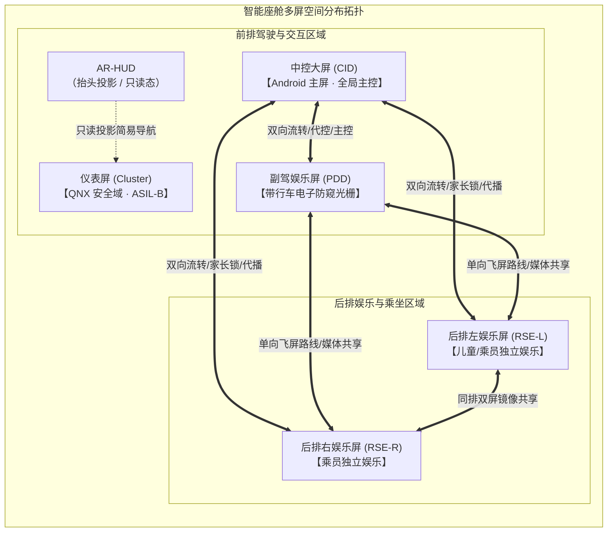
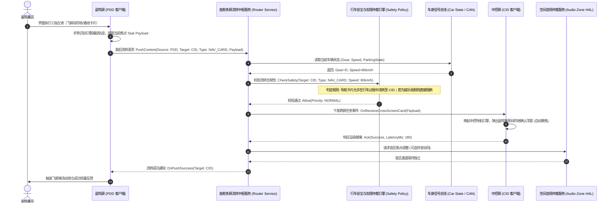
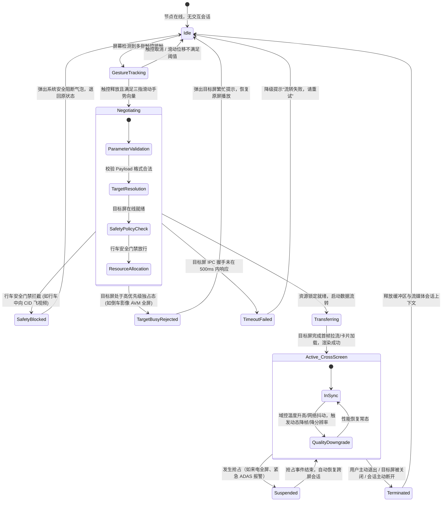

# 智能座舱多屏互动系统 (Multi-Screen Interaction System) MVP PRD

---

## 1. 文档元数据与版本管理

| 属性 | 内容 |
| :--- | :--- |
| **文档编号** | PRD-COCKPIT-MULTI-SCREEN-2026-v1.0 |
| **产品定位** | 面向新一代智能座舱的分布式多屏协同与内容流转中枢系统。覆盖仪表屏 (Cluster)、中控信息屏 (CID)、副驾娱乐屏 (PDD) 及后排双娱乐屏 (RSE-L/RSE-R)，实现音视频与导航卡片的低延迟跨屏流转（飞屏）、独立音区协同、副驾/后排代驾控制及行车安全防窥门禁。 |
| **目标硬件平台** | 智能座舱单/双 SoC 域控制器（支持 Hypervisor 隔离，典型配置为 QNX 仪表安全域 + Android Automotive OS 娱乐域）；屏幕拓扑覆盖 4~5 屏。 |
| **文档状态** | 基线草案 (Baseline Draft for Engineering & QA Review)；性能常数须在硬件台架与实车环境中实测冻结。 |
| **所属模块** | 智能座舱系统 / 分布式交互框架与流媒体中枢 |

### 1.1 变更记录

| 版本 | 日期 | 修改人 | 修改内容摘要 |
| :--- | :--- | :--- | :--- |
| v1.0 | 2026-11-08 | 资深技术 PM | 初始版本基线创建：明确 5 屏拓扑、三指飞屏流转协议、4 音区仲裁规则、行车安全阻断门禁、BDD 测试用例与架构/QA 红队审查报告。 |

---

## 2. 业务背景、核心价值与指标体系 (Why & ROI)

### 2.1 业务背景与用户痛点

在多屏化成为新能源中高端汽车标配的背景下，多数车辆的各块屏幕在物理上被割裂为独立的“信息孤岛”：
- **主驾安全与分神痛点**：主驾在高速驾驶或复杂路况下，手动调整导航偏好、途经点或查找音乐极其危险；副驾虽有心协助，但手机与车机系统缺乏无缝桥接，导致主驾视线偏离道路。副驾播放高动态亮色视频时，夜间余光眩光严重干扰驾驶员，存在违规与行车事故隐患（违反行车防分心安全法规）。
- **家庭出行多角色协同断层**：后排儿童观看动画片时，前排家长无法通过 CID 直观了解播放内容，频繁回头存在安全风险；缺乏全局锁控与音量限制能力。
- **媒体体验割裂**：乘员在手机或车机副驾屏上未看完的影音，无法顺畅流转给同车乘员或后排共享，多屏协同仅停留在“蓝牙连接”阶段。

### 2.2 核心价值与商业 ROI
1. **行车安全升维（Safety First）**：副驾通过“代设导航一键飞屏”降低主驾操作负荷，副驾屏电子防窥/调光在 D 档下自动激活，杜绝主驾视线分神。
2. **座舱多模态体验壁垒**：打造“全车协同”的无缝数字生活空间，提高高配座舱用户粘性与转介绍率。
3. **软硬解耦与能力复用**：建立标准化的跨屏流转协议与音视频管道，适配后续不同车型屏幕拓扑（3 屏/4 屏/5 屏/AR-HUD）。

### 2.3 成功衡量指标与护栏指标 (Metrics)

| 指标类别 | 指标名称 | 目标值 (V1.0) | 测量口径与计算方式 |
| :--- | :--- | :--- | :--- |
| **核心指标 (North Star)** | 跨屏流转成功率 | $\ge 99.5\%$ | $\frac{\text{成功完成流转且目标屏首帧渲染事件数}}{\text{用户发起飞屏动作总次数}} \times 100\%$ |
| **核心指标 (North Star)** | 飞屏手势识别成功率 | $\ge 98.0\%$ | 规范三指滑动轨迹下，手势引擎准确判定并触发意图的比例 |
| **核心指标 (Experience)** | 跨屏端到端响应时延 | $P50 \le 300\text{ms}$<br>$P95 \le 600\text{ms}$ | 用户手指离开屏幕（Touch Up）至目标屏完成解码并渲染出首帧内容的时延 `[待硬件基线实测 (Pending Hardware Baseline)]` |
| **核心指标 (Experience)** | 音视频跨屏音画同步差 | $|\Delta t| \le 45\text{ms}$ | 跨屏渲染时音频 PTS 与视频 PTS 时间戳对齐误差 |
| **安全护栏 (Guardrail)** | 行车安全阻断合规率 | **严格 100%** | 车速 $> 0\text{km/h}$ 或非 P 档下，娱乐类视频流转到仪表屏或未做防窥遮蔽的主视区拦截率必须为 100% |
| **性能护栏 (Guardrail)** | 域控 CPU / 内存增量 | CPU $\le 8\%$<br>RAM $\le 150\text{MB}$ | 持续流转与视频管道转发期间，座舱娱乐域 CPU 额外负载与常驻内存增量 `[待硬件基线实测 (Pending Hardware Baseline)]` |
| **安全护栏 (Guardrail)** | 仪表安全域隔离性 | 0 卡顿 / 0 干扰 | QNX 仪表渲染帧率稳定维持 $\ge 58\text{fps}$，IPC 通信异常绝不引起仪表系统看门狗复位或主控挂死 |

### 2.4 本期明确不做事项 (Non-Goals)
1. **不做仪表屏（Cluster）运行第三方三方视频/游戏**：仪表屏仅支持接收由中控或副驾流转的标准“简易导航卡片”、“媒体元数据（歌名/歌词简条）”，坚决不渲染第三方富媒体视频帧。
2. **不做云端中继的座舱内飞屏**：所有跨屏数据传输必须在车机内部高速 IPC（域控内部进程间通信）或车载千兆以太网内完成，严禁走蜂窝移动网络上传云端后下发。
3. **不做未经认证的匿名外接设备任意投屏**：V1.0 仅支持座舱内置屏幕互投及通过原厂 App/无线协议认证绑定的白名单车主手机，不支持公网 AirPlay/Miracast 开放广播发现。
4. **不改动实体车辆底盘与动力域网络**：多屏互动系统仅与车身状态（档位、车速、座椅占用传感器）建立单向只读监听，无权下发任何底盘/车控执行器写指令。

---

## 3. 屏幕拓扑、系统架构与状态机 (Topology, Architecture & States)

### 3.1 座舱屏幕物理与逻辑拓扑



### 3.2 屏幕能力与权限矩阵表

| 屏幕节点 | 操作系统环境 | 角色与主权 | 允许发起流转的内容类型 | 允许接收流转的内容类型 | 音区归属与外设通道 |
| :--- | :--- | :--- | :--- | :--- | :--- |
| **仪表屏 (Cluster)** | QNX RTOS (ASIL-B) | 只读受控节点 | 严禁发起流转 | 仅限：简要导航转向卡片、通话提醒、媒体摘要信息（无视频） | 主驾专属扬声器（头枕/仪表蜂鸣） |
| **中控屏 (CID)** | Android Automotive OS | 全局管理员 (Master) | 导航、媒体、全车设置、应用投屏 | 导航、通话、第三方音乐、驻车视频（D 档阻断视频） | 全车主扬声器 / 主驾独立音区 |
| **副驾屏 (PDD)** | Android Automotive OS | 协同节点 (Passenger) | 导航目的地、音视频流、网页卡片 | 媒体流、CID 推荐卡片、后排分享流 | 副驾独立音区（蓝牙耳机 / 独立副驾扬声器） |
| **后排左 (RSE-L)** | Android Automotive OS | 受限娱乐节点 | 媒体分享、向 CID 提请路线需求 | 媒体流、CID 强制推送内容、同排镜像流 | 左后独立音区（有线/蓝牙耳机 / 局部扬声器） |
| **后排右 (RSE-R)** | Android Automotive OS | 受限娱乐节点 | 媒体分享、向 CID 提请路线需求 | 媒体流、CID 强制推送内容、同排镜像流 | 右后独立音区（有线/蓝牙耳机 / 局部扬声器） |

### 3.3 跨屏飞屏端到端业务流序图 (Sequence Diagram)

以下以“副驾乘员在 PDD 搜索目的地并三指飞屏至主驾 CID，同时将当前播放的音乐推至全车音响”为例：



### 3.4 跨屏流转会话生命周期状态机 (State Machine)



### 3.5 核心状态转移契约表

| 当前状态 | 触发事件 | 前置校验条件 | 下一状态 | 系统动作与副作用 |
| :--- | :--- | :--- | :--- | :--- |
| **Idle** | `EVT_GESTURE_START` | 接触点数 $\ge 3$，触摸位于有效内容容器内 | **GestureTracking** | 锁定当前视窗手势监听，禁止子控件响应单指点击 |
| **GestureTracking** | `EVT_GESTURE_COMMIT` | 滑动速度 $v \ge 1.2\text{px/ms}$，水平位移 $\Delta x \ge 200\text{px}$ | **Negotiating** | 捕获源界面快照，组装 `HandoffSessionDescriptor` 结构体 |
| **Negotiating** | `EVT_POLICY_PASS` | 车型车速安全策略校验通过，目标屏幕在线且非高优先级互斥占用 | **Transferring** | 目标屏创建预加载 Surface，向源屏发送准备拉流 ACK |
| **Negotiating** | `EVT_POLICY_BLOCK` | 车速 $>0\text{km/h}$ 且流转类型为 `VIDEO_STREAM`，目标为主驾 CID/Cluster | **SafetyBlocked** | 中断流转管线；源屏触发回弹阻断动效，弹出“行车安全限制，无法流转视频至主屏”提示 |
| **Negotiating** | `EVT_TARGET_OCCUPIED` | 目标屏正运行 AVM 360 倒车全景或紧急告警 | **TargetBusyRejected** | 释放握手资源；向源屏返回 `ERR_TARGET_HIGH_PRIORITY_OCCUPIED` |
| **Transferring** | `EVT_FIRST_FRAME_RENDERED` | 目标屏解码器成功解码首帧并在 Display 呈现 | **Active_CrossScreen** | 源端释放视频硬解码句柄（或转为副屏控制态），双方建立状态心跳 |
| **Active_CrossScreen** | `EVT_CAR_ALARM_INTERRUPT` | 触发碰撞预警、疲劳监测告警或倒车信号 | **Suspended** | 目标屏挂起当前流媒体渲染，保存 PTS 进度，展示告警界面 |
| **Suspended** | `EVT_INTERRUPT_CLEAR` | 倒车完成退回 P/D 档，告警弹窗被用户或系统确认关闭 | **Active_CrossScreen** | 目标屏恢复流媒体渲染管线，依据最新时间戳对齐播放 |
| **Active_CrossScreen** | `EVT_SESSION_CLOSE` | 乘员点击“结束跨屏”或手动关闭目标应用 | **Terminated** | 关闭流媒体传输 Socket，解绑音区路由，复原双屏独立上下文 |

---

## 4. 功能需求详述 (What)

### 4.1 模块一：跨屏多媒体与导航流转（飞屏与推屏）

#### 4.1.1 业务规则与交互设计
1. **交互手势触发**：
   - **三指轻扫 (Three-Finger Swipe)**：在媒体播放器或导航详情页，乘员使用三根手指沿屏幕方向快速滑向目标屏方向（向左滑代表推向前左屏幕，向右滑代表推向前右屏幕）。
   - **控制中心拖拽 (Drag & Drop)**：在下拉全局控制中心“多屏协同”面板中，长按当前媒体缩略卡片，拖动投掷到可视化的目标屏幕几何小部件上。
2. **支持内容载荷类型 (Payload Types)**：
   - `NAV_POINT`：单一经纬度目的地及 POI 元数据（POI ID、地址字符串）。
   - `NAV_ROUTE`：完整路径规划算路结果包含途经点列表。
   - `MEDIA_PROGRESS_STREAM`：视频/音频媒体进度点（流媒体 URL、当前播放时间戳 PTS、播放倍速、音轨索引）。
3. **断点续播与无缝对齐**：流转期间，源端必须在上报当前播放位置时补偿预计的传输与解码握手耗时 $\delta t \approx 200\text{ms}$，目标端接力播放跳帧感不得超过 2 个 GOP 间隔。

#### 4.1.2 异常边界与降级策略
- **极端弱网/内网抖动**：车内以太网发生瞬时拥塞导致首帧加载超时（超过 $800\text{ms}$），目标端显示极简 Skeleton 加载动画，若超过 $2.0\text{s}$ 未渲染，则宣布会话失败并自动退回源端全屏播放。
- **并发冲突**：若主驾正在通过语音修改导航路线，同时副驾发起飞屏路线覆盖：
  - *仲裁规则*：以“最后一次有效确认动作”为准，但若主驾已处于引导变道紧急提示阶段，系统弹窗提示副驾“主驾正在紧急变道，路线已加入待办列表”，不即时切屏。

#### 4.1.3 BDD 验收准则

```gherkin
Scenario: 副驾在行车过程中向主驾中控屏飞送导航目的地
  Given 车辆处于 D 档，车速为 60km/h
  And 副驾在副驾屏 (PDD) 地图软件中选定了一个新的咖啡馆 POI
  When 副驾使用三根手指向左滑向 CID 中控大屏
  Then 中控屏 (CID) 在 300ms 内收到该 POI 数据
  And 中控屏当前主视区不被强行遮挡，而是在底部/侧边滑出“副驾推荐新目的地：是否设为途经点？”卡片
  And 副驾屏弹出轻量动画提示“已送至中控屏”
  And 该操作不打断主驾当前 HUD 的实时车速与转向提示

Scenario: 副驾在行车过程中试图将正在播放的娱乐视频飞至主驾中控屏
  Given 车辆处于 D 档行驶中，车速为 40km/h
  And 副驾正在副驾娱乐屏观看 1080P 电影
  When 副驾使用三指左滑动作将电影推向中控屏 (CID)
  Then 系统安全合规引擎立即拦截该请求
  And 中控屏不产生任何视频播放动作
  And 副驾屏播放器发生轻微阻断回弹，并在屏幕中央展示合规提示：“行车中禁止向中控屏流转视频”
  And 副驾屏视频在原屏保持继续播放，声音不发生中断
```

---

### 4.2 模块二：跨屏协同与后排代控（Parental & Companion Control）

#### 4.2.1 业务规则与交互设计
1. **CID 后排管控看板 (RSE Manager on CID)**：
   - 中控大屏内置“后排屏幕管理卡片”，主驾/前排乘员可在卡片中查看 RSE-L / RSE-R 当前正在播放的应用名称与内容分级标签。
   - **一键代控操作集**：
     - `强制暂停/播放 (Force Play/Pause)`
     - `音量上限钳制 (Volume Cap Limit)`：限制后排最大音量不能超过 $60\%$，防止损伤儿童听力。
     - `一键熄屏锁屏 (Lock Screen)`：强制后排屏幕进入纯黑低功耗息屏状态，屏蔽触控输入（儿童防沉迷）。
2. **同排双屏镜像共享 (RSE Dual-Screen Mirroring)**：
   - 后排左右乘员可一键发起“共享我的屏幕”，右后屏直接镜像呈现左后屏画面，音频通道自动合并，支持左右乘员佩戴各自耳机收听同一音轨。

#### 4.2.2 异常边界与降级策略
- **后排正在运行本地重度 App**：若后排正在运行大型单机游戏，前排发起视频强制推屏时：
  - *处理逻辑*：系统先向后排下发优雅挂起信号 `OnPreemptNotification`，给予后排应用 3 秒保存本地进度，随后自动切换至前排推送的内容源。
- **锁屏被物理强行触摸**：后排锁屏激活时，屏蔽一切点击、滑动与双击唤醒；仅当 CID 主动解锁或全车断电后方可恢复。

#### 4.2.3 BDD 验收准则

```gherkin
Scenario: 前排家长通过 CID 强制锁屏后排儿童娱乐屏
  Given 后排左屏 (RSE-L) 正在播放动画片，音量为 70%
  And 前排家长在 CID 点击下拉控制中心的“后排儿童锁”开关
  When 家长点击确认“立即锁定后排左屏”
  Then 后排左屏在 200ms 内淡出视频并关闭背光进入黑屏锁定态
  And 后排左屏的扬声器/耳机输出立即静音
  And 此时点击后排左屏任何物理或触控区域均不唤醒屏幕，仅在轻触时显示半透明锁头图标 2 秒后隐去
  And CID 界面该控制按钮状态同步切换为“已锁定 (绿色)”
```

---

### 4.3 模块三：独立空间音区与行车防窥安全门禁

#### 4.3.1 独立音区架构与仲裁矩阵
座舱划分 4 个物理独立声学音区：`Zone 1 (主驾)`, `Zone 2 (副驾)`, `Zone 3 (左后)`, `Zone 4 (右后)`。

| 音区发生场景 | 触发输入源 | 输出设备通道 | 冲突发生时的仲裁规则 (Ducking / Mute) |
| :--- | :--- | :--- | :--- |
| **主驾导航与安全警报** | ADAS 告警、车机导航 TTS、行车电话 | 主驾头枕扬声器 / 全车主声场前区 | **最高优先级**。触发时，主驾正在收听的背景音乐瞬时自动压音（降低 $18\text{dB}$）；完全不影响副驾与后排耳机的音频。 |
| **副驾独立娱乐** | 副驾屏电影、独立音乐、副驾语音 | 专属副驾蓝牙耳机 / 副驾定向声学扬声器 | 独立路由。主驾打语音电话或导航播报时，副驾音频音量 $0\text{dB}$ 衰减（完全无感知）。 |
| **全车协同影院** | 驻车状态下一键开启全车影院 | 全车 7.1.4 环绕声音响功放 | 音频统一接管全车主扬声器，临时静音各屏私有通道；一旦出现倒车或安全报警，立即整体下压音量。 |

#### 4.3.2 行车安全防窥门禁 (Electronic Privacy Glass / Soft Dimming)
1. **防窥触发条件**：
   - 监听车身 CAN/以太网信号，当 `VehicleSpeed > 0km/h` 且 `Gear != P` 时触发。
2. **防窥执行形式**：
   - **硬件电控液晶光栅**：通电改变透光偏振角度，使视角大于 $35^\circ$（即主驾视线方向）处可见光衰减 $\ge 92\%$。
   - **软件侧向高对比度防窥算法 (保底)**：若硬件无光栅，副驾屏在行车时将高饱和度大动态画面的边缘进行动态色彩与亮度限幅，并将朝向主驾侧的视场角灰阶进行软性压暗。

#### 4.3.3 BDD 验收准则

```gherkin
Scenario: 车辆从 P 档挂入 D 档启动行车，副驾屏防窥策略自动上锁
  Given 车辆在车库静止，档位处于 P 档
  And 副驾正在观看一部色彩明亮的高清电影
  When 主驾驶踩下制动踏板并将档位切换至 D 档，车速开始大于 0km/h
  Then 域控安全中间件在 100ms 内向副驾屏显示服务发送 EVT_PRIVACY_MODE_ENABLE
  And 副驾屏幕的物理防窥光栅在 150ms 内完成偏振角度转换
  And 从主驾驶座椅头部视角（视场角约 45 度）看副驾屏呈现全黑或极暗无信息状态
  And 副驾乘员正视视角仍能看清视频，画面无闪烁与剧烈色偏
```

---

### 4.4 模块四：全车沉浸模式（驻车全车影院）

#### 4.4.1 业务规则与交互设计
1. **模式开启前置门禁**：
   - 车辆档位必须严格处于 `P 档`。
   - 动力电池剩余电量（SOC） $\ge 20\%$，或燃油车处于怠速/外接供电状态。
   - 严禁在车辆行进中通过任何跨进程注入或调试手段开启该模式。
2. **全屏全车同屏互动**：
   - CID、PDD、RSE-L、RSE-R 联动拉取同一份高清媒体流。
   - 核心主控权赋予 CID（支持后排授权交还）。
   - 座舱氛围灯联动画面主色调流光溢彩，全车空调自动调至“舒适观影模式”。

#### 4.4.2 BDD 验收准则

```gherkin
Scenario: 驻车状态下开启全车沉浸影院模式
  Given 车辆处于 P 档，动力电池 SOC 为 55%
  And 用户在中控大屏 (CID) 点击“开启全车影院”快捷卡片
  When 系统完成多屏心跳与时钟同步握手
  Then 中控屏、副驾屏与后排双屏在 800ms 内同时切换为统一媒体播放界面
  And 全车音响自动切换为 7.1.4 环绕声声道模式
  And 四块屏幕的播放进度差异绝对值小于 45ms（人耳无明显回音重影感）
  And 任意屏幕点击“暂停”动作，其余三块屏幕在 150ms 内同步暂停
```

---

## 5. 异常分支与系统容错韧性机制 (System Resilience & Edge Cases)

### 5.1 跨系统 IPC 通信中断与心跳丢失
- **场景**：Android 娱乐域由于第三方重度 App 内存泄露触发 OOM，导致多屏流转中枢服务瞬时崩溃重启。
- **容错契约**：
  1. **安全域绝对隔离**：QNX 仪表系统必须采用硬件内存屏障与独立 IPC 端口通信，Android 侧进程挂死时，仪表屏保持当前最后一帧安全画面并优雅收回副驾流转卡片，绝不产生雪花、白屏或系统看门狗整机复位。
  2. **快速热自愈**：中枢服务守护进程（Watchdog）在 $300\text{ms}$ 内完成重新拉起，拉起后通过共享内存（Shared Memory）恢复崩溃前的屏幕映射关系表，乘员端界面仅表现为轻微转圈后无感续播。

### 5.2 车速突变与紧急倒车抢占 (AVM Preemption)
- **场景**：主驾在 P 档静止观影时，突然挂入 R 档准备倒车。
- **仲裁契约**：
  - 倒车影像（AVM）信号具有**最高系统显示层级**。
  - CID 必须在 $\le 100\text{ms}$ 内强行覆写显示管线，将全屏替换为 360 倒车全景。
  - 原跨屏流转视频会话自动转入后台静音暂挂（Suspended）状态，严禁阻塞倒车影像的显示通路。
  - 当车辆退出 R 档并重新挂入 P 档时，CID 弹出悬浮胶囊提问：“是否继续观影？”，由用户自主决定是否恢复全屏。

### 5.3 多屏并发控制冲突与版本向量 (Concurrency & Idempotency)
- **场景**：副驾与后排乘客同时在两块屏幕上对同一设备属性（如后排空调温度、同一播放列表首曲）进行滑动调节。
- **仲裁契约**：
  - 采用**时序逻辑时钟（Lamport Timestamp）与版本向量**机制。
  - 车控类属性遵循“前排主控屏（CID/PDD）优先级高于后排娱乐屏（RSE）”。
  - 相同权限层级的并发操作，以毫秒级时间戳到达中枢网关的最后一次写入为准（Last-Write-Wins），并以广播事件向所有屏幕下发最新收敛状态，避免界面状态割裂。

---

## 6. 非功能性需求与规范合规 (Non-Functional Requirements)

### 6.1 性能与 SLA 核心指标

$$\text{End-to-End Latency: } T_{\text{E2E}} = T_{\text{gesture}} + T_{\text{ipc}} + T_{\text{decode}} + T_{\text{render}} \le 600\text{ms (P95)}$$

| 指标维度 | SLA 达标门槛 | 极端弱化兜底阈值 | 验证环境要求 |
| :--- | :--- | :--- | :--- |
| **手势意图识别耗时** | $\le 80\text{ms}$ | $\le 120\text{ms}$ | 多指滑动离手起算 `[待硬件基线实测]` |
| **跨屏会话握手时延** | $\le 50\text{ms}$ | $\le 100\text{ms}$ | 域控制器内部 IPC 传输 |
| **视频跨屏首帧渲染耗时** | $P50 \le 250\text{ms}$<br>$P95 \le 450\text{ms}$ | $\le 800\text{ms}$ | 1080P/60fps H.264/H.265 硬解码 `[待硬件基线实测]` |
| **音画同步绝对偏差** | $|\Delta t| \le 45\text{ms}$ | $|\Delta t| \le 80\text{ms}$ | 专业声学测时仪对齐 |
| **稳态帧率表现** | $\ge 58\text{fps}$ | $\ge 45\text{fps}$ (重度负载下降帧保音) | 4 屏同投场景持续 30 分钟实测 |

### 6.2 法规、功能安全与网络安全准则
1. **行车安全规范**：符合 GB 11552《乘用车内部凸出物》中关于显示装置对驾驶员视野干扰的约束，以及 UNECE R155/R156 车辆网络安全与软件升级标准。
2. **ASIL-B 仪表隔离**：仪表屏通信管道只允许单向只读接收结构化纯文本/图元指令，任何二进制 Shell、可执行脚本或直接显存 Framebuffer 跨域映射均在微内核层实行物理权限隔离。
3. **乘员隐私隔离**：副驾屏私有相册、通话记录向后排流转前，必须在源屏触发“乘员授权弹窗”，未经副驾确认严禁私自调取敏感隐私媒体。

---

## 7. 数据埋点与灰度策略 (Telemetry & Rollout)

### 7.1 核心数据埋点事件规范表

| 事件英文名称 (`event_name`) | 触发时机 | 核心上报属性定义 (JSON Payload) | 业务分析用途 |
| :--- | :--- | :--- | :--- |
| `cockpit_cross_screen_gesture_detected` | 屏幕触摸引擎成功捕捉到有效跨屏多指手势时 | `{"source_screen": "PDD", "gesture_type": "THREE_FINGER_SWIPE_LEFT", "velocity_x": 1.45, "content_type": "VIDEO"}` | 监控手势识别灵敏度与漏触率 |
| `cockpit_cross_screen_push_request` | 中枢路由服务接收到飞屏意图请求时 | `{"session_id": "UUID", "src_screen": "PDD", "target_screen": "CID", "type": "NAV_POI", "vehicle_speed": 62.5, "gear": "D"}` | 统计流转意图分布与行车场景交叉关联 |
| `cockpit_cross_screen_policy_result` | 安全合规与仲裁引擎完成判决时 | `{"session_id": "UUID", "decision": "BLOCKED", "reason": "SAFETY_MOVING_VIDEO_FORBIDDEN", "speed": 62.5}` | 监控行车安全阻断率与用户误操作倾向 |
| `cockpit_cross_screen_session_rendered` | 目标屏幕完成首帧画面解码并显示时 | `{"session_id": "UUID", "latency_total_ms": 320, "ipc_latency_ms": 15, "decode_latency_ms": 110, "render_fps": 60}` | 端到端 SLA 性能与首帧时延监控 |
| `cockpit_cross_screen_interrupt_event` | 跨屏会话因倒车/来电/告警等突发事件被中断时 | `{"session_id": "UUID", "interrupt_source": "AVM_REVERSE", "previous_state": "ACTIVE", "action_taken": "SUSPEND"}` | 监控异常打断恢复与用户体验断裂点 |

### 7.2 灰度发布与一键安全熔断方案 (Feature Flag & Rollback)
1. **分级发布策略**：
   - **Phase 1 (内部车队验证 - 100 辆)**：全面开启高频日志追踪，收集各工况下的硬解编解码器耗时分布与误触率。
   - **Phase 2 (先锋体验用户 - 1% 尝鲜灰度)**：开放导航卡片飞屏与基础副驾代控。
   - **Phase 3 (规模公测 - 10% 灰度)**：开放全车影院与双屏镜像。
   - **Phase 4 (OTA 全量推送 - 100%)**。
2. **云端动态配置与一键熔断降级**：
   - 系统内置安全总线开关 `feature_flag_cross_screen_v1`。
   - 若线上发生严重车载 IPC 内存泄露或导致车机系统黑屏投诉率超过 $0.05\%$，云端下发动态配置指令，在无需 OTA 整包刷写的前提下，静默将多屏互动能力降级为本地单屏独立运行模式。

---

## 8. 🛡️ 红队边界自检报告 (Architecture & QA Red-Team Audit)

在需求正式提交研发与测试评审前，由**资深系统架构师**与**苛刻 QA 总监**进行极限场景对抗审查：

### 8.1 架构师视角：系统并发、资源瓶颈与死锁审查

| 潜在系统漏洞与风险 | 攻击场景剖析 | 架构防护方案与 PRD 补充条款 |
| :--- | :--- | :--- |
| **硬件编解码器实例耗尽导致黑屏** | 副驾正在播放 4K 视频，同时发起双屏镜像向两块后排屏广播，系统瞬时需要 3 路 1080P/4K 硬解实例，超出车载高通/联发科 SoC 硬件 VPU 实例上限。 | **严格实例配额门禁**：流转中枢在握手阶段预检 VPU Codec 句柄数；当硬解句柄不足时，拒绝发起第三路流转，或强制将源端视频流动态协商降级为 720P 软解/省资源模式，严禁无脑创建解码管道。 |
| **网络风暴与跨屏广播风暴** | 后排左屏镜像至右屏，右屏误触反向镜像回左屏，或者多屏同时发送状态同步广播，形成死循环死锁。 | **单向会话唯一性锁**：每个跨屏流转会话分配全局单调递增的 `session_id`。所有节点维护“主-从 (Master-Worker)”角色拓扑，从节点禁止向主节点反向发起同一流的镜像请求。 |
| **共享内存泄露与脏数据污染** | 跨屏传输大尺寸 Bitmap（如相册照片飞屏）时，接收端应用意外退出，导致共享内存（ashmem/dmabuf）未被回收引发系统内存缓慢耗尽。 | **基于智能指针与生命周期挂钩的销毁机制**：共享内存块绑定至会话 Session 生命周期，接收端必须在 $1.0\text{s}$ 内返回消费 ACK，超时未应答强制由分配端 Unmap 释放。 |

### 8.2 QA 总监视角：极端异常、边界操作与破坏性测试审查

| 极端测试用例 (Corner Cases) | 预期破坏现象 | 验收防线与断言标准 |
| :--- | :--- | :--- |
| **高频疯狂划动手势 (Chaos Monkey)** | 用户在副驾屏幕上用 3~5 指在 1 秒内连续快速滑动画框 20 次。 | 触摸引擎内置防抖（Debounce）机制，手势窗口在识别成功后进入 $500\text{ms}$ 冷却期，期间忽略后续手势，严禁后台创建 20 个并发握手线程导致系统 OOM。 |
| **流转中瞬间熄火/断电 (Power State Drop)** | 媒体流正从副驾飞往后排，车辆瞬间执行“踩刹车下电熄火”，整车电源进入 Sleep 挂起状态。 | 系统在检测到电源管理状态（PMIC）下坠时，瞬时落盘保存断点时间戳（PTS）至持久化轻量缓存，取消网络 Socket 传输，下次冷启动后维持待机静止，不自动暴走弹窗。 |
| **超大超长脏数据载荷注入** | 乘员手机通过蓝牙/Wi-Fi 向中控飞送名称长达 100,000 字符的畸形超长 POI 字符串。 | 接口层在数据解析反序列化前必须进行 Schema 校验：POI 名称强制截断至 128 字符，超出直接丢弃，严禁引发渲染层 Buffer Overflow 崩溃。 |
| **行车状态在临界跳变 (Boundary Race)** | 车辆在 P 档怠速，副驾刚点击向中控飞送电影，动作发生的同一毫秒内，主驾强踩油门切 D 档冲出。 | 安全合规拦截在**渲染管线呈现前**做最终双重校验（Double Check）。即使握手初始判定为 P 档，若首帧准备上屏瞬间检测到 `Speed > 0`，立刻就地熔断丢弃视频帧并弹出合规阻断提示。 |

---

## 9. 交付物与后续行动项 (Next Actions)

1. **研发交底准备**：
   - 组织研发 Tech Lead 针对“跨屏流转会话协议（Payload Schema）”与“VPU 解码器实例配额机制”开展技术评审 (TDD 对齐)。
2. **设计团队协同 (Design Brief)**：
   - 交互设计团队依据本 PRD 制定三指飞屏动效曲线示意、防窥状态提示图标及中控控制中心交互原型。
3. **自动化测试套件挂载**：
   - 将本 PRD 中的 BDD 测试用例同步录入座舱端到端自动化测试平台，配置 CAN 信号仿真器模拟档位与车速跳变，执行安全门禁回归。
