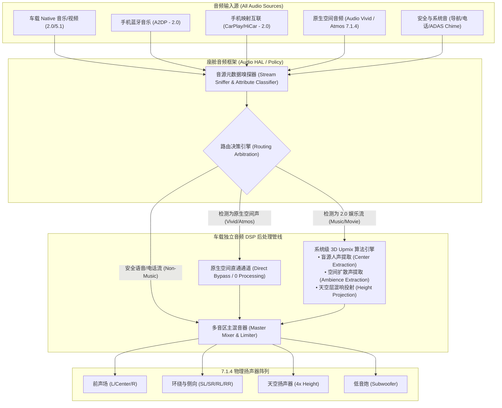
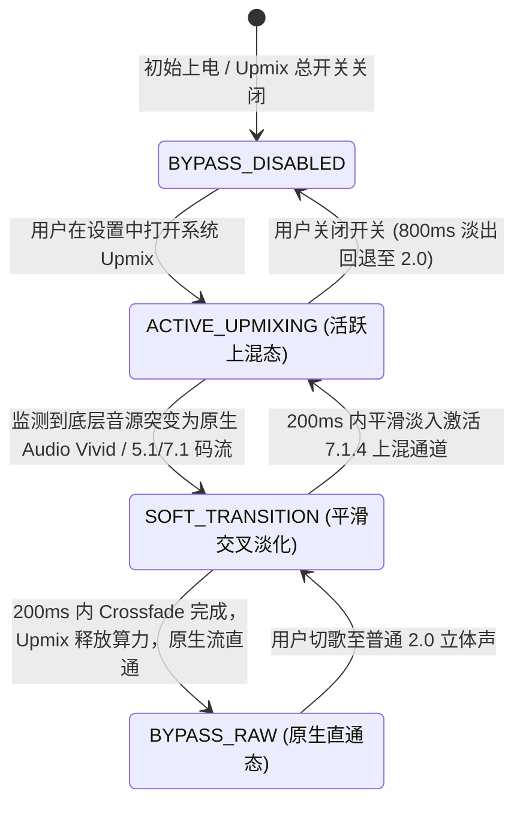

# 智能座舱系统级空间音频上混引擎 (System Upmix) PRD

---

## 1. 文档元数据与版本管理

| 属性 | 内容 |
| :--- | :--- |
| **文档编号** | PRD-COCKPIT-AUDIO-UPMIX-2026-v1.0 |
| **产品定位** | 座舱底层全局音频增强中枢（System-level Audio Post-Processing Pipeline）。在 Android Audio HAL / QNX Audio Server 与独立音频 DSP 管道层介入，将全音源（蓝牙/原生App/投屏/广播）无感三维化重建为 7.1.4 / 7.3.4 全车扬声器矩阵输出，并提供原生空间声自动 Bypass、安全流物理隔离与空间沉浸度调节。 |
| **目标硬件平台** | 智能座舱单/双芯片域控制器（SoC + 独立音频 DSP / 浮点运算单元），车规级 7.1.4 扬声器硬件拓扑。 |
| **文档状态** | 基线审定稿 (For DSP Firmware, Audio HAL & Acoustic Engineering Teams)；性能常数须在硬件台架与实车环境中实测冻结。 |
| **所属模块** | 智能座舱系统 / 底层音频框架 (Audio HAL) & DSP 后处理管道 |

### 1.1 变更记录

| 版本 | 日期 | 修改人 | 修改内容摘要 |
| :--- | :--- | :--- | :--- |
| v1.0 | 2026-11-08 | 资深技术 PM | 初始版本基线创建：确立全音源输入过滤矩阵、原生空间声自动 Bypass 契约、声场宽度与天空增益调节规则、BDD 用例及架构/QA 红队自检报告。 |

---

## 2. 业务背景、核心价值与指标体系 (Why & ROI)

### 2.1 业务背景与用户痛点
- **硬件冗余与内容荒的巨大鸿沟**：当前整车搭载了 16~28 个扬声器（含 4 个顶棚天空声道），但主流用户有超过 85% 的时长在使用手机蓝牙连接（A2DP）、普通音质广播或第三方未适配空间音频的 App。由于音源只有左右声道（L/R），车内高达 60% 的扬声器单元发声极弱甚至处于物理闲置，硬件价值无法感知。
- **第三方 App 私有音效体验割裂**：各音乐 App 的“全景声插件”各行其是，一旦切换到广播、导航或视频 App，声音立刻跌回干瘪的扁平立体声，整车声学体验缺乏一致性。
- **车载物理声学非对称缺陷**：传统立体声在车内播放时，驾驶员因离左门中低音扬声器最近，主唱人声严重偏左；如果通过左右平衡（Balance）暴力拉偏，副驾听感又会被完全破坏。

### 2.2 核心价值与商业 ROI
1. **全域音源“免适配”升级**：在车机操作系统层介入，无需内容提供商重制片源，让任意 2.0 音源秒变“全景包裹声”，最大化变现硬件资产。
2. **人声中置与声场拓宽（Center Extraction & Upmixing）**：将左右声道中的同相共模信号（主要是歌手人声/对白）提取并锚定至物理前中置扬声器，解决传统车载音响“驾驶员离左门太近导致人声偏左”的非对称物理缺陷。
3. **消除应用间割裂，打造一致座舱品牌调音**：统一整车音效出口，形成主机厂专属声学调音标签。

### 2.3 成功衡量指标与护栏指标 (Metrics)

| 指标类别 | 指标名称 | 目标值 (V1.0) | 测量口径与计算公式 |
| :--- | :--- | :--- | :--- |
| **核心体验 (North Star)** | 系统级 Upmix 功能常开率 | $\ge 80\%$ | $\frac{\text{系统设置中保持开启状态的车辆数}}{\text{总联网激活车辆数}} \times 100\%$ |
| **音质主观 (Experience)** | 声学专家/主观盲测 MOS 评分 | $\ge 4.2\text{ 分}$ (5分制) | 组织金耳朵团队针对流行/摇滚/古典 50 首样本，在开启与关闭状态下的环绕度与自然度盲测均分 |
| **体验护栏 (Guardrail)** | 原生空间声直通检出率 (Bypass) | **严格 100%** | 当输入流为 Audio Vivid、Dolby Atmos 等原生多声道时，系统必须 100% 自动 Bypass，**严禁二次上混** |
| **声学护栏 (Guardrail)** | 相位抵消与梳状滤波失真率 | $0\text{ 关键缺陷}$ | 人声提取算法不得导致歌手人声产生金属空洞感、移相（Phasing）或高频梳状滤波杂音 |
| **系统护栏 (Guardrail)** | DSP 持续算力与延迟增量 | 额外算力 $\le 18\%$<br>算法延迟 $\le 8\text{ms}$ | 开启系统 Upmix 时，DSP 额外算力开销与音频管道引入的算法处理固有延迟 `[待硬件基线实测 (Pending Hardware Baseline)]` |

### 2.4 本期明确不做事项 (Non-Goals)
1. **不做非娱乐类音频流（Navigation/Call/Chimes）的上混**：所有导航播报、蓝牙免提通话、系统按键音、倒车雷达绝对不进入 Upmix 引擎，保持原生点对点路由。
2. **不做超低码率音频（$< 64\text{kbps}$）的强制深度上混**：严重压缩失真的音源若强行分离高频反射声，会成倍放大高频金属毛刺杂音，系统采取保守弱上混或旁路。
3. **不替代专业原生三维声标准**：Upmix 定位为兼容补充，当存在原生 Audio Vivid / 杜比全景声时，系统自动让出管线主权。

---

## 3. 系统音频架构与数据路由拓扑 (Architecture & Routing)

### 3.1 操作系统级音频管线介入点拓扑



### 3.2 动态直通与状态转移状态机 (State Transition)



---

## 4. 详细功能规格与业务规则 (Functional Specs & Business Rules)

### 4.1 音频流属性识别与白名单过滤矩阵
系统级 Upmix **绝不是无脑处理所有声卡数据**。必须基于 Android `AudioAttributes` 的 `Usage` 与 `ContentType` 进行底层过滤：

| AudioAttributes Usage | 典型流类型 | 是否允许进入 Upmix 引擎 | 路由策略与声学行为 |
| :--- | :--- | :---: | :--- |
| `USAGE_MEDIA` | 音乐、电影、有声读物、广播 | **允许 (ALLOW)** | 正常进入 Upmix，拆解为人声中置、水平环绕与天空扩散声 |
| `USAGE_VOICE_COMMUNICATION` | 蓝牙电话、微信语音通话 | **绝对禁止 (BLOCK)** | 强制 Bypass。保持纯净单声道/立体声，仅定向输出到主驾前门及头枕扬声器 |
| `USAGE_ASSISTANCE_NAVIGATION_GUIDANCE` | 高德/腾讯地图导航语音 | **绝对禁止 (BLOCK)** | 强制 Bypass。避免导航提示音被错误扩展为全车三维回声 |
| `USAGE_EMERGENCY` / `SAFETY` | ADAS 碰撞告警、倒车蜂鸣 | **绝对禁止 (BLOCK)** | 硬件级直通最高优先级混音器，严禁经过任何算法延迟节点 |
| `USAGE_NOTIFICATION` | 消息通知铃声、按键音 | **绝对禁止 (BLOCK)** | 保持原始点声源输出 |

### 4.2 原生空间声自动规避机制 (Auto-Bypass Mechanism)
- **规则 4.2.1（双重音效熔断）**：
  当音频框架层检测到输入流包含如下特征时，Upmix 引擎必须在 $20\text{ms}$ 内完成判定，并在 $200\text{ms}$ 采样窗内**优雅退出（Bypass）**：
  1. 码流中携带 Audio Vivid 同步元数据（Metadata）；
  2. 码流为原生 Dolby Atmos / TrueHD 封装；
  3. 输入 PCM 物理声道数本身即为 6 通道（5.1）或 8 通道（7.1）及以上。
- **规则 4.2.2（抗突变交叉渐变 Crossfade）**：
  在“上混生效”与“原生直通”之间切换时，禁止直接跳切（硬切会导致听觉响度突变与咔哒声 POP-Noise）。必须采用车规级对数等功率交叉淡化曲线（Equal-Power Crossfade），渐变耗时严格控制在 $150\text{ms} \le t \le 300\text{ms}$。

### 4.3 空间音频强度与声场维度定制规则 (HMI Control)
在中控屏（CID）声音设置界面中，提供直观的系统级参数调节：

- **自然保真 (Natural)**：主要提取自然环境反射声送入环绕层，天空声道增益较低（默认 $-6\text{dB}$），保留原汁原味的录音室质感。
- **音乐厅 (Concert)**：强化中远场空间混响与侧向反射，天空声道增益提升至 $0\text{dB}$，适合现场 Live 录音、交响乐。
- **剧院 (Cinema)**：大幅强化低频 LFE（重低音）分离与动态范围，侧环绕与后环绕增益提升 $+3\text{dB}$，适合车载观影。

---

## 5. 验收标准与 BDD 测试用例 (Acceptance Criteria)

### 场景 1：手机蓝牙播放普通 2.0 流行歌曲时的自动立体声上混
```gherkin
Given 系统设置中 "全域 3D 空间音频" 开关为开启状态
And 车辆扬声器系统正常工作（7.1.4）
When 用户通过手机蓝牙连接车机并播放普通 2.0 格式歌曲《加州旅馆》
Then 座舱底层 Audio HAL 应准确识别该流为 USAGE_MEDIA 且声道数为 2.0
And DSP 启动 Upmix 引擎：
  | 扬声器通道 | 期望声学行为 |
  | Center (中置) | 清晰解析出主唱歌手吉他与人声，声像稳定在仪表盘中央 |
  | Surround (环绕) | 分离出观众欢呼声与现场环境声，形成环绕包裹感 |
  | Height (天空) | 呈现天花板级别的自然空间反射，无刺耳破音 |
And 整个渲染管道延迟不超过 15ms，车内无明显拖尾混响
```

### 场景 2：切歌至原生多声道片源时的瞬态直通 (Bypass)
```gherkin
Given 车辆正在播放普通 2.0 音乐，Upmix 处于活跃渲染状态 (ACTIVE_UPMIXING)
When 用户切换至车机自带爱奇艺播放一部原生 Audio Vivid 5.1.4 格式电影
Then 音频元数据嗅探器必须在 20ms 内检测到原生 Vivid 空间元数据标识
And Upmix 算法在 200ms 内执行平滑淡出，进入 BYPASS_RAW 直通模式
And 原生 Vivid 解码器接管 7.1.4 物理声道分配
And 整个过渡过程听感平滑连续，无突发爆音、瞬时静音或电平暴增
```

### 场景 3：播放 Upmix 音乐期间接听蓝牙电话
```gherkin
Given 车内 7.1.4 扬声器正在以高沉浸度播放 Upmix 音乐
When 手机端接入电话并接通（音频属性切换为 USAGE_VOICE_COMMUNICATION）
Then Upmix 引擎必须针对通话流进行严格拦截并 Bypass
And 音乐流触发 Ducking（衰减 20dB）或暂停
And 通话人声仅从主驾头枕及驾驶位 A 柱前扬声器输出
And 后排及天空扬声器严禁输出通话人声，确保通话私密性且杜绝车内麦克风形成声学回路（Acoustic Feedback Loop）
```

---

## 6. 非功能性需求与性能门禁 (NFR & SLA)

1. **算法端到端延迟控制**：
   - Upmix 频域分析与合成滤波引入的算法群延迟（Algorithmic Latency）必须 $\le 8\text{ms}$，加上硬件缓冲区延迟后，整体播放链路延迟增量不得超过 $15\text{ms}$，确保视频播放时不发生唇音不同步。
2. **总谐波失真与信噪比 (THD+N & SNR)**：
   - 经过 Upmix 引擎处理后的各通道音频输出，其总谐波失真加噪声：$\text{THD+N} \le 0.015\%$（在 $1\text{kHz}$ 标准正弦波下测试）。
   - 算法计算引入的底噪本底限制：$\text{SNR} \ge 105\text{dB}$，驻车熄火极静环境下不可闻任何高频算力底噪（Hissing Noise）。
3. **资源预算与鲁棒性**：
   - 无论音源采样率在 $44.1\text{kHz}$、$48\text{kHz}$ 或 $96\text{kHz}$ 之间如何动态切换，重采样与 Upmix 线程不得出现内存泄漏（Memory Leak），连续 72 小时压力测试无 OOM。

---

## 7. 🛡️ 架构与 QA 红队边界压力自检报告 (Red-Team Audit)

| 潜在致命缺陷 / 极端场景 | 严重级别 | 架构防线与容错策略 (Mitigation) |
| :--- | :---: | :--- |
| **相位反转抵消致人声消失**<br>某些老旧录音或网络电台存在反相录制（L 与 R 声道反相 180 度），Upmix 提取中置信号时 $(L+R)$ 相互抵消，导致主唱人声几乎完全消失。 | **CRITICAL (致命)** | **前置相干性检测引擎 (Phase Correlation Check)**：<br>在人声中置提取前端布置相位相干性检测，若实时相干系数 $r < 0.1$（判定为严重反相或伪立体声），Upmix 自动禁用硬中置提取，改走能量包络提取模式，**绝对保证人声基频不被物理抵消**。 |
| **双重混响地狱 (Echo Chamber)**<br>用户开启了第三方 App 内置的“3D/KTV/浴室音效”，进入车机系统层又被系统级 Upmix 再度叠加混响，导致声音糊成一团。 | **HIGH (高危)** | **高频瞬态与混响能量探测器 (Reverb Estimator)**：<br>DSP 实时监控输入音频的混响时间（$RT_{60}$）。若检测到输入流本身已有严重人工后期混响，系统 Upmix 的“天空及环绕混响投射量”动态自动衰减 60%，防止混响叠加导致听觉恶心。 |
| **高负荷突发丢帧致音响劈啪响**<br>座舱地图导航正在渲染复杂 3D 建筑群，SoC/DSP 瞬间发生算力争抢，Upmix 算法线程未能按时交付 12 通道 PCM 缓冲区。 | **HIGH (高危)** | **硬实时调度与优雅欠载（Underrun Handling）**：<br>1. 音频 DSP 线程绑定最高实时优先级（SCHED_FIFO / QNX Priority 50+）；<br>2. 一旦发生音频欠载（Buffer Underrun），音频底层必须执行插值静音（Zero-padding with Hanning Window），**严禁直接输出断帧方波产生爆音炸机**。 |
| **语音助手识别率断崖式下跌**<br>开启系统 Upmix 后，由于天空和环绕声全开，车内二次反射大幅增加，导致用户喊“唤醒词”时车机经常听不见。 | **MEDIUM (中危)** | **AEC（回声消除）同步多通道参考回采**：<br>系统级 Upmix 生成的 12 通道物理信号，必须分流一份完整的 Multi-channel Reference 流实时送入座舱麦克风 AEC 模块。麦克风降噪算法使用真实的 7.1.4 渲染后信号作为参考基准，将三维声消除干净，**确保语音助手唤醒率下降幅度 $\le 1\%$**。 |
