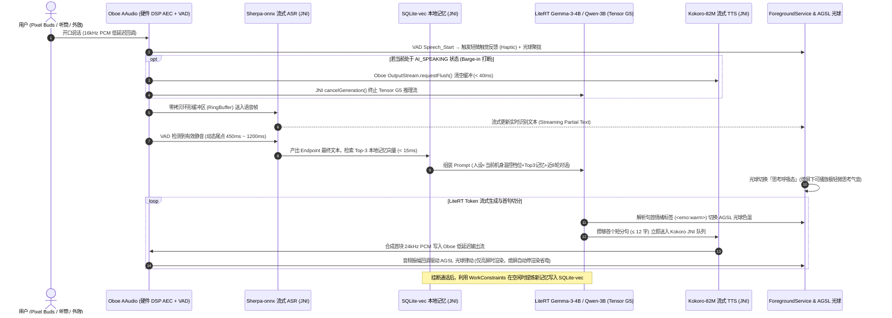

# Android (Pixel 10) 端侧 AI 语音虚拟伴侣 (Her Pocket) MVP PRD

| 文档状态 | 已基线 (Baseline) | 负责人 | @Frank |
| :--- | :--- | :--- | :--- |
| **目标版本** | v0.1.0-pixel-mvp | **优先级** | P0 |
| **目标硬件** | Google Pixel 10 / 10 Pro (Tensor G5 SoC, 16GB RAM, Android 16) | **架构模式** | 100% 端侧独立闭环 (纯本地单机运行 / 无云端服务端) |

## 1. 变更记录 (Changelog)
| 日期 | 版本 | 修改人 | 修改内容摘要 |
| :--- | :--- | :--- | :--- |
| 2026-10-24 | v0.1.0 | @Frank | 初稿创建：聚焦 Pixel 10 (Tensor G5 NPU/GPU) 本地全双工语音陪伴、熄屏口袋通话与移动端温控/功耗防护体系 |

---

## 2. 背景与目标 (Why)

### 2.1 业务背景与用户痛点
- **问题陈述**：用户在夜间睡前关灯躺卧、通勤步行、或独自散步等移动场景下，渴望能够像“给最亲密的人煲电话粥”一样进行随时随地的语音倾诉。但现有移动端 AI 语音应用不仅依赖实时蜂窝网络（进地铁/电梯即断联卡死）、消耗昂贵云端算力，且在手机端极易因长亮屏与高负载导致烫手、掉电过快。
- **MVP 验证目标**：专门针对 **Google Pixel 10 (Tensor G5 + 16GB RAM)** 硬件特性进行单点突破（不兼容低端安卓机、不建云端后端），验证 **“熄屏揣兜耳机畅聊 + 贴耳听筒私密倾诉 + 100% 离线端侧流式语音管道 + 温控自适应长续航”** 的真实移动陪伴体验。

### 2.2 成功衡量指标 (Success Metrics) & 护栏指标 (Guardrail Metrics)
| 指标类型 | 指标名称 | 目标阈值 (MVP 验收线) | 测量口径 |
| :--- | :--- | :--- | :--- |
| **核心体验指标** | 端到端语音响应延迟 (TTFA, P50 / P95) | **P50 ≤ 800ms / P95 ≤ 1150ms** | 用户停止说话 (`VAD_Speech_End`) 到耳机/听筒播出首帧音频的时间差 |
| **核心交互指标** | 语音打断截断延迟 (Barge-in Latency) | **≤ 80ms** | 用户插话触发 `VAD_Speech_Start` 到 Oboe/AudioTrack 停止发声的时间差 |
| **核心场景指标** | 熄屏/后台通话时长占比 | **≥ 50%** | 验证用户是否真正将其当作“揣在兜里/放在枕边的伴侣电话”使用 |
| **硬件护栏指标** | 连续通话 20 分钟机身峰值温度 / 耗电率 | **电池温度 ≤ 41.0°C / 耗电 ≤ 7%** | 室温 25°C 熄屏佩戴蓝牙耳机连续对话 20 分钟实测 |
| **系统护栏指标** | Native 进程峰值内存 (PSS) / 后台强杀率 | **PSS ≤ 3.2 GB / LMK 强杀率 = 0%** | 确保开启陪伴通话时，用户切出去回微信/刷网页不会被 Android 系统杀后台 |

### 2.3 本期明确不做 (Out of Scope / Non-Goals)
1. **不做账号登录、云端后台与跨端同步**：纯单机 APK 独立运行，所有模型权重、对话历史与情感记忆 100% 保存在 Pixel 10 本地沙盒。
2. **不做非 Pixel 旗舰机型的泛化兼容**：MVP 锁死 Pixel 10 系列 (`Tensor G5` + `16GB RAM` + `Android 16`)，直接利用 Google LiteRT / MediaPipe GenAI 与 NNAPI/GPU Delegate，不在中低端手机碎片化适配上浪费精力。
3. **不做 2D/Live2D/3D 角色渲染**：视觉层仅提供 **60fps AGSL 流体光球全屏沉浸页** + **Android 16 锁屏/状态栏实时通话胶囊 (Live Notification)**。
4. **不做系统级助理功能（如发短信、设闹钟、读通知）**：纯粹验证情感倾诉、睡前陪伴与共情对话。

---

## 3. 核心架构与业务流程 (Flow & State Machine)

### 3.1 Pixel 10 端侧技术栈选型 (Tensor G5 Optimized Stack)
- **UI 与系统集成层**：`Kotlin` + `Jetpack Compose` + `AGSL (Android Graphics Shading Language)` 硬件加速流体光球 + Android 16 `ForegroundService` (`specialUse` / `microphone` 类型，支持锁屏通话胶囊控制)。
- **低延迟音频 I/O 与回声消除**：`Google Oboe (C++ AAudio)`，配置 `AAUDIO_PERFORMANCE_MODE_LOW_LATENCY` 与 `AAUDIO_INPUT_PRESET_VOICE_COMMUNICATION`（强制启用 Pixel 硬件 DSP 级回声消除 `AcousticEchoCanceler` 与噪声抑制 `NoiseSuppressor`）。
- **VAD (语音活动检测)**：`Silero VAD v5` (`ONNX Runtime C++`，XNNPACK 2 线程，单帧耗时 `< 1.2ms`)。
- **ASR (端侧流式语音识别)**：`Sherpa-onnx Streaming Zipformer (中英双语 INT8)` 或 `Moonshine-Base`（纯流式边说边识，尾点触发后 `< 60ms` 拿到最终文本，比非流式 Whisper 省电 65%）。
- **LLM (端侧情感对话大脑)**：`Gemma-3-4B-IT-4bit` 或 `Qwen2.5-3B-Instruct-4bit`（基于 `Google AI Edge LiteRT / MediaPipe LLM Inference API`，调用 Tensor G5 GPU/TPU 硬解，预填充 `> 180 tok/s`，解码 `32 ~ 45 tok/s`）。
- **TTS (端侧流式情感语音)**：`Kokoro-82M (FP16/INT8 混合量化)`（通过 `Sherpa-onnx / ONNX Runtime NNAPI + GPU` 运行，实时率 RTF `~ 0.18`，支持子句流式边合成边播放）。
- **本地记忆存储**：`SQLite` + `sqlite-vec` (JNI 编译挂载) + `MiniLM-L6 / BGE-Micro` (`INT8` 端侧向量化，耗时 `< 15ms`)。

### 3.2 端到端全双工交互时序图

### 3.3 核心会话状态机流转表 (State Machine)
| 当前状态 | 触发事件 | 前置校验条件 (Guard) | 下一状态 | 界面/通知栏表现 & 硬件/系统副作用 |
| :--- | :--- | :--- | :--- | :--- |
| `STOPPED` | 用户点击桌面图标并点击「拨通陪伴」 | 本地模型包校验通过 & 已授予 `RECORD_AUDIO` / `POST_NOTIFICATIONS` 权限 | `INITIALIZING` | 启动 `ForegroundService`，获取 `PARTIAL_WAKE_LOCK`；将 LiteRT 模型映射至 Tensor G5 |
| `INITIALIZING` | Native 推理引擎与 Oboe 音频流就绪 | 可用内存 `> 2.5GB` | `LISTENING` | 播放轻柔接通提示音 + 短促细腻震动 (`VibrationEffect.EFFECT_TICK`)；光球进入倾听呼吸态 |
| `LISTENING` | VAD 持续检测到有效人声 `> 150ms` | 硬件 DSP AEC 消除后能量达标 | `USER_SPEAKING` | 边说边送入流式 ASR；亮屏下光球随音量内聚收缩 |
| `USER_SPEAKING` | VAD 检测到静音达到动态尾点 (`450ms~1200ms`) | 流式 ASR 已解码出有效汉字/单词 | `THINKING` | 检索本地 `sqlite-vec` 记忆，调用 LiteRT 启动流式生成 |
| `THINKING` | 首句 TTS 音频块合成完毕写入 Oboe | 未发生用户抢话打断 | `AI_SPEAKING` | 播出 AI 语音；亮屏下 AGSL 光球随情绪标签变色并与音频包络同步扩散 |
| `AI_SPEAKING` | **VAD 检测到用户插话 `> 200ms` (Barge-in)** | 确认非外放回声残留 | `USER_SPEAKING` | **40ms 内 Flush Oboe 输出流**，中断 LLM 生成，截断未播完文本并标记 `[被打断]` |
| `任意通话态` | **用户按电源键熄屏或切到后台应用** | `ForegroundService` 存活 | `头脑/语音保持原状态 (UI_PAUSED)` | **关键省电动作：立即挂起 AGSL 60fps 渲染协程（GPU 渲染功耗降为 0）**，音频与端侧推理在后台无感继续；锁屏/状态栏显示「正在通话胶囊」 |
| `任意通话态` | **贴近耳朵触发距离传感器 (`Proximity Sensor Near`)** | 当前未连接蓝牙/有线耳机 | `EARPIECE_MODE` | **类真实电话体验**：自动关闭屏幕防脸部误触，音频路由从底部扬声器无缝切换至**顶部微缝听筒 (Earpiece)**，保护私密倾诉不被旁人听见！ |
| `任意通话态` | 拔下耳机 / 蓝牙耳机突然断开 (`ACTION_AUDIO_BECOMING_NOISY`) | 正在通话中 | `PAUSED_PRIVACY_GUARD` | **防社死铁律**：毫秒级静音 Oboe 输出并暂停麦克风采集，发送轻微震动提示，需用户在锁屏通知或界面点击“切换为外放继续”才恢复发声 |

---

## 4. 功能需求详述 (What)

### 模块 4.1：Pixel 10 专属移动交互（全屏流体光球 + 听筒贴耳模式 + 锁屏胶囊）
- **亮屏沉浸态**：
  - 纯黑 OLED 省电背景 (`#000000`) + 居中 `AGSL Shader` 流体光球，底部仅保留三个极简圆角胶囊按钮：`静音麦克风`、`挂断陪伴`、`记忆抽屉`。
  - 支持双击光球切换「显示/隐藏微字流式字幕」。
- **贴耳听筒私密模式 (Hold-to-Ear Mode)**：
  - 模拟真实电话：当用户没有戴耳机，但在床上或沙发上把 Pixel 10 举到耳边时，距离传感器触发熄屏，且 `AudioManager` 自动将声音切入顶部听筒、降低音量，用户可以用极小声音气音倾诉，旁人完全听不到 AI 的回复。
- **锁屏与后台通话胶囊 (Android 16 Live Notification)**：
  - 锁屏界面与顶部状态栏常驻通话计时胶囊，无需解锁屏幕即可直接点击「闭麦/开麦」或「挂断」；支持通过 Pixel Buds 耳机捏合手势 (`MediaSession` 映射) 直接切换闭麦/开麦。
- **验收标准 (Acceptance Criteria)**：
  - `Given` 用户正在全屏光球界面与 AI 通话，`When` 用户按下电源键锁屏将手机放入口袋，`Then` 语音对话不中断，且 `dumpsys gfxinfo` 确认 UI 渲染线程已完全休眠（0 FPS）。
  - `Given` 用户在未戴耳机状态下外放聊天，`When` 将手机贴近耳朵遮挡顶部距离传感器，`Then` 屏幕在 `200ms` 内熄灭，AI 声音立即从底部大喇叭切换至顶部听筒输出。

### 模块 4.2：移动端温控与算力自适应降级引擎 (Thermal-Aware Scheduler)
- **设计背景**：端侧大模型在手机上连续跑 15 分钟极易撞上温度墙。必须在用户感知到卡顿或烫手之前，由产品逻辑平滑介入降级。
- **三级温控自适应表**（监听 `PowerManager.OnThermalStatusChangedListener`）：
  | 系统热状态 (`ThermalStatus`) | 机身体感 | LLM 上下文窗口 (KV Cache) | 单次回复长度硬约束 | 渲染与音频帧率策略 |
  | :--- | :--- | :--- | :--- | :--- |
  | `STATUS_NONE` / `LIGHT` (`< 38°C`) | 清凉/微温 | `2048 tokens` | 自然长度 (`≤ 3 句话 / 60字`) | AGSL 光球 `60 FPS` 满血渲染 |
  | `STATUS_MODERATE` (`38°C ~ 41°C`) | 温热 | 自动裁剪至 `1024 tokens` | 注入简短指令 (`≤ 2 句话 / 35字`) | AGSL 光球自动锁帧至 `30 FPS` |
  | `STATUS_SEVERE` (`> 41°C`) | 明显发热 | 极限裁剪至 `512 tokens` | 极简共情模式 (`≤ 20字` 短句回应) | 提示“手机有点热，我们关屏聊吧”并引导熄屏 |
- **验收标准 (Acceptance Criteria)**：
  - `Given` 通过 ADB 模拟注入 `cmd thermalservice override-status 2` (`MODERATE`)，`When` 进行下一轮语音对话，`Then` Debug 面板显示 KV Cache 上限已实时收缩至 `1024`，光球帧率降为 `30 FPS`，且通话全程无破音。

### 模块 4.3：本地情感记忆卡片与离线模型装载器
- **本地记忆库 (`SQLite-vec`)**：
  - 存储在 `/data/data/com.her.pocket/databases/memory.db`。
  - **省电延迟提炼**：不在通话进行中跑后台提炼以防抢占算力与发热；仅在**用户挂断通话后**（且剩余电量 `> 20%` 时），启动一次 `10 秒` 以内的端侧增量总结，提取本通电话的核心情绪与事件存入向量库。
  - 提供「记忆卡片」Bottom Sheet，支持用户随时查看、左滑删除单条记忆或一键格式化。
- **模型首次导入与下载器**：
  - 支持两种模式：
    1. **App 内置分片断点续传下载器**（仅限 Wi-Fi 或用户显式允许移动网络，总包约 `2.1GB`）。
    2. **ADB 极速推入模式（MVP 开发测试首选）**：支持直接读取 `/sdcard/Android/media/com.her.pocket/models/` 下的模型权重文件，研发调试时用 `adb push` 10 秒即可就绪，无需在手机上反复下载。

---

## 5. 非功能性需求与 SLA (Non-Functional Requirements)

- **音频实时性保障**：
  - Oboe 音频输出线程必须绑定高优先级 (`SCHED_FIFO`)，合成侧与播放侧采用无锁环形队列 (`Lock-Free SPSC RingBuffer`) 隔离，确保即使 Tensor G5 在 LLM 推理峰值瞬间，音频播放也绝不出现 `XRun (Underrun)` 爆音。
- **安全与纯离线证明**：
  - 核心推理模块编译为独立 Native `.so`，对话期间即使开启 Android **「飞行模式（仅开蓝牙连耳机）」**，100% 语音陪伴与记忆召回功能完全正常运作。

---

## 6. 本地诊断与评测面板 (On-Device Benchmark HUD)

在界面右上角提供隐藏式「开发者遥测浮层」（三指连点屏幕呼出），并同步写入 `/sdcard/Android/media/com.her.pocket/logs/perf_metrics.jsonl` 供 `adb pull` 导出分析：

| 事件名称 (`event_name`) | 触发时机 | 核心记录字段 (`json_properties`) |
| :--- | :--- | :--- |
| `pixel_turn_metrics` | 每轮语音回复完成或被打断 | `asr_endpoint_ms`, `vec_query_ms`, `litert_prefill_ms`, `litert_decode_tps`, `kokoro_first_chunk_ms`, `total_ttfa_ms`, `thermal_status` |
| `audio_route_changed` | 音频输入/输出设备发生切换 | `from_device` (Speaker/Earpiece/Bluetooth), `to_device`, `action_taken` (Paused / SeamlessSwitch) |
| `thermal_throttle_step` | 系统温控状态跨档位变化 | `old_status`, `new_status`, `battery_temp_celsius`, `current_pss_mb`, `applied_kv_limit` |
| `session_summary` | 用户点击挂断结束本次陪伴 | `duration_sec`, `screen_off_ratio`, `total_turns`, `barge_in_count`, `battery_drop_percent` |

---

## 7. 🛡️ 红队边界自检报告 (Architecture & QA Red-Team Audit)

| 风险类别 | 极端边界场景 (Edge Case) | 潜在崩溃/糟糕体验后果 | MVP 强制防御与兜底设计 |
| :--- | :--- | :--- | :--- |
| **1. 系统电话/微信语音强行打断 (AudioFocus Preemption)** | 用户正戴着耳机和 AI 深入聊心事，突然打进来一个运营商电话或微信语音通话 | 若不妥善处理音频焦点，AI 会继续在电话背景里自言自语，或者电话挂断后 Oboe 录音流死锁无法恢复 | 严格注册 `AudioFocusRequest` (`AUDIOFOCUS_GAIN_TRANSIENT`)：收到 `AUDIOFOCUS_LOSS_TRANSIENT` 瞬间，立即中断当前 TTS 与 LLM 推理、释放 `AudioRecord` 硬件句柄并转入 `ON_HOLD` 挂起态；待系统电话结束收到 `AUDIOFOCUS_GAIN` 后，延迟 `800ms` 重建 Oboe 流，并由 AI 温柔说一句“忙完啦？我们刚才聊到哪了？”自然接回。 |
| **2. 蓝牙耳机放回充电盒瞬间外放社死** | 用户在地铁或办公室戴着 Pixel Buds 倾诉私密话题，单手摘下耳机塞回耳机盒，Android 系统默认将音频流瞬间切回手机大喇叭外放 | AI 正在说的私密安慰话语直接在公共场合大声公放，造成灾难级社死体验 | **最高优先级硬件广播拦截**：注册 `BroadcastReceiver` 监听 `AudioManager.ACTION_AUDIO_BECOMING_NOISY` 以及 `AudioDeviceCallback.onAudioDevicesRemoved`。一旦检测到蓝牙/有线耳机断开，在系统音频路由落回扬声器前，**Native 层立即置零输出增益并挂起会话**，绝不漏出半个字的公放声音。 |
| **3. 内存逼近阈值触发 Android LMK / Phantom Process Killer** | 用户开着后台陪伴通话，同时切出去打开相机拍照或打开大型手游，系统可用内存骤降 | Android 16 `lmkd` 直接强杀占用 3GB 内存的伴侣进程，用户在耳机里突然听到一阵死寂，毫无提示 | 重写 `Service.onTrimMemory(level)`：当收到 `TRIM_MEMORY_RUNNING_CRITICAL` 时，立即主动释放 Kokoro TTS 与 Embedding 模型的常驻内存池，甚至先卸载 LLM 权重，同时在耳机里播放一段预录好的本地简短语音提示（“手机内存有点不够啦，我先休息一下，随时叫我”），实现体面优雅降级而非暴毙。 |
| **4. 睡前陪伴用户睡着后的无限耗电死循环** | 用户晚上躺在枕边开着陪伴聊天，聊着聊着睡着了，环境里有轻微鼾声或空调风声 | AI 把鼾声/风声当成用户说话，一整晚不停推理自言自语，第二天早上手机发烫且电量耗尽关机 | **睡眠静默自动挂断保护 (Sleep Auto-Cutoff)**： ① 连续 `3 轮` ASR 识别结果为空或仅为无意义语气词/噪音，或用户连续 `5 分钟` 无有效语义回应； ② AI 轻声试探一句“你是不是困啦？那我先去休息咯，晚安~”，随后在 `10 秒` 后**自动停止 `ForegroundService`、释放 `WakeLock` 并完全卸载模型**，守护用户整晚电量。 |
